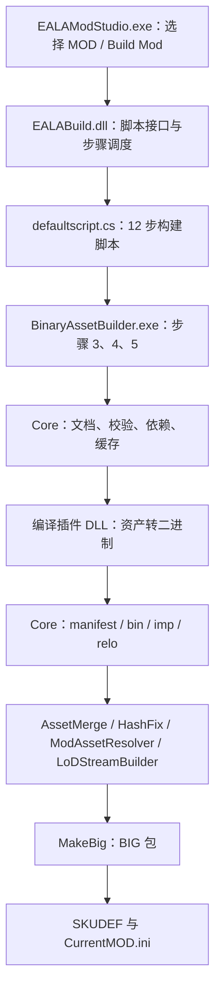
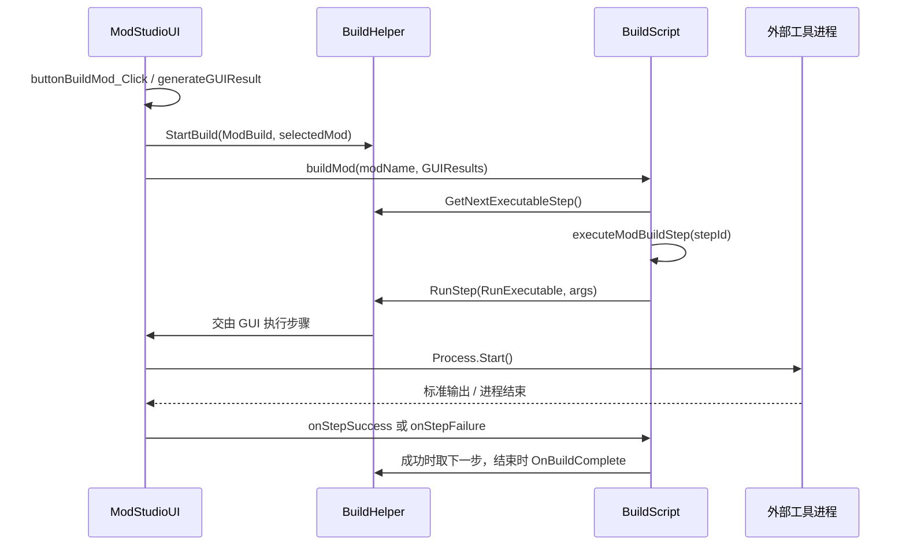

# EALAModStudio 编译 MOD：文件、调用关系与执行流程

本文依据 `recovery/compiler-source` 分支的提交 `714796ada3ba66312db60ede543a728932553e01` 编写（2026-10-25）。程序实际名称为 **EALAModStudio**。本文是代码静态核对结果，本次没有执行 SDK 编译。

## 1. 总体结构

EALAModStudio 是图形界面和步骤执行宿主；真正决定“编译哪些输入、调用什么工具、怎样打包”的是运行时加载的 `SDK/defaultscript.cs`。BinaryAssetBuilder（下文 BAB）负责 XML 资产编译，随后还有资产合并、修复、LOD 处理和 BIG 打包。



图中最后一项的 SKUDEF 即 `.skudef`。具体调用以以下章节为准；被取消勾选的步骤会跳过，图示不是所有构建必定执行的固定链。

依据：[recovery/decompiled/EALAModStudio/EALAModStudio/ModStudioUI.cs:1306](https://github.com/wu162/NewSdk/blob/714796ada3ba66312db60ede543a728932553e01/recovery/decompiled/EALAModStudio/EALAModStudio/ModStudioUI.cs#L1306)、[SDK/defaultscript.cs:163](https://github.com/wu162/NewSdk/blob/714796ada3ba66312db60ede543a728932553e01/SDK/defaultscript.cs#L163)、[SDK/tools/BinaryAssetBuilder.exe.config](https://github.com/wu162/NewSdk/blob/714796ada3ba66312db60ede543a728932553e01/SDK/tools/BinaryAssetBuilder.exe.config)。

## 2. 关键文件及职责

| 文件（相对仓库根目录） | 职责 / 调用对象 |
| --- | --- |
| `SDK/EALAModStudio.exe` | WinForms 入口；加载脚本、展示选项、启动外部进程、接收日志和完成回调。 |
| `SDK/EALABuild.dll` | 提供 `EALABuildScript`、`BuildHelper`、`RunExecutableArguments`、`StepType`、`GUIElementData`、`StaticPaths` 等接口及调度支持。 |
| `SDK/defaultscript.cs` | 实现 `BuildScript : EALABuildScript`；初始化路径，定义选项，编排 12 步及命令行。 |
| `SDK/defaultscript.cs.guidata` | 界面选项持久化；GUI 核对脚本 SHA1 后才恢复其中的选项。不是 MOD 输入文件。 |
| `SDK/Mods/<Mod>/Data/Mod.xml` | 基础数据编译根文档，使用 Includes 引入各资产 XML 和参考流。 |
| `SDK/Mods/<Mod>/Data/aptui/*.xml` | 步骤 3 的逐文件编译输入。 |
| `SDK/Mods/<Mod>/Data/additionalmaps/mapmetadata_*.xml` | 步骤 4 的逐文件编译输入。 |
| `SDK/Mods/<Mod>/Art`、`Audio`、`Data` | MOD 的资源和数据搜索目录；只被放入搜索路径，不表示目录中所有文件都会自动编译。 |
| `SDK/tools/BinaryAssetBuilder.exe` | 加载配置、命令行及编译插件，调用 Core 处理文档。 |
| `SDK/tools/BinaryAssetBuilder.exe.config` | 指定 Schema、数据根目录、各类型对应插件、Verifier 和构建配置。 |
| `SDK/tools/BinaryAssetBuilder.Core.dll` | 文档递归处理、表达式、继承、XSD 校验、引用、缓存、资产流输出。 |
| `SDK/Schemas/xsd/CnC3Types.xsd` 及它引用的 XSD | 当前 BAB 配置所指定的 Schema 入口及类型定义。 |
| `SDK/tools/BinaryAssetBuilder.*Compiler.dll`、`BinaryAssetBuilder.Tokenizer.dll` | 按资产类型实际生成二进制数据。映射见第 6 节。 |
| `SDK/tools/BinaryAssetBuilder.GameDataVerifier.dll` | 资产级数据验证；区别于 XSD 校验。 |
| `SDK/tools/AssetMerge.exe` | 合并 MOD 的 `assets` 目录中的预编译 `.asset`。 |
| `SDK/tools/HashFix.exe`、`ModAssetResolver.exe` | 对基础数据输出进行 Hash / 资产引用后处理。 |
| `SDK/tools/LoDStreamBuilder.exe` | 对 `mod.manifest` 执行 LOD 流后处理。 |
| `SDK/additional`、`SDK/Mods/<Mod>/additional` | 额外拷贝入包的目录；MOD 目录后复制，可覆盖同路径 SDK 额外文件。 |
| `SDK/tools/MakeBig.exe` | 将暂存目录打包为 `.big`，排除 `*.asset`。 |
| `SDK/RunCurrentMod.exe`、`SDK/CurrentMOD.ini` | 编译后的运行入口及参数文件；RunCurrentMod.exe 未被这 12 步直接启动。 |

Windows 下脚本使用小写 `mods/data/assets/additional` 等路径，而仓库实际目录有 `Mods/Data/Additional` 等大小写；本文统一按职责书写。复现到大小写敏感环境时不能直接假定路径等价。

## 3. GUI 如何进入构建脚本

### 3.1 启动和脚本加载

1. `EALAModStudio.Program.Main(args)` 调用 `Application.Run(new ModStudioUI(args))`。
2. `ModStudioUI.Form1_Load()` 调用 `BuildHelper.setBuildGUI(this)`，把界面注册给构建辅助层。
3. `loadBuildScript()` 使用 `CSharpCodeProvider.CompileAssemblyFromFile()` 动态编译构建脚本；默认文件名是 `defaultscript.cs`，编译引用为 `System.dll` 和 `EALABuild.dll`，结果保存在内存中。
4. 扫描编译出的类型，找到实现 `EALABuildScript` 的类型，调用无参构造函数取得实例。
5. 尝试读取 `<脚本文件>.guidata`，只有脚本 SHA1 匹配才恢复 GUI 选项。
6. 调用脚本 `initialize()`，加载 MOD 名称；调用 `GetModBuildGUIData()` 生成步骤复选框、版本和 skudef 名称输入项。

源码：[recovery/decompiled/EALAModStudio/EALAModStudio/Program.cs](https://github.com/wu162/NewSdk/blob/714796ada3ba66312db60ede543a728932553e01/recovery/decompiled/EALAModStudio/EALAModStudio/Program.cs)、[recovery/decompiled/EALAModStudio/EALAModStudio/ModStudioUI.cs:363](https://github.com/wu162/NewSdk/blob/714796ada3ba66312db60ede543a728932553e01/recovery/decompiled/EALAModStudio/EALAModStudio/ModStudioUI.cs#L363)、[recovery/decompiled/EALAModStudio/EALAModStudio/ModStudioUI.cs:568](https://github.com/wu162/NewSdk/blob/714796ada3ba66312db60ede543a728932553e01/recovery/decompiled/EALAModStudio/EALAModStudio/ModStudioUI.cs#L568)。

### 3.2 脚本初始化出的路径

`BuildScript.initialize()` 开启 BuildHelper 自动重置和计时，并计算：

| 变量 | 值或来源 |
| --- | --- |
| `PersonalDirectory` | 当前用户注册表 `User Shell Folders/Personal`，展开环境变量。 |
| `SDKDirectory` | SDK 卸载注册表项 `InstallLocation`，先普通位置，再 Wow6432Node；都没有时回退到 `StaticPaths.CurrentDirectory`。 |
| `UserDataLeafName` | 游戏注册表的同名值，先普通位置，再 Wow6432Node；缺省 `Red Alert 3`。 |
| `BuiltModsPath` | `<SDK>/builtmods`。 |
| 所有工具路径 | `<SDK>/tools/<工具名>.exe`。 |
| `ModPath` | `<SDK>/mods/<Mod>`。 |
| `BuiltModPath` | `<SDK>/builtmods/mods/<Mod>`。 |
| `BuiltModDataPath` | `<SDK>/builtmods/mods/<Mod>/data`。 |
| `ModInstallPath` | `<Personal>/<UserDataLeafName>/Mods/<Mod>`。 |

注意暂存路径中 `builtmods/mods` 不是笔误：BAB 输出保留输入相对 SDK 数据根的路径。

源码：[SDK/defaultscript.cs:79](https://github.com/wu162/NewSdk/blob/714796ada3ba66312db60ede543a728932553e01/SDK/defaultscript.cs#L79)、[SDK/defaultscript.cs:163](https://github.com/wu162/NewSdk/blob/714796ada3ba66312db60ede543a728932553e01/SDK/defaultscript.cs#L163)。

### 3.3 点击 Build Mod 后的调用链



`buildMod()` 保存 GUIResults，设置总步骤数 12，使用 `BuildHelper.BuildTarget` 作为 MOD 名称，初始化该 MOD 的路径和输出文件名，然后执行首个可执行步骤。`shouldExecuteStep(stepId)` 读取 `step1` 至 `step12`，对应项不存在时返回 true。

界面的 `launchExecutable()` 创建 `Process`，填入文件名、参数、输出重定向等信息，再调用 `Start()`；完成时进入 `executableExited()`，回调脚本。这里 BuildHelper 的中间转发依据调用点和 GUI 接口描述；本分支的 `recovery/decompiled` 未提供 EALABuild.dll 对应源码，不能据此列出其内部每一层私有方法。

源码：[recovery/decompiled/EALAModStudio/EALAModStudio/ModStudioUI.cs:1306](https://github.com/wu162/NewSdk/blob/714796ada3ba66312db60ede543a728932553e01/recovery/decompiled/EALAModStudio/EALAModStudio/ModStudioUI.cs#L1306)、[recovery/decompiled/EALAModStudio/EALAModStudio/ModStudioUI.cs:1097](https://github.com/wu162/NewSdk/blob/714796ada3ba66312db60ede543a728932553e01/recovery/decompiled/EALAModStudio/EALAModStudio/ModStudioUI.cs#L1097)、[recovery/decompiled/EALAModStudio/EALAModStudio/ModStudioUI.cs:1238](https://github.com/wu162/NewSdk/blob/714796ada3ba66312db60ede543a728932553e01/recovery/decompiled/EALAModStudio/EALAModStudio/ModStudioUI.cs#L1238)、[SDK/defaultscript.cs:133](https://github.com/wu162/NewSdk/blob/714796ada3ba66312db60ede543a728932553e01/SDK/defaultscript.cs#L133)。

## 4. 12 个步骤：实际输入、工具与输出

| 步骤 | 界面名称 | 实际处理及调用关系 |
| --- | --- | --- |
| 1 | 清理 MOD 暂存文件 | `cmd.exe` 递归删除 `BuiltModPath` 中扩展名不是 `.asset` 的文件，保留资产中间文件。 |
| 2 | 清空缓存 | 删除 `builtmods/builtmods`、`builtmods/cache`；删除本 MOD 暂存目录下所有 `.asset`；删除 `builtmods` 下 sessioncache XML、压缩版及各自 old 文件和 `stringhashes.xml`。 |
| 3 | 建立 AptUI | 清理输出 `data/aptui/*`；对 MOD `data/aptui/*.xml` 逐个调用 BAB；对应 manifest 存在时，另写一个空的 `.version` 文件。这里的 AptUI 是游戏 UI 资源阶段。 |
| 4 | 建立全局数据 | 清理输出 `data/additionalmaps/mapmetadata_*`；对 MOD `data/additionalmaps/mapmetadata_*.xml` 逐个调用 BAB。**该步骤没有直接调用根目录 Global.xml，也没有单独编译整个 global 流的命令。** |
| 5 | 建立基础数据 | 删除本 MOD 输出目录的 `mod.bin/.imp/.manifest/.relo/.version` 及 `mod_*`；调用 BAB 编译 `Mods/<Mod>/data/mod.xml`。如果步骤 6 和 7 都未勾选，再立即调用 LoDStreamBuilder。 |
| 6 | 合并 Assets 资产 | 递归遍历 MOD `assets` 目录，存在 `*.asset` 的目录调用 `AssetMerge.exe "<BuiltModDataPath>/mod" "<该资产目录>"`。如果步骤 7 未勾选，末尾再调用 LoDStreamBuilder。 |
| 7 | 修复中立资产 | 严格按脚本顺序调用 `HashFix.exe mod.manifest` → `ModAssetResolver.exe mod.manifest` → `LoDStreamBuilder.exe mod.manifest`。 |
| 8 | 复制额外文件 | 脚本自身调用 `CopyFolders()`：先复制 SDK additional，再复制本 MOD additional，目的地都是 BuiltModPath；最后执行一个切换目录的 cmd 步骤以接入统一完成回调。 |
| 9 | 建立 Big 文件 | 若 BuiltModPath 存在，调用 `MakeBig.exe -f "<BuiltModPath>" -x:*.asset -o:"<ModInstallPath>/<Mod>_<Version>.big"`。 |
| 10 | 建立 Skudef 文件 | 在 ModInstallPath 写 `mod-game 1.12`；BIG 存在时追加 `add-big <Mod>_<Version>.big`。 |
| 11 | 建立全屏 INI 文件 | 覆盖 SDK 根目录 `CurrentMOD.ini`，写入带引号的 skudef 完整路径。 |
| 12 | 建立窗口 INI 文件 | 再次覆盖同一个 CurrentMOD.ini，写入 skudef 完整路径并附加 `-win`。若 11、12 都选中，最终为步骤 12 的窗口模式内容。 |

LoDStreamBuilder 的落点由 5、6、7 的复选框组合决定：选 7 时在 7；不选 7 而选 6 时在 6；6、7 都不选时在 5。该脚本没有替用户检查所有跳步依赖，单独勾选后处理可能会使用既有产物。

默认 MOD 版本为 `1.0`。skudef 名称为空或为提示文本“中文限五字”时，文件名是 `<Mod>_<Version>.skudef`；否则是 `<自定义名称>_<Version>.skudef`。自定义 skudef 名不改变 BIG 的命名规则。

依据：[SDK/defaultscript.cs:234](https://github.com/wu162/NewSdk/blob/714796ada3ba66312db60ede543a728932553e01/SDK/defaultscript.cs#L234)。

## 5. BAB 启动参数及 MOD 输入关系

### 5.1 步骤 5 的核心命令

省略清理命令后，等价的 Windows 命令为：

```bat
cd /D "<SDK>"
"<SDK>\tools\binaryassetbuilder.exe" "<SDK>\Mods\<Mod>\Data\Mod.xml" /od:"<SDK>\builtmods" /iod:"<SDK>\builtmods" /csc:false /ls:true /osh:false /pc:true /res:true /slowclean:true /ss:true /art:".;.\Mods\<Mod>\Art;.\Mods;.\Art" /audio:".;.\Mods\<Mod>\Audio;.\Mods;.\Audio" /data:".;.\Mods\<Mod>\Data;.\Mods;.\SageXml"
```

步骤 3、4 使用同一组编译参数，只将输入替换为各自循环中的 XML。

| 参数 | 含义 / 本分支注意事项 |
| --- | --- |
| `/od`、`/iod` | 输出根目录、中间文件输出根目录，都是 SDK/builtmods。 |
| `/csc:false` | 不压缩 session cache；**不是关闭 session cache**，后者对应 `/sc`。 |
| `/ls:true` | 启用 linked stream，生成汇总二进制流。 |
| `/osh:false` | 不另行构建字符串 Hash 输出流；不能解释成整个编译过程不计算 Hash。 |
| `/pc:true` | 允许复用已有 manifest 对应的预编译参考流。 |
| `/res:true` | 参数映射为 Resident；但此分支反编译的 Settings.Resident getter 固定返回 false，因此不能据参数断言实际会进入常驻服务器模式。 |
| `/slowclean:true` | 强制使用较慢的资产及 cdata 清理方式。 |
| `/ss:true` | 稳定资产排序。 |
| `/art`、`/audio`、`/data` | 配置对应资源路径别名的搜索顺序。 |

配置中的 `dataRoot=".."` 和 `schema="..\Schemas\xsd\CnC3Types.xsd"` 由 SettingsLoader 以 BAB 可执行文件所在目录为锚点解析，因此分别落到 SDK 根目录和 SDK/Schemas/xsd/CnC3Types.xsd。ART/AUDIO/DATA 搜索路径随后结合 DataRoot 规范化。

源码：[recovery/decompiled/BinaryAssetBuilder.Core/BinaryAssetBuilder/Settings.cs:217](https://github.com/wu162/NewSdk/blob/714796ada3ba66312db60ede543a728932553e01/recovery/decompiled/BinaryAssetBuilder.Core/BinaryAssetBuilder/Settings.cs#L217)、[recovery/decompiled/BinaryAssetBuilder.Core/BinaryAssetBuilder/Settings.cs:752](https://github.com/wu162/NewSdk/blob/714796ada3ba66312db60ede543a728932553e01/recovery/decompiled/BinaryAssetBuilder.Core/BinaryAssetBuilder/Settings.cs#L752)、[recovery/decompiled/BinaryAssetBuilder.Core/BinaryAssetBuilder.Core/SettingsLoader.cs](https://github.com/wu162/NewSdk/blob/714796ada3ba66312db60ede543a728932553e01/recovery/decompiled/BinaryAssetBuilder.Core/BinaryAssetBuilder.Core/SettingsLoader.cs)、[SDK/tools/BinaryAssetBuilder.exe.config](https://github.com/wu162/NewSdk/blob/714796ada3ba66312db60ede543a728932553e01/SDK/tools/BinaryAssetBuilder.exe.config)。

### 5.2 Mod.xml 如何关联其他文件

本分支现有样例 `SDK/Mods/mymod/Data/Mod.xml`：

- 用 `Include type="reference"` 引入 `DATA:static.xml`、`DATA:global.xml`、`DATA:audio.xml`：建立对这些参考流资产的引用关系；有可复用预编译 manifest 时可走预编译引用路径。
- 用 `Include type="all"` 引入 `CommandData.xml`、`mytank.xml`、`RecoveryArmorProbe.xml`、`RecoveryWeaponNuggetProbe.xml`：将对应文档的资产纳入当前流处理。
- 普通相对文件名相对包含文档所在目录解析；`DATA:` 等别名使用配置后的搜索路径。

因此，单纯把 XML 放入 Data 目录不保证它会进入编译链；需要根文档的包含关系能到达它，或像步骤 3、4 一样被脚本单独传给 BAB。

`defaultscript.cs` 确实给 `ModBabProj` 赋值为 `<ModPath>/mod.babproj`，但后续没有使用；当前默认脚本走的是 Mod.xml。BAB 本身支持 .babproj 输入，并在 `ProcessDocument()` 中分派给 `ProcessProjectDocument()`，这是另一条入口，不能混为当前 GUI 默认编译链。

依据：[SDK/Mods/mymod/Data/Mod.xml](https://github.com/wu162/NewSdk/blob/714796ada3ba66312db60ede543a728932553e01/SDK/Mods/mymod/Data/Mod.xml)、[recovery/decompiled/BinaryAssetBuilder.Core/BinaryAssetBuilder.Core/DocumentProcessor.cs:167](https://github.com/wu162/NewSdk/blob/714796ada3ba66312db60ede543a728932553e01/recovery/decompiled/BinaryAssetBuilder.Core/BinaryAssetBuilder.Core/DocumentProcessor.cs#L167)、[recovery/decompiled/BinaryAssetBuilder.Core/BinaryAssetBuilder.Core/DocumentProcessor.cs:525](https://github.com/wu162/NewSdk/blob/714796ada3ba66312db60ede543a728932553e01/recovery/decompiled/BinaryAssetBuilder.Core/BinaryAssetBuilder.Core/DocumentProcessor.cs#L525)、[SDK/defaultscript.cs:179](https://github.com/wu162/NewSdk/blob/714796ada3ba66312db60ede543a728932553e01/SDK/defaultscript.cs#L179)。

## 6. BAB 内部调用：从 XML 到资产流

### 6.1 初始化

`Program.Main()` → `ResidentInstance.SetupSettings(args)` → 读取 exe.config 的 assetbuilder 配置 → `CommandLineOptionProcessor.ProcessOptions()` → `SettingsLoader.PostProcessSettings()`。

随后初始化 BAB；在本分支上述 Resident getter 行为下，进入普通构建路径：`StartBuild(args)` 创建线程调用 `BinaryAssetBuilder.Run()`，再到 `DoBuildData()`。

`DoBuildData()` 创建 SchemaSet、初始化字符串 Hash 及 session cache，创建 DocumentProcessor，设置 Cache、SchemaSet，然后调用：

```csharp
documentProcessor.ProcessDocument(
    Settings.Current.InputPath,
    generateOutput: true,
    __outputStringHashes: true,
    out success);
```

源码：[recovery/decompiled/BinaryAssetBuilder/BinaryAssetBuilder/Program.cs:146](https://github.com/wu162/NewSdk/blob/714796ada3ba66312db60ede543a728932553e01/recovery/decompiled/BinaryAssetBuilder/BinaryAssetBuilder/Program.cs#L146)、[recovery/decompiled/BinaryAssetBuilder/BinaryAssetBuilder/BinaryAssetBuilder.cs:126](https://github.com/wu162/NewSdk/blob/714796ada3ba66312db60ede543a728932553e01/recovery/decompiled/BinaryAssetBuilder/BinaryAssetBuilder/BinaryAssetBuilder.cs#L126)、[recovery/decompiled/BinaryAssetBuilder/BinaryAssetBuilder/BinaryAssetBuilder.cs:266](https://github.com/wu162/NewSdk/blob/714796ada3ba66312db60ede543a728932553e01/recovery/decompiled/BinaryAssetBuilder/BinaryAssetBuilder/BinaryAssetBuilder.cs#L266)。

### 6.2 文档处理顺序

`DocumentProcessor.ProcessDocument()` 对 XML 调用 `ProcessDocumentInternal()`，它打开或复用文档，按需创建 OutputManager，处理 Includes，之后进入 `ProcessDocumentContents()`。

对于需要重新处理、处于 Loaded 状态的文档，核心顺序为：

1. `ProcessExpressions()`：处理表达式。
2. `ProcessOverrides()`：处理继承 / 覆盖。
3. `Validate()`：给 XmlDocument 附加 SchemaSet，执行 XSD 校验；随后 `ValidateInstances()` 计算类型/实例处理信息、收集文件和资产引用，并按 Schema 类型附加 TypeId 等信息。
4. `RecordStringHashes()`、`MergeInstances()`。
5. `ProcessInstances()`：获取 BinaryAsset；只有没有可用资产位置时才调用 `CompileInstance()`，已有资产可从本地 / 缓存等位置复用。
6. `CompileInstance()` → `Plugins.GetPlugin(TypeId)` → `plugin.ProcessInstance(InstanceDeclaration)`，将返回的 AssetBuffer 放入 BinaryAsset.Buffer。
7. `VerifyInstance()` 调用 verifier，随后 `BinaryAsset.Commit()` 提交资产。
8. 若当前文档要生成流：`PrepareOutputInstances()` 解析并准备输出引用 → `CommitManifest()` → `CleanOutput()` → `UpdateOutputAssets()` → 启用 linked streams 时 `LinkStream()` → 启用 versionFiles 时 `CreateVersionFile()`。
9. 文档完成，保存到 session cache；BAB 收尾时按设置保存 session cache。

**传入编译插件的节点经过上游表达式、继承/覆盖和 XSD 校验及引用信息处理，不能按“未经处理的原始 XML”理解。** 缓存可命中时，不一定重新走每个校验和编译函数。Verifier 在资产处理过程中运行，是另一层检查，不等同于 XSD。

源码：[recovery/decompiled/BinaryAssetBuilder.Core/BinaryAssetBuilder.Core/DocumentProcessor.cs:309](https://github.com/wu162/NewSdk/blob/714796ada3ba66312db60ede543a728932553e01/recovery/decompiled/BinaryAssetBuilder.Core/BinaryAssetBuilder.Core/DocumentProcessor.cs#L309)、[recovery/decompiled/BinaryAssetBuilder.Core/BinaryAssetBuilder.Core/DocumentProcessor.cs:371](https://github.com/wu162/NewSdk/blob/714796ada3ba66312db60ede543a728932553e01/recovery/decompiled/BinaryAssetBuilder.Core/BinaryAssetBuilder.Core/DocumentProcessor.cs#L371)、[recovery/decompiled/BinaryAssetBuilder.Core/BinaryAssetBuilder.Core/AssetDeclarationDocument.cs:822](https://github.com/wu162/NewSdk/blob/714796ada3ba66312db60ede543a728932553e01/recovery/decompiled/BinaryAssetBuilder.Core/BinaryAssetBuilder.Core/AssetDeclarationDocument.cs#L822)、[recovery/decompiled/BinaryAssetBuilder.Core/BinaryAssetBuilder.Core/AssetDeclarationDocument.cs:1029](https://github.com/wu162/NewSdk/blob/714796ada3ba66312db60ede543a728932553e01/recovery/decompiled/BinaryAssetBuilder.Core/BinaryAssetBuilder.Core/AssetDeclarationDocument.cs#L1029)、[recovery/decompiled/BinaryAssetBuilder.Core/BinaryAssetBuilder.Core/AssetDeclarationDocument.cs:1090](https://github.com/wu162/NewSdk/blob/714796ada3ba66312db60ede543a728932553e01/recovery/decompiled/BinaryAssetBuilder.Core/BinaryAssetBuilder.Core/AssetDeclarationDocument.cs#L1090)、[recovery/decompiled/BinaryAssetBuilder.Core/BinaryAssetBuilder.Core/AssetDeclarationDocument.cs:1188](https://github.com/wu162/NewSdk/blob/714796ada3ba66312db60ede543a728932553e01/recovery/decompiled/BinaryAssetBuilder.Core/BinaryAssetBuilder.Core/AssetDeclarationDocument.cs#L1188)。

### 6.3 资产类型由哪个 DLL 编译

映射以 `SDK/tools/BinaryAssetBuilder.exe.config` 为准：

| 资产类型 | 插件类 | DLL |
| --- | --- | --- |
| TerrainTextureAtlas、Texture、OnDemandTexture | BinaryAssetBuilder.TextureCompiler.Plugin | BinaryAssetBuilder.TextureCompiler.dll |
| AudioFile、AudioFileMP3Passthrough、PathMusicMap、PathMusicTrack、PathMusicEvent | BinaryAssetBuilder.AudioCompiler.Plugin | BinaryAssetBuilder.AudioCompiler.dll |
| W3DAnimation、W3DMesh | BinaryAssetBuilder.W3XCompiler.Plugin | BinaryAssetBuilder.W3XCompiler.dll |
| GameObject、WeaponTemplate、ArmorTemplate | BinaryAssetBuilder.Tokenizer.Plugin | BinaryAssetBuilder.Tokenizer.dll |
| 其他未显式映射的类型（#all） | BinaryAssetBuilder.XmlCompiler.Plugin | BinaryAssetBuilder.XmlCompiler.dll |
| 全部类型的数据验证 | BinaryAssetBuilder.GameDataVerifier.Plugin | BinaryAssetBuilder.GameDataVerifier.dll |

PluginRegistry 按 TypeId 查找显式插件，无匹配时使用 DefaultPlugin。因此 GameObject 不会因为源文件是 XML 就自动交给 XmlCompiler。

以上是该快照 SDK 配置的运行时目标。仅修改 `recovery/src` 的恢复源码并不会自动切换 SDK 所加载的 DLL；使用恢复实现时仍需另行完成对应构建和部署。本流程说明不表示这些源码会被 EALAModStudio 当场编译进 SDK。

依据：[SDK/tools/BinaryAssetBuilder.exe.config](https://github.com/wu162/NewSdk/blob/714796ada3ba66312db60ede543a728932553e01/SDK/tools/BinaryAssetBuilder.exe.config)、[recovery/decompiled/BinaryAssetBuilder.Core/BinaryAssetBuilder.Core/PluginRegistry.cs](https://github.com/wu162/NewSdk/blob/714796ada3ba66312db60ede543a728932553e01/recovery/decompiled/BinaryAssetBuilder.Core/BinaryAssetBuilder.Core/PluginRegistry.cs)。

## 7. 输出文件如何到达游戏 MOD 目录

以 `mymod`、版本 `1.0` 为例：

| 阶段 | 文件 / 目录 | 用途 |
| --- | --- | --- |
| 根输入 | `SDK/Mods/mymod/Data/Mod.xml` | 本 MOD 主流入口。 |
| 中间资产 | `SDK/builtmods` 下按流组织的 `.asset` 和可能存在的 `.cdata` | 编译和缓存复用的中间数据 / 自定义数据；具体子路径由 BinaryAsset 与 OutputManager 计算。 |
| 基础输出流 | `SDK/builtmods/mods/mymod/data/mod.manifest` | 资产清单、引用和流信息。 |
| 基础输出流 | 同目录 `mod.bin` | linked stream 的资产二进制数据。 |
| 基础输出流 | 同目录 `mod.imp`、`mod.relo` | 导入 / 资产引用及重定位相关数据流。 |
| 其他输出 | `data/aptui/<输入名>.*`、`data/additionalmaps/mapmetadata_*.*` | 步骤 3、4 各自输入对应的流；前提是相应输入存在且步骤执行。 |
| 附加输出 | `mod.version`、LOD 派生文件等 | 是否生成及具体文件由 BAB 设置、输入和 LOD 工具决定；步骤 5 会清理旧 mod.version，不等于无条件生成新文件。 |
| 打包输入 | `SDK/builtmods/mods/mymod` | 所有编译产物及 additional 拷贝结果。 |
| 安装产物 | `<Personal>/<UserDataLeafName>/Mods/mymod/mymod_1.0.big` | MakeBig 输出。 |
| 加载定义 | 同目录 `mymod_1.0.skudef`，或自定义名称 | 指定游戏版本及加载的 BIG。 |
| 启动参数 | `SDK/CurrentMOD.ini` | 指向 skudef，可能带 -win。 |

OutputManager 先提交 manifest，再在 LinkStream 中生成 / 更新汇总 .bin、.imp、.relo；`.asset` 不会被 MakeBig 包进去。步骤 9 之后的 BIG 与步骤 10 的 skudef 位于用户文档中的游戏 MOD 目录，不在 SDK/builtmods。

依据：[recovery/decompiled/BinaryAssetBuilder.Core/BinaryAssetBuilder.Core/OutputManager.cs:76](https://github.com/wu162/NewSdk/blob/714796ada3ba66312db60ede543a728932553e01/recovery/decompiled/BinaryAssetBuilder.Core/BinaryAssetBuilder.Core/OutputManager.cs#L76)、[recovery/decompiled/BinaryAssetBuilder.Core/BinaryAssetBuilder.Core/OutputManager.cs:222](https://github.com/wu162/NewSdk/blob/714796ada3ba66312db60ede543a728932553e01/recovery/decompiled/BinaryAssetBuilder.Core/BinaryAssetBuilder.Core/OutputManager.cs#L222)、[recovery/decompiled/BinaryAssetBuilder.Core/BinaryAssetBuilder.Core/OutputManager.cs:371](https://github.com/wu162/NewSdk/blob/714796ada3ba66312db60ede543a728932553e01/recovery/decompiled/BinaryAssetBuilder.Core/BinaryAssetBuilder.Core/OutputManager.cs#L371)、[SDK/defaultscript.cs:386](https://github.com/wu162/NewSdk/blob/714796ada3ba66312db60ede543a728932553e01/SDK/defaultscript.cs#L386)。

## 8. 阅读 / 排查时的重点

- **只验证 XML 编译**：重点是步骤 5 的 BAB 调用及 Mod.xml 包含链；AptUI、地图元数据和打包是独立步骤，是否需要由目标决定。
- **GUI 成功不等于所有工具都成功**：界面 `processInputLine()` 只有遇到 `Critical:` 才直接设置 stepFailed；`Error:`、`Warning:` 进入对应列表。所见 `executableExited()` 依据 stepFailed 回调，没有检查 ExitCode。脚本大量使用 `&` 串接命令，也不是每条命令成功才继续的 `&&`。验证应结合日志和真实输出文件。
- **参考流可能复用**：`/pc:true` 允许使用已有预编译 manifest。修改了源码而输出没有变化时，应先核实输入可达性、缓存和参考流使用情况。
- **“全局数据”是界面标签**：本脚本步骤 4 的实际输入是地图元数据，不能将标签直接理解为执行 `BAB Global.xml`。
- **不能把编译与启动游戏混为一段**：默认脚本最后写 CurrentMOD.ini；没有在这些步骤中调用 RunCurrentMod.exe 或游戏 exe。
- **证据边界**：本文逐项核对了脚本、配置和本分支已有反编译源码；未反编译本分支缺失源码的 EALABuild.dll，也未验证每个后处理 EXE 的内部算法。对这些组件仅描述已确认的输入和调用顺序。

依据：[recovery/decompiled/EALAModStudio/EALAModStudio/ModStudioUI.cs:1154](https://github.com/wu162/NewSdk/blob/714796ada3ba66312db60ede543a728932553e01/recovery/decompiled/EALAModStudio/EALAModStudio/ModStudioUI.cs#L1154)、[recovery/decompiled/EALAModStudio/EALAModStudio/ModStudioUI.cs:1238](https://github.com/wu162/NewSdk/blob/714796ada3ba66312db60ede543a728932553e01/recovery/decompiled/EALAModStudio/EALAModStudio/ModStudioUI.cs#L1238)、[SDK/defaultscript.cs](https://github.com/wu162/NewSdk/blob/714796ada3ba66312db60ede543a728932553e01/SDK/defaultscript.cs)。

## 9. 源码阅读入口

| 内容 | 推荐入口 |
| --- | --- |
| GUI 程序入口 | [recovery/decompiled/EALAModStudio/EALAModStudio/Program.cs](https://github.com/wu162/NewSdk/blob/714796ada3ba66312db60ede543a728932553e01/recovery/decompiled/EALAModStudio/EALAModStudio/Program.cs) |
| GUI 加载脚本、运行工具、接收回调 | [recovery/decompiled/EALAModStudio/EALAModStudio/ModStudioUI.cs](https://github.com/wu162/NewSdk/blob/714796ada3ba66312db60ede543a728932553e01/recovery/decompiled/EALAModStudio/EALAModStudio/ModStudioUI.cs) |
| 完整 12 步及每条命令 | [SDK/defaultscript.cs](https://github.com/wu162/NewSdk/blob/714796ada3ba66312db60ede543a728932553e01/SDK/defaultscript.cs) |
| BAB 命令行和设置装载 | [recovery/decompiled/BinaryAssetBuilder/BinaryAssetBuilder/Program.cs](https://github.com/wu162/NewSdk/blob/714796ada3ba66312db60ede543a728932553e01/recovery/decompiled/BinaryAssetBuilder/BinaryAssetBuilder/Program.cs)、[recovery/decompiled/BinaryAssetBuilder.Core/BinaryAssetBuilder/Settings.cs](https://github.com/wu162/NewSdk/blob/714796ada3ba66312db60ede543a728932553e01/recovery/decompiled/BinaryAssetBuilder.Core/BinaryAssetBuilder/Settings.cs)、[recovery/decompiled/BinaryAssetBuilder.Core/BinaryAssetBuilder.Core/SettingsLoader.cs](https://github.com/wu162/NewSdk/blob/714796ada3ba66312db60ede543a728932553e01/recovery/decompiled/BinaryAssetBuilder.Core/BinaryAssetBuilder.Core/SettingsLoader.cs) |
| BAB 主构建函数 | [recovery/decompiled/BinaryAssetBuilder/BinaryAssetBuilder/BinaryAssetBuilder.cs](https://github.com/wu162/NewSdk/blob/714796ada3ba66312db60ede543a728932553e01/recovery/decompiled/BinaryAssetBuilder/BinaryAssetBuilder/BinaryAssetBuilder.cs) |
| 文档递归和处理顺序 | [recovery/decompiled/BinaryAssetBuilder.Core/BinaryAssetBuilder.Core/DocumentProcessor.cs](https://github.com/wu162/NewSdk/blob/714796ada3ba66312db60ede543a728932553e01/recovery/decompiled/BinaryAssetBuilder.Core/BinaryAssetBuilder.Core/DocumentProcessor.cs) |
| XSD、实例编译与 verifier 调用 | [recovery/decompiled/BinaryAssetBuilder.Core/BinaryAssetBuilder.Core/AssetDeclarationDocument.cs](https://github.com/wu162/NewSdk/blob/714796ada3ba66312db60ede543a728932553e01/recovery/decompiled/BinaryAssetBuilder.Core/BinaryAssetBuilder.Core/AssetDeclarationDocument.cs) |
| 类型分派 | [recovery/decompiled/BinaryAssetBuilder.Core/BinaryAssetBuilder.Core/PluginRegistry.cs](https://github.com/wu162/NewSdk/blob/714796ada3ba66312db60ede543a728932553e01/recovery/decompiled/BinaryAssetBuilder.Core/BinaryAssetBuilder.Core/PluginRegistry.cs)、[SDK/tools/BinaryAssetBuilder.exe.config](https://github.com/wu162/NewSdk/blob/714796ada3ba66312db60ede543a728932553e01/SDK/tools/BinaryAssetBuilder.exe.config) |
| manifest 和 linked stream 输出 | [recovery/decompiled/BinaryAssetBuilder.Core/BinaryAssetBuilder.Core/OutputManager.cs](https://github.com/wu162/NewSdk/blob/714796ada3ba66312db60ede543a728932553e01/recovery/decompiled/BinaryAssetBuilder.Core/BinaryAssetBuilder.Core/OutputManager.cs) |
| 当前 mymod 根文档样例 | [SDK/Mods/mymod/Data/Mod.xml](https://github.com/wu162/NewSdk/blob/714796ada3ba66312db60ede543a728932553e01/SDK/Mods/mymod/Data/Mod.xml) |
