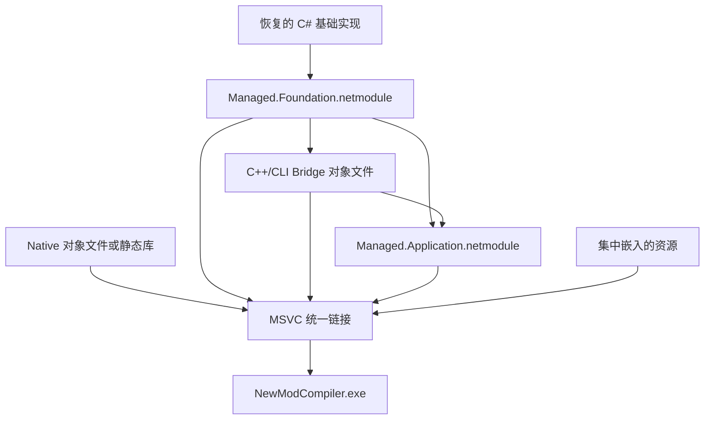
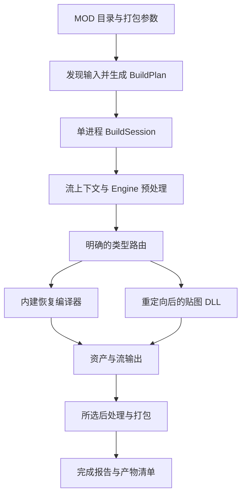

> 2026-10-27 当前结果说明：用户指定 `compiler-main` 为重构成果及后续开发主线，不再合回旧分支，旧 PR #13 关闭且不合并。本文为历史设计，勾选及“待实现”文字不是当前状态；当前能力以根 README、REFACTOR_RESUME 和 COMPILER_RELEASE 为准。WBData 相关规划已取消。版本/包名参数、必要旧参数合同与 LoD 确定性修复策略已准备，最终生产/ZIP验收已通过；UI/runtime、Unicode Texture、混合 Texture 会话缓存另列范围。

# NewSdk 恢复源码整合与新 MOD 编译器重构方案

- **建议文件位置**：`recovery/NewSdk_ModCompiler_Refactor_Plan.md`
- **文档版本**：修订版 2，按本轮五项意见更新
- **审计／修订日期**：2026-10-26（北京时间）
- **目标仓库／分支**：`wu162/NewSdk` → `recovery/compiler-source`
- **本次核对提交**：`87cf54e254dfb44a129da087316fd04806ed2b10`
- **文档性质**：实施方案。已核对源码、构建脚本、历史验收记录和部分原 DLL 的 PE／CLR 元数据；本轮修订没有执行重构、修改生产 DLL、Windows 构建或真实 SDK 编译。下文新增 CLI、事件协议和目录均为待实现设计。
- **代理使用规则**：允许使用子代理，数量由用户针对当前任务或阶段临时指定，并在指定范围内有效。未指定数量时主代理独立推进，不自行创建子代理。具体分工规则见 9.2。
- **质量原则**：正确性是底线；效率改进必须保持输出、依赖、生命周期和错误处理正确。
- **仓库交付约束**：按现有规则提 PR，用户明确批准后才合入；禁止强推。本方案修订本身不代表已向仓库提交或合入。

### 本次修订决定

| 用户意见 | 修订后的决定 | 主要章节 |
| --- | --- | --- |
| 子代理数量临时指定 | 允许委派；以用户对当前任务指定的数量为上限，不擅自扩大授权范围 | 9.2、12 |
| MOD 参数传入目录，由打包参数决定编译内容 | `--mod` 必须是 MOD 文件夹；一次生成 BuildPlan，一次 BuildSession 在同一编译进程内执行全部选中入口 | 5、7、G3 |
| 放弃旧 GUI，建立日志与构建信息输出 | 不纳入旧 GUI；新建日志、版本化事件协议和最终报告，界面实现不在本方案范围 | 5.4–5.7 |
| 修改贴图 DLL，使其引用 EXE | 优先验证混合 DLL 的元数据引用重定向；Core 类型转发改为后备路线 | 4、G2 |
| 正确性是底线 | 先冻结行为基线，再减少重复启动、初始化和验证成本；未验证项明确标记 | 7.6、9.3、10 |

## 1. 推荐方案与交付目标

推荐以 **Windows x86、.NET Framework 4.8、C# + C++／C++/CLI 源码共同链接** 为首个正式版本的技术路线：

1. 已恢复的 C# 功能编译为构建期 `.netmodule`。
2. 已恢复的 C++／C++/CLI 编译为 `.obj`，原生静态库也只作为构建中间物。
3. 由 MSVC `link.exe` 生成真正包含恢复实现的 `NewModCompiler.exe`。
4. 贴图功能暂保留原 `BinaryAssetBuilder.TextureCompiler.dll` 的实现；**优先对发行副本做元数据重定向，让它直接引用 EXE 中的兼容类型**。
5. 表达式解析暂保留当前实际依赖的 `antlr.runtime.dll`；以后可单独评估源码整合。
6. 新入口接受 MOD 文件夹和打包参数，构造完整构建计划；同一次调用内直接运行所需编译器，不循环启动 BAB。
7. 新建日志、结构化构建事件和最终报告；旧 GUI、驻留 BAB 和旧通信层不进入默认产品链。

**推荐核心发布目标为“1 个 EXE + 2 个暂留 DLL”，默认不包含 Core 转发 DLL：**

| 文件 | 首版定位 | 删除条件 |
| --- | --- | --- |
| `NewModCompiler.exe` | 全部纳入本轮整合的恢复实现、CLI、构建调度和新日志系统 | 主程序 |
| `BinaryAssetBuilder.TextureCompiler.dll` | 尚未完整恢复的贴图实现；优先发布经验证的引用重定向副本 | 完整恢复 PC 贴图路由并验收 |
| `antlr.runtime.dll` | 当前表达式解析器实际使用的 2.7.5.2 运行库 | 必要运行库源码纳入统一构建并通过表达式差分 |

这是一项**需要 G1／G2 实证确认的目标**，不是已经实现的文件清单。修改贴图 DLL 成功不等于恢复了它的源码。

只有在相应前置验证给出具体失败证据后，才采用过渡依赖：

- 贴图无法可靠直接引用 EXE：评估一个薄 `BinaryAssetBuilder.Core.dll` 类型转发程序集。
- Native／Bridge 无法在当前工具链统一链接：评估一个 `Recovered.Backend.dll`。
- Hash／Metrics 等旧身份：仅在真实加载证据证明需要、且直接重定向不能解决时，逐项记录处理方式。

不得为了让启动通过而默认复制整套旧 SDK DLL。任何过渡包都注明多出的文件、原因及去除条件。

源码级统一链接有微软官方支持：MSVC 可把 C# 生成的 MSIL 模块与 C++ 对象文件链接成不再依赖输入模块文件的输出。当前项目的资源、元数据修复和类型关系是否适配，必须先过第 8 节验证。[M1]

### 1.1 首版必须达到的结果

- `GameObject`、`WeaponTemplate`、`ArmorTemplate`、已验收 XML 类型、W3X、PC 音频及管理代码经过新主程序的真实入口运行。
- 不再为了这些恢复实现发布一组 `Recovered.*.dll`；逻辑源码仍分层维护。
- Core、Utility、Hash、Metrics、MvpXml、ExpressionEval、GameDataVerifier 的目标生产实现纳入 EXE。
- 用户传入 MOD 文件夹，选择编译／打包内容；程序负责发现入口、展开依赖、排序、编译和所选打包步骤。
- 一个 MOD 构建使用一个编译进程、一个 BuildSession；多个 XML／流入口作为内部任务，不产生多个 BAB 进程。
- 构建状态、诊断、进度和结果可通过稳定协议传递给外部调用方。
- 新增源码、工程、配置、构建逻辑、测试、文档和验证证据都归于 `recovery`。
- `.netmodule`、`.obj`、`.lib` 只作为构建中间物；正式包运行不依赖它们。
- 对不支持的资产与参数给出明确错误，不能静默退回旧 Tokenizer／XmlCompiler。

### 1.2 文件目标、进程目标与完整产品边界

“一个 EXE”计数对象是编译器自身的发布程序文件。`.exe.config`、Schema、参考流、配置、许可说明、MOD 输入和输出不是额外执行程序，但仍是实际运行依赖。

.NET Framework、VC++ 运行库和旧混合模式组件的环境前提应明确记录；不计入自研业务 DLL 数量，不能因此声称无需运行库或 SDK 数据。

**新编译流程不允许通过再次启动 BAB、另起编译 worker 或为每个 XML 启动同一个 EXE 来完成编译任务。** 原 BAB 只用于隔离的验证基线。第 7.3 节允许明确标记的旧后处理兼容过渡版；若仍调用外部后处理 EXE，该版本尚未达到完整产品的单 EXE 目标。

## 2. 目标分支的实际起点

本次以固定提交中的文件、源码树和证据为准。部分 README／RESUME 仍保留“等待 PR”“尚未合入”的历史描述，但音频、Hash 等源码已能在本次目标提交中找到；不能继续依据旧文字将它们列为未恢复。[R1][R2][R3]

### 2.1 恢复功能与整合动作

下表路径均相对仓库根目录。

| 模块 | 本次确认的现状 | 整合动作 |
| --- | --- | --- |
| Core | `recovery/src/Managed/Core` 已有源码；工程仍引用 SDK 原 Utility、Hash、Metrics，MvpXml 已改源码项目引用 | 把恢复依赖共同编译；保留文档、继承、Schema、引用、缓存和输出语义；拆开宿主 UI 职责 |
| Utility | `recovery/src/Managed/Utility` 为可重建 C#；有原生布局、ANSI 行为和元数据身份修复 | 实现进入 EXE；保留布局与签名修饰符的精确测试；调整构建期修复位置 |
| Hash | `recovery/src/Managed/Hash` 已恢复六个公开重载并通过差分；Core 尚未切换 | 直接使用恢复源码；保留 ANSI／DBCS、signed-char 尾字节、种子和溢出行为 |
| Metrics | `recovery/src/Managed/Metrics` 已恢复并完成离线对照 | 保留编译所需计时／诊断；SQL 等非必要宿主功能不进入默认执行路径 |
| MvpXml | `recovery/src/Managed/MvpXml` 已恢复；Core 已直接构造 XIncludingReader | 同模块源码编译；保留原资源名及 51 个 EXSLT 方法名修复 |
| ExpressionEval | `recovery/src/Managed/ExpressionEval` 已恢复；仍引用 Core 与 antlr.runtime；Core 包装器仍用 Assembly.Load | 改为直接构造或注入表达式服务；首版保留原语法和 ANTLR 版本 |
| GameDataVerifier | `recovery/src/Managed/GameDataVerifier` 已恢复 | 内建注册，不再按旧 DLL 名反射寻找 |
| Tokenizer 的 PC 编译路由 | GameObject、WeaponTemplate、ArmorTemplate 已由恢复插件接管并有组件／SDK 证据 | 以三个内建编译器纳入；不把“业务路由可替代”扩大成原 DLL 全部 ABI 均已恢复 |
| XmlCompiler | 289 个组件登记入口，267 个 Schema 全局根有真实 SDK 证据；另有 22 个非全局登记项 | 以明确类型清单内建注册；保持已有边界 |
| W3X | W3DAnimation、W3DMesh 已有正式恢复插件和真实 SDK 证据 | 合并两套桥接及插件包装，保留 Mesh／Animation 共用原生实现 |
| AudioCompiler | **实际位于仓库根 `src/AudioCompiler`**；PC 范围已验收，纯 C# 工程目标 net472、仍引用 SDK Core | 迁移到 `recovery/src/Managed/Audio`；更新脚本／工程路径；实现直接纳入 EXE |
| TextureCompiler | 本次目标分支没有可直接替代原插件的完整源码部署 | 通过 LegacyTextureAdapter 调用原实现；优先使用引用重定向后的副本 |
| Remote | 恢复源码存在，主要服务旧驻留 BAB 通信 | 不作为新 CLI 的运行依赖；保留历史源码供查证 |
| EALABuild | 恢复源码存在，包含路径、步骤、脚本和 GUI 契约 | 提取编译调度需要的逻辑；旧 WinForms／动态脚本宿主不照搬 |
| BAB 主 EXE | 主程序源码主要仍在 `recovery/decompiled/BinaryAssetBuilder` | 把所需初始化／构建逻辑迁入正式 `recovery/src/App`，建立新的受支持入口 |

来源：Core 工程、管理代码文档、音频工程，以及各类型的当前验收入口。[R1]–[R10][R19]

### 2.2 当前源码不是纯 C# 工程集合

本次 `recovery/src` 树包含 Managed、Native、Bridge、Plugin 四个层次，其中有 239 个 C# 文件、87 个 Native C++ 源文件和 70 个 Bridge C++ 源文件；音频还在根 `src`，另计。这里的数字只描述源码规模，不代表未完成工作量。

现有构建脚本会分别产出 XML、GameObject、Weapon、Armor 的桥接／插件 DLL，W3X 又产出 Native、Mesh、Plugin 三个 DLL。统一发布的关键工作是**把这些原本跨 DLL 的调用和编译依赖改为同一最终程序集内的关系**。[R11][R12]

### 2.3 不扩大的恢复范围

- GameObject 已验收的 322 个 Marshal 模块继续保留；58 个 token-only 项维持原有边界，不伪造可用的 Marshal 实现。
- XML 的 22 个非全局／抽象／runtime 项不改造成虚构的全局资产入口。
- TestGameObject 和 11 个排除的 Joypad 独立根不因为整合而自动承诺支持。
- UIConfigList 内部已有的相关嵌套布局不能仅凭名字含 Joypad 就删除；应按 Win32 根的实际依赖闭包决定。
- 音频只承诺现有文档列出的 PC 范围，不新增 Xbox／XMA 或其他平台目标。
- 平台边界在 CLI／构建配置入口统一限制为 Win32；不在第一次结构迁移中顺便大改已验收的序列化算法。[R4][R5][R6]

## 3. 技术路线及真实的单 EXE 构建方式

### 3.1 第一版运行平台

| 项目 | 推荐决定 | 原因 |
| --- | --- | --- |
| 运行平台 | Windows，x86 进程 | 原插件为 x86；恢复布局也有 4 字节指针断言 |
| 目标运行时 | .NET Framework 4.8／CLR4 | 兼容当前恢复代码与旧混合模式插件，统一原有 net20／net472 工程的运行环境 |
| C# 编译 | 固定 Roslyn 版本，先维持已使用的 C# 10 语义 | 避免编译器升级同时改变生成元数据 |
| C++ 编译 | 已有 VS2022／MSVC 环境，固定具体工具版本 | 延续现有 C++/CLI、x86、浮点和优化基线 |
| 原生浮点 | 延续已验收的 `/fp:precise`，不切 fast-math | 输出要求逐字节对照 |
| .NET 现代化 | 待旧混合模式边界退出后另行规划 | 现代 .NET 的 C++/CLI 不能直接生成 EXE；不会自动解决旧 Framework 插件兼容问题 |

这是面向当前依赖的方案选择，不是断言新编译器永远只能使用 .NET Framework。微软明确区分 .NET 与 .NET Framework 下 C++/CLI 的支持范围。[M2]

### 3.2 构建期分层

建议让源码依赖保持单向，构建中间物不进入发布目录：



**Foundation 模块**放置 Core 的数据类型与流水线、Utility、Hash、Metrics、MvpXml、ExpressionEval、Verifier、纯托管音频、元数据目录及桥接所需接口。它不能静态依赖上层的 C++/CLI 包装实现。

**Bridge 对象文件**读取 Foundation 模块的类型信息，将 XML／资产对象转换成原生输入，调用恢复的序列化实现，再返回 AssetBuffer。这里使用可链接的 `/clr .obj`，不把已经生成的混合模式 DLL 当成合并输入。不要让 Bridge 改成 `#using NewModCompiler.exe`：微软对用 `#using` 导入 `/clr` EXE 的元数据明确列出了文件加载限制。本方案让 Bridge 在最终链接前依赖 C# 模块，避免这条构建路径。[M6]

**Application 模块**包含 CLI、构建调度、内建编译器注册和需要直接调用 Bridge 的 C# 插件包装。它可以依赖 Foundation 与 Bridge；这样避免“Core 在 EXE、Bridge 引用 EXE、EXE 又先引用 Bridge DLL”的构建循环。

**最终链接**一次纳入所需模块、对象文件和资源，设置唯一入口、程序集身份及配置。所有业务实现的最终所属程序集应为新 EXE。

微软示例展示了 `csc /target:module`、C++ `/clr` 对象文件和 `link /LTCG` 的组合。实际脚本应依据本项目引用程序集、资源、入口和 CRT 配置生成，不能照抄示例参数就当作项目已能构建。[M1]

### 3.3 必须处理的五个构建细节

1. **资源集中嵌入。** 输入 MSIL 模块不能携带该链接路径不支持的嵌入资源；在最终链接时通过 `/ASSEMBLYRESOURCE` 等对应选项嵌入，并核对实际逻辑名称。保留 `BinaryAssetBuilderProject.xsd`、MvpXml 的原资源名和字节。不能把资源遗漏解释为“没用到”。[M1][M7][R1][R8]
2. **元数据修复放在正确阶段。** UtilityIdentity 与 MvpXmlMetadata 当前针对独立托管 DLL 操作。应适配为修复构建期纯托管模块，再由链接器生成最终混合 EXE；链接后再只读核对。不能直接用普通托管重写器重写含原生代码的最终 EXE，未经证明就假定原生段、RVA、重定位与初始化仍完整。[R7][R8]
3. **程序集级信息只能统一定义。** 排除各旧库重复的 AssemblyInfo／目标框架属性，生成新产品的一份身份；保留真正影响调用和布局的类型／成员元数据。缓存所需实现版本与游戏资产的类型哈希分开管理。
4. **共享原生代码只编译一次。** 从当前成功构建脚本整理明确源码清单；合并 Relocation、ScalarParsing、ResourceMarshaling 等共享实现。检查头文件内实现、模板、静态对象和同名公开桥接类型，不能将所有 `*.cpp` 无区别递归加入。
5. **程序集引用必须真实闭合。** 最终 EXE 不得残留对仅用于中间构建的 Foundation／Application 模块文件或旧恢复 DLL 的运行时引用；不能靠开发机搜索路径补齐缺失项。

### 3.4 不作为默认路线的做法

| 做法 | 本项目中的结论 |
| --- | --- |
| 仅用 C# `/addmodule` 生成一个程序集 | 必须区分“一个程序集”与“一个物理文件”；最终以 MSVC 实际链接和干净目录运行证明为准 |
| ILMerge／ILRepack 一次合并全部现有 DLL | 混合模式模块、原生代码与资源都需要额外处理，不作为无需验证的主方案 |
| DLL 嵌入资源、启动时解包到临时目录 | 运行时仍有独立 DLL，不满足本方案“恢复实现进入 EXE”的严格验收 |
| 直接换现代 .NET 并设置 PublishSingleFile | 不会自动迁移旧 CLR2 混合插件，也不能代替跨语言整合 |
| 将全部 Native／Bridge 重写为 C# | 可以作为长期方向，但会扩大算法回归范围，不是减少首版发布文件的优先办法 |
| 一开始大规模重命名全部旧类型 | 会扩大旧插件兼容面；先保留需要的命名空间与签名，边界稳定后再整理 |

### 3.5 统一链接失败时的明确退路

如果第 8 节的小型验证证明当前工具链无法稳定链接某一类恢复模块，允许先交付：

- C# 实现集中到一个 EXE。
- 所有恢复的 Native／Bridge 合并为**一个** `Recovered.Backend.dll`。
- 继续保留旧贴图等实际必要依赖。

这个版本必须明确标记为“过渡发布”，并记录额外 DLL 的原因和去除条件。它可以满足“少量 DLL”，但不能宣称所有恢复实现已经进入 EXE。应先解决具体失败证据，再决定是否继续统一链接或迁移特定模块，避免为去掉一个 DLL 而盲目重写全部算法。

## 4. 剩余 DLL 与兼容边界

### 4.1 本次直接读取二进制元数据的结论

本次从目标提交读取 SDK 原二进制，使用只读 PE／CLR 分析核对 AssemblyRef、TypeRef、原生导入及清单。这是静态审计，不能代替 Windows 加载与真实编译测试。[R13]

| 项目 | 实际发现 | 对方案的影响 |
| --- | --- | --- |
| TextureCompiler | x86 混合程序集，版本 `1.0.3492.22451`，无公钥 token；本文件没有强名称签名和 Authenticode 签名数据 | 保持 x86／Framework 兼容；对这一固定输入无需取得原签名私钥 |
| Texture → Core | 直接引用 `BinaryAssetBuilder.Core, Version=1.0.0.0`；引用接口、AssetBuffer、实例、平台、Tracer、哈希提供者和异常等类型 | 必须解决类型所属程序集，并保留所需 ABI |
| Core AssemblyRef | RID 5，即 token `0x23000005`；Name 指向 `#Strings` 索引 3622 | 优先修改这一引用记录的目标身份 |
| 共享字符串 | 9 个 TypeRef 的 `BinaryAssetBuilder.Core` 命名空间也指向 `#Strings` 索引 3622 | **不能原地替换共享字符串，否则会误改类型命名空间** |
| Texture → Utility | 没有直接 AssemblyRef；旧 Core 才引用 Utility | 不把 Utility 列成贴图 DLL 的直接依赖 |
| Texture 其他项目 AssemblyRef | EALA.Hash、EALA.Metrics、EALA.ProcessUtility；本次未发现对应的直接 TypeRef | 真实使用及动态加载必须进一步核对；不机械复制或改写 |
| Core／Utility／Hash／Metrics | 本次读取的原程序集均无公钥 token | 首版无需安排恢复原强名称签名的任务 |
| Texture 原生导入 | 含 MSVCR80、MSVCP80、msvcm80；清单声明 VC80 CRT x86 | 依赖重定向不会消除原生 CRT 要求 |
| antlr.runtime | 纯托管，版本 `2.7.5.2` | ExpressionEval 实际使用，暂留有依据 |
| antlr.astframe | 引用 WinForms、Drawing 和 antlr.runtime 的独立程序集 | 新产品不需要 AST 图形查看器；闭包核对后排除 |
| CC3Tools | x86 原生 DLL，无 CLR 元数据 | 只在所选后处理实际需要时讨论，不能按托管 DLL 合并 |

固定原 Texture 输入的 SHA-256：

`4f559428e11a5cf8b914792e0eccf3b94397b8851233ec658d4c02c4633e9d9e`

共享索引 3622 的九个命名空间引用分别涉及 IAssetBuilderPlugin、TargetPlatform、Tracer、AssetBuffer、InstanceDeclaration、ExtendedTypeInformation、HashProvider、InstanceHandle、AssetDeclarationDocument。索引值是本文件的审计定位信息，补丁工具应根据内容和结构核对，不能仅硬编码偏移。

`EALA.ProcessUtility.dll` 未出现在本次 `SDK/tools` 文件列表中。不能为满足名字而创建空实现；先核对原 SDK 如何完成生产路径。静态引用、实际托管绑定与原生动态加载分别记录。

### 4.2 主路线：贴图 DLL 直接引用新 EXE

**可以把修改贴图 DLL 纳入优先验证，而且应先验证这条路线能否去掉 Core 转发文件。** 实现方法是修改托管元数据中的程序集引用，不修改贴图算法，也不重命名全部旧类型。

CLR 的 TypeRef 通过 ResolutionScope 标识类型解析范围，外部类型可指向 AssemblyRef；微软元数据 API 也明确允许设置 AssemblyRef 的名称、版本、文化和公钥信息。这为重定向提供机制依据，但不能单凭这些 API 宣布旧混合 DLL 已兼容。[M8][M9]

构建流程如下：

1. 先生成新 EXE，读取其实际 AssemblyName、AssemblyVersion、Culture 与公钥信息。补丁目标来自最终元数据，不根据文件名猜测。
2. 校验原 Texture 哈希，只在 `recovery/artifacts` 中复制并修改发行副本；仓库原二进制继续作为 oracle。
3. 将 Core 的 AssemblyRef 行改为 EXE 的准确身份。为新程序集名建立独立字符串项或安全重建相关堆，保持原类型命名空间及名称不变。
4. 该行仍由相关 TypeRef 的 ResolutionScope 引用；优先保留原行号、token 和其他引用结构。若写入器重排元数据，必须证明原生代码和全部相关引用得到正确处理。
5. 核查 TypeRef、MemberRef、TypeSpec、嵌套类型、泛型／自定义修饰符，以及程序集限定字符串、资源和运行时反射加载。不要只检查 AssemblyRef 表，也不要对所有字符串全局替换。
6. 核对 EXE 中所需 public 类型、成员签名、字段布局、枚举值和异常类型；以真实调用验证它们属于当前入口 EXE 的同一运行时类型。
7. Hash／Metrics 若有真实使用，再逐项验证能否重定向至 EXE 内已有实现。未知的 ProcessUtility 不得盲目映射到 EXE，也不生成空壳。
8. 生成补丁清单并执行 G2。EXE 身份或兼容 ABI 改变后重新生成并验证配套补丁。

`bindingRedirect` 只解决相应程序集的版本绑定，不承担这里的任意程序集改名。[M4] C++ `#using` 导入混合 EXE 的限制是构建期限制，也不能直接用来断言预编译 DLL 在运行期一定无法绑定当前 EXE；两者分别由 G1、G2 验证。[M6]

### 4.3 补丁工具与混合 PE 的保护

建议在 `recovery/tools/TextureReferencePatch` 建立**构建期工具**，首个候选采用固定版本的 dnlib。其官方文档明确为 C++/CLI 提供 `NativeWrite()`；不能把面向纯 IL 的 `Write()` 当作等价路径。工具支持混合写入不代表已证明它能安全处理本文件。[M10]

先做两步递进试验：

- **不改语义的读写往返**：读取原 DLL，仅用选定原生写入路径重新输出，在原 Core 环境下跑实际贴图用例。若这一轮已经失败，先定位写入器／选项问题，不继续归因于 EXE 引用。
- **引用重定向**：往返验证通过后，仅施加批准的引用变更，在 G1 的 EXE 中调用；移除旧 Core 与所有转发程序集后验证。

工具必须检查：

- 原生代码、导入、资源、重定位、TLS、入口、CLR 目录、VTableFixups 和初始化信息的保留情况。
- token／RVA 与原生桥接是否一致；原生代码字节默认不应被无关改动，任何重写差异必须解释。
- 类型名、命名空间、方法／字段签名和自定义修饰符是否保持；元数据差异是否只落在明确允许的范围。
- 输入是否为允许哈希；未知版本拒绝处理，不“尽量猜测修复”。
- 已补丁输入如何识别；默认从原始副本重建，避免二次重写造成漂移。
- 相同输入、目标身份和固定工具链能否重现结果；如存在时间戳等写入器差异，应固定或单独解释。

补丁清单至少记录原文件哈希、补丁文件哈希、目标 EXE 身份、目标兼容签名摘要、工具版本、参数、改变的 AssemblyRef 和验证收据。dnlib 及补丁工具只用于构建，不加入编译器运行包。

### 4.4 转发与其他退路的启用条件

路线顺序为：

| 顺位 | 方式 | 启用条件 |
| --- | --- | --- |
| 1 | 元数据重定向，Texture 直接引用 EXE | 默认验证目标；G2 完整通过后采用 |
| 2 | 更小范围、理解 PE／CLR 结构的定向补丁 | 通用原生写入器确有问题，且已定位可修复的结构原因；仍须同样验收 |
| 3 | 薄 Core 类型转发 DLL | 直接引用方案出现已定位且暂不能解决的兼容问题 |
| 4 | 一个恢复版 Core 边界程序集 | 直接重定向与薄转发均被具体证据否定；明确标记过渡状态 |

薄转发 DLL 仅包含将旧身份映射到 EXE 类型的声明，不复制第二套 AssetBuffer、InstanceDeclaration 或 Core 业务实现。先生成 EXE，再用 C# 编译转发程序集；EXE 的业务代码不反向引用转发 DLL。CLR 类型转发机制有官方依据，但本项目的完整混合调用组合仍需独立验证。[M3]

任何退路都保留“同一进程内完成一次 MOD 编译”的要求。不采用每个流启动 BAB、另起贴图 worker 或多次启动主 EXE 来规避生命周期问题。若同进程边界仍未解决，应明确报告阻塞，不能以隐藏子进程方式宣称目标完成。

## 5. 新编译器内部结构、日志与构建信息输出

### 5.1 逻辑模块与单次构建模型

| 模块 | 职责 | 约束 |
| --- | --- | --- |
| CLI | MOD 文件夹、打包参数、兼容参数、帮助和退出码 | 参数转换为明确的 BuildRequest |
| Application／Planning | 发现输入、生成 BuildPlan、排序、执行、取消和收尾 | 不启动 BAB；同一次调用使用一个 BuildSession |
| Engine | XML、XInclude、表达式、Schema、继承、依赖、实例处理和输出 | 首轮保持原语义与顺序 |
| BuiltInCompilers | Tokenizer 三根、XML、W3X、Audio 的显式注册 | 直接实例化；支持范围可审计 |
| Native／Bridge | 布局、序列化、重定位和导入等恢复实现 | 统一构建进入 EXE |
| LegacyTextureAdapter | 验证贴图副本、加载、初始化、调用及错误转换 | 优先直接绑定 EXE；保持 ABI |
| Diagnostics | 新日志、结构化事件、诊断代码及最终报告 | 不复用旧 GUI／Remoting；不新增仅为日志服务的运行 DLL |
| Infrastructure | 文件系统、路径、缓存、计时、资源和原子输出 | 状态作用域明确 |
| Compatibility | 旧参数映射、必要 ABI 适配与可选后备转发 | 不能成为第二份业务实现 |
| Packaging | 选中内容的后处理、BIG／skudef 与产物清单 | 只消费本次计划认可的产物 |

BuildRequest 表达用户意图，BuildPlan 表达实际执行任务，BuildSession 持有本次构建生命周期，StreamContext 隔离每个编译入口的可变状态。任务包含入口、有效配置、依赖、预计输出和选择理由；不能把几个旧脚本命令简单排列后当作新执行引擎。

### 5.2 真实编译调用链



事件由各阶段通过 Diagnostics 统一发出；图中不包含 GUI。数据必须经过真实的 Core 预处理，再进入编译函数；直接拼装 AssetBuffer 的测试不能代替生产路径验收。

迁移中保持：

- Include、XInclude、声明文件相对路径与 DATA／ART／AUDIO 搜索规则。
- XSD 默认值、继承合并、引用预处理和多态 TypeId 的行为及先后顺序。
- 合法 id、xml:base、xml:lang、buildRule／typeHashCode 等元数据的正确处理层次。
- 字符串哈希、数值解析、浮点位模式、布局、重定位、imports、CustomData 和资产顺序。
- `.bin/.manifest/.imp/.relo` 的组织规则。[R9][R14]

### 5.3 替换动态加载与全局状态

当前 PluginDescriptor 对程序集限定类型名执行 Type.GetType／Activator.CreateInstance；ExpressionEvaluatorWrapper 仍用旧程序集名 Assembly.Load。这些路径必须调整，否则源码进入 EXE 后仍会查找旧 DLL。[R15]

- 内建编译器通过 BuiltInCompilerRegistry 显式注册，表达式服务直接构造或注入。
- 配置选择能力、路径和选项，不再要求给内建实现填写旧程序集名。
- 贴图适配器独立检查允许文件、补丁清单、目标 EXE 身份和实际加载来源。
- 类型 ID 到处理器映射检查重复、缺失和不支持项。
- 同步迁移 SerializedSectionHandler、serializedType 等程序集限定名。

建立 Settings.Current、OutputManager、字符串哈希表、静态缓存、Tracer、Metrics 和插件生命周期清单。构建期间可通过短期适配接管旧静态接口，但拥有者和复位时点必须明确。一个 BuildSession 内允许多个顺序 StreamContext；跨流复用仅限已证明可复用的数据。

### 5.4 旧 GUI 退出范围

生产编译清单排除旧 WinForms 界面、托盘、驻留 BAB、IpcChannel／.NET Remoting、旧 GUI 回调和 EALAModStudio 动态界面宿主。历史源码保留用于查证，不是新主程序依赖。[R16]

本轮只设计无界面的构建核心、CLI、日志及对外信息契约。**后续新界面的技术选型、页面、交互、进程组织及接入方式均不在本方案范围。** 外部程序只需遵循事件和结果协议即可获取构建信息。

### 5.5 新日志系统

建立独立的 Diagnostic／BuildEvent 模型与 IBuildEventSink 输出接口，统一产生时间、关联 ID 和诊断代码。优先使用 Framework 能力及项目内源码实现必要功能，避免为日志引入额外发布 DLL。

| 输出 | 内容与用途 | 规则 |
| --- | --- | --- |
| 控制台 | 面向用户的阶段、警告、错误与摘要 | 默认写 stderr；日志详细级别可调 |
| `build.log` | 可读的完整诊断记录 | UTF-8，包含构建 ID、阶段和错误上下文 |
| `build.events.jsonl` | 可由外部程序实时读取的事件流 | UTF-8；每行一个完整 JSON 对象；协议版本明确 |
| `build-report.json` | 本次最终结果、有效参数、依赖、产物与统计 | 构建结束写临时文件后原子替换；含状态和退出码 |

旧 Tracer／Metrics 的兼容签名可能仍被贴图调用，应保留必要 ABI，并由适配器将其信息送入新系统。旧日志前缀、旧 GUI 回调和原 Remoting 不能充当新协议。外部旧后处理工具的 stdout／stderr 也转换成带工具名、阶段和级别的诊断。

主程序维护统一错误状态；调低日志级别不能把失败变成功。诊断包含稳定 code、消息、源路径／行列、资产／流、异常及必要上下文；调用方按 code 和结构字段处理，不解析自然语言文本。

### 5.6 构建事件与最终报告协议

首版事件至少包含：

| 事件 | 发送时点与必要内容 |
| --- | --- |
| BuildStarted | 已获得构建 ID；记录请求、工具版本和输入位置 |
| PlanResolved | 计划解析完成；所选内容、任务、依赖、跳过项与原因 |
| StageStarted／StageCompleted | 阶段开始／结束；阶段状态、耗时和产物数量 |
| StreamStarted／StreamCompleted | 单个编译入口开始／结束；入口、有效配置和结果 |
| Diagnostic | 警告、错误及需要记录的信息；稳定诊断代码 |
| Progress | 已完成数、总数、单位及阶段；未知总量时标记未知 |
| ArtifactProduced | 产物路径、类型、大小及需要的指纹 |
| BuildFinished | 正常受控结束的唯一终止事件；成功／失败／取消、退出码、摘要及报告路径 |

建议的公共字段为 `schemaVersion`、`buildId`、`sequence`、`timestampUtc`、`elapsedMs`、`eventType`、`level`、`stageId`、`streamId`、`assetId`、`diagnosticCode`、`message`、`source`、`progress` 和 `payload`。不适用字段允许缺省，字段必选性和各事件载荷另写 JSON Schema。

示意事件如下，字段为待实现协议：

```json
{"schemaVersion":"1.0","buildId":"build-001","sequence":18,"timestampUtc":"2026-10-26T12:00:00Z","elapsedMs":1240,"eventType":"StreamCompleted","level":"info","stageId":"compile-base","streamId":"base/mod","payload":{"status":"succeeded","artifactCount":4}}
```

协议约束：

- sequence 由单一事件分发器分配并递增；耗时使用单调计时。日志、事件和报告共享 buildId。
- 相同主版本允许兼容增加字段；消费者忽略未知可选字段。删除字段或改变语义升级主版本。
- 详细资产事件默认可关闭或聚合；生命周期、错误和最终结果不能因为低详细级别丢失。
- 进度按明确单位报告，允许按阶段分别计数；未知总量不伪造百分比，构建真正完成前不显示整体 100%。
- `--events <路径>` 是默认机器通信方式，消费者可增量读取完整行。`--report <路径>` 指定终态报告位置。
- `--events -` 如提供，只允许 stdout 输出协议 JSON；必须先证明旧托管／原生输出已隔离。未经验证则明确不支持此模式，优先交付可靠的事件文件。
- 调用方以终态报告、BuildFinished 和进程退出码交叉核对；协议缺失、截断或不一致不得推断成功。

BuildReport 至少包含：schemaVersion、buildId、状态、退出码、请求参数、最终生效参数及来源、选中内容、展开后的任务、每阶段结果、诊断统计、已加载提供者、外部工具、缓存统计、耗时、产物清单及日志路径。构建计划与兼容回退也必须可见。

### 5.7 事件可靠性、失败与取消

首版可以采用简单的顺序写入；只有测量证明确有必要，再使用有界队列与单写入器。若使用异步输出，进度可按明确规则合并，并记录合并数量；错误、阶段生命周期和终态事件不可丢弃。慢消费者或断开连接不能无上限占用内存，也不能改变编译结果。

事件文件在完整行后刷新，结束时确保必要日志和报告落盘。必需事件／报告写入失败应产生明确的基础设施失败及非零退出码；不能在承诺完整报告的模式下悄悄继续并报告成功。可选控制台通道的失败按明确策略记录。

正常成功、可捕获失败和合作式取消各有且只有一个终止结果。强制结束进程或原生崩溃可能来不及写 BuildFinished；调用方应将缺失终态、未完成报告或旧 buildId 判断为异常中断。终态文件不能从上次构建沿用。

取消在安全边界检查，进入 finally 清理临时文件、缓存写入和插件状态；不用 Thread.Abort。取消与失败不得把未完成目录当成有效发行物。执行前校验、阶段完成和最终提交分别有明确状态，输出采用本次构建隔离目录及受控提交策略。

## 6. recovery 下的目录与工程组织

第一阶段保留已有 Native／Bridge 路径，减少路径移动与算法变更叠加；新增正式入口，迁回根目录音频源码。下表是建议布局，不是已存在文件清单。

| 路径 | 内容 |
| --- | --- |
| `recovery/NewModCompiler.sln` | 日常开发入口 |
| `recovery/NewSdk_ModCompiler_Refactor_Plan.md` | 本方案 |
| `recovery/REFACTOR_RESUME.md` | 当前阶段、提交、验证状态、下一步及当前任务代理额度 |
| `recovery/src/App/Cli` | MOD 目录与参数解析、帮助、退出码 |
| `recovery/src/App/Application` | BuildRequest、BuildPlan、BuildSession、StreamContext 和调度 |
| `recovery/src/App/Diagnostics` | 新日志、诊断模型、事件分发、各输出 sink 及报告生成 |
| `recovery/src/App/Packaging` | 所选后处理、BIG／skudef 和产物清单 |
| `recovery/src/Managed/Core` | 复用 Core，再按文档／Schema／资产／输出逐步拆分 |
| `recovery/src/Managed/Audio` | 从根 `src/AudioCompiler` 迁入 |
| `recovery/src/Managed/{Utility,Hash,Metrics,MvpXml,ExpressionEval,GameDataVerifier,W3x}` | 明确逻辑模块，统一源码构建 |
| `recovery/src/Native`、`recovery/src/Bridge` | 既有恢复算法与互操作层 |
| `recovery/src/Plugin` | 旧包装逐步改成内建适配，不继续默认发布插件 DLL |
| `recovery/src/Compatibility/LegacyTexture` | 贴图身份检查、加载、调用及旧 Tracer 适配 |
| `recovery/src/Compatibility/LegacyCore` | 仅在后备路线启用时存在的类型转发工程 |
| `recovery/tools/TextureReferencePatch` | 构建期混合 DLL 元数据补丁与验证工具 |
| `recovery/build` | 中间模块、Native／Bridge、最终链接和资源清单 |
| `recovery/config` | 默认参数、内容选择规则、能力与依赖清单 |
| `recovery/contracts` | BuildEvent／BuildReport JSON Schema、诊断代码和版本兼容规则 |
| `recovery/scripts` | BuildCompiler、TestCompiler、PackageCompiler 等统一入口 |
| `recovery/tests` | 既有差分与新参数、计划、日志、生命周期、部署测试 |
| `recovery/tests/Mods` | 测试 MOD；覆盖 SDK 内和 SDK 外的目录 |
| `recovery/evidence/refactor` | 固定源码／工具链／输入／产物、补丁清单、轨迹与收据 |
| `recovery/artifacts` | 忽略提交的 bin、obj、贴图副本、临时 SDK 和测试输出 |
| `recovery/decompiled`、`recovery/logs` | 历史证据，不作为默认生产编译输入 |

GitHub Actions 的薄入口按平台规定保留在 `.github/workflows`；复用现有入口，实际逻辑留在 `recovery/scripts`。不要把入口移到 recovery 后假定 GitHub 仍会识别。

### 6.1 工程数量与发布 DLL 数量分开

多个工程可用于 IDE、定向测试、构建中间模块和静态库；发布脚本只选择最终 EXE 与允许依赖。测试／oracle DLL、补丁工具及其依赖不进入发行包。

```powershell
# 以下命令是待实现的接口设计
./recovery/scripts/BuildCompiler.ps1 -Configuration Release -Platform Win32
./recovery/scripts/TestCompiler.ps1 -Suite Integration
./recovery/scripts/PackageCompiler.ps1 -Configuration Release
```

脚本明确输入、输出、源码提交与工具链。停止把 `SDK/tools/*.dll` 整批复制进生产目录；oracle 环境与发行环境分别维护准确清单。[R12]

### 6.2 源码移动的顺序

先登记源码树和验证锚点，再以不改行为的提交迁移音频，并同步 HintPath、脚本、工作流路径过滤及当前源码位置。历史 sourceCommit／树哈希不改写。

其他目录在主入口可构建后逐步整理。旧工程可短期作为对照入口，但必须标记测试／兼容用途，不能形成两套长期独立修改的生产实现。

## 7. MOD 目录、打包参数与单进程构建

### 7.1 主入口是 MOD 文件夹

`--mod` 接收存在的 MOD 文件夹路径，例如 `D:\Mods\Upheaval`，不能用 `Data/Mod.xml` 替代。程序根据该目录和打包参数发现入口，用户不需要逐个给出 XML，也不需要手动执行旧脚本 case。

路径语义分别定义：

- ModRoot：用户传入的 MOD 目录，可以在 SDK 外，支持空格和中文。
- SdkRoot：Schema、参考流和必要 SDK 数据根；与 MOD 所在位置独立。
- OutputRoot：本次输出根；由 `--out` 或兼容 `/od` 指定，不能隐式覆盖 MOD 输入。
- Data／Art／Audio 搜索路径：由明确配置和兼容参数组成；保留旧路径优先级与相对路径语义，并在报告中显示解析结果。

不得依靠固定 `SDK/Mods/<名字>` 拼接输入或为每个 XML 改换工作目录来蒙混通过。对旧插件确有工作目录要求的路径，在会话级明确建立并记录，不能让未知全局目录状态污染后续流。

### 7.2 打包参数生成 BuildPlan

将“本次要交付哪些内容”和“用什么容器打包”分开建模：

| 参数类别 | 建议接口 | 对编译计划的影响 |
| --- | --- | --- |
| 内容选择 | `--package-content base,apt,maps` | 决定扫描和编译哪些内容组 |
| 包装形式 | `--package-format loose\|big` | loose 输出流及清单；big 追加已实现的 BIG 包装 |
| 旧 AssetMerge 步骤 | 不纳入新编译器流程 | 2026-10-27 用户确认不需要；前序编译已生成所需 manifest 等文件 |
| 版本／补丁／LOD 等 | 有必要的旧参数与明确新配置 | 增加相应输出或依赖任务，不重新启动编译器 |
| 路径／平台／缓存／校验 | 兼容参数或新命名参数 | 作用于相应任务上下文，不改变选项原有含义 |

建议未指定内容时使用项目预设；没有预设时默认 `base,apt,maps`，未指定容器时默认 `loose`。所有默认值都写入有效参数报告；未知选项或尚未实现的 BIG／后处理能力在预检时明确拒绝。这里的名称和默认值是待实现接口决定，实施时保持文档、帮助及解析器一致。

三个已知内容组的真实输入如下：

| 内容组 | 入口发现规则 | 预期产物 |
| --- | --- | --- |
| base | `Data/Mod.xml` 与其 Include 闭包 | 基础四类流文件及相应 CustomData |
| apt | `Data/AptUI/*.xml` | 各入口流文件，以及有效配置要求的 version 文件 |
| maps | `Data/AdditionalMaps/MapMetaData_*.xml` | 地图元数据流 |

maps 对应旧 defaultscript 的 case 4；不因为旧步骤被称为“全局数据”而改为编译 SDK 根 Global.xml。apt 也不意味着新增任意 SWF／APT 转换器；保持既有 APT payload 范围。[R5][R14]

计划生成依次完成：

1. 校验目录、参数组合、能力和必要依赖。
2. 仅扫描所选内容组；解析入口与实际配置。
3. 展开必要依赖闭包，标明每个任务是显式选择还是依赖引入。
4. 用输入、有效配置、平台和输出目标区分任务；同一任务去重，不把不同上下文中的同名资产误判为相同任务。
5. 按真实依赖和已验证顺序生成确定的执行顺序；无依赖任务也按固定规则排序。
6. 输出 PlanResolved；执行器按计划运行，而非在编译过程中不断拼接 BAB 命令。

选择 base 不应无故编译 apt／maps；所选内容若确实需要其他内容，必须展开依赖并说明原因，不通过省略必需输入制造“局部构建成功”。缺少必需入口是错误；允许为空的可选集合以 SkippedNoInputs 等明确状态记录。

**一次 CLI 调用 → 一个 BuildSession → 多个内部编译／打包任务。** Schema、类型注册和经过验证的只读资源可在会话内复用；每个流分别维护输出、哈希表、实例图及插件状态。不存在“每个文件启动一个 BAB”或“每个阶段启动一次 BAB”。

### 7.3 后处理与 BIG 打包

原脚本还可能调用 AssetMerge、HashFix、ModAssetResolver、LoDStreamBuilder 和 MakeBig；仅整合 BAB 与插件不会使这些工具自动消失。[R14]

| 产品状态 | 能力 | 与最终目标的关系 |
| --- | --- | --- |
| 核心编译版本 | 由同一 EXE 完成所选 base／apt／maps 内容，直接输出流 | 达到核心编译器文件和进程目标 |
| 旧后处理兼容过渡版 | 已选中的后处理通过显式调用旧工具完成 | 额外 EXE 必须列出；不宣布完整产品单 EXE |
| 完整流程版本 | 必要后处理与打包实现进入主程序，或使用已允许的 DLL API | 通过相应正确性验收后达到完整目标 |

旧后处理过渡版仍严禁启动 BAB 或把编译任务外包给另一进程。外部调用只限明确列出的后处理工具，并在 BuildPlan、事件与报告中显示工具、输入、输出和退出码。

实施规则：

- 只编译和打包本次选择及其依赖所需内容。打包读取本次产物清单，不递归扫旧输出目录把陈旧文件混入。
- 按 2026-10-27 用户指示，旧 AssetMerge 不纳入新流程，也不作为 P7 完成条件。前序编译已经生成正常打包所需 manifest 等文件；已有独立组件准备只保留为历史参考。
- 按 2026-10-27 用户最新指示，取消 WBData 下载、提取、读取器开发及依赖真实 WBData 的完整中立资产插入验收，不作为本轮重构完成条件。已有显式可选修复保留，需完整参考输入；缺失时明确拒绝，未做的真实数据验证不得称为通过。
- 需联合执行时保留 HashFix → ModAssetResolver → LoDStreamBuilder 的原依赖顺序；先核验行为，再优化。
- `SDK/tools/Source/ModAssetResolver.dpr` 和字符串表源码可供后续整合，但不代表所有工具都已有可用源码。[R18]
- 使用 CC3Tools API 前确认所需导出、调用约定与行为；不假定它覆盖所有旧工具。
- BIG／skudef 的验收包括文件集合、路径、大小、内容和游戏读取要求；不得用“生成了 .big 文件”代替。
- 启动游戏、安装 MOD、写 CurrentMOD.ini 等动作不是 build 的隐式副作用。

### 7.4 建议 CLI 与旧参数兼容

以下命令均为设计草案：

```powershell
# 编译所选内容并输出松散流；MOD 目录可以位于 SDK 外
NewModCompiler.exe build --mod "D:\Mods\Upheaval" --package-content base,apt,maps --package-format loose --sdk-root "D:\SDK" --out "D:\Build\Upheaval"

# 仅选择基础数据，关闭会话缓存和构建缓存
NewModCompiler.exe build --mod "D:\Mods\Upheaval" --package-content base --package-format loose --sdk-root "D:\SDK" --out "D:\Build\BaseOnly" /sc:false /bc:false

# 完整打包能力实现且验收通过后支持
NewModCompiler.exe build --mod "D:\Mods\Upheaval" --package-content base,apt,maps --package-format big --sdk-root "D:\SDK" --out "D:\Build\Package" --events "D:\Build\Logs\build.events.jsonl" --report "D:\Build\Logs\build-report.json"

NewModCompiler.exe doctor --sdk-root "D:\SDK"
```

不把 `compile --input <单个 XML>` 作为面向用户的主入口；底层单流能力可以作为内部 API／定向测试入口保留。用户主要决定 MOD 目录和打包意图，执行器负责展开。

以下旧参数名和字段含义已与恢复版 Settings 源码核对。保留有用语义、兼容必要别名，并在新实现中核对实际调用点；表格不是宣称兼容层已经实现。[R21]

| 旧参数 | 实际意义 | 新编译器处理 |
| --- | --- | --- |
| `/sp`、`/dr`、`/art`、`/audio`、`/data` | Schema、DataRoot 和资源搜索路径 | 保留，映射到明确路径配置 |
| `/od`、`/iod`、`/oix` | 最终输出、中间目录、中间 XML 输出 | 保留；与 `--out` 等别名做冲突检查 |
| `/sc`、`/bc` | 会话缓存、构建缓存开关 | 保留；使用新产品缓存命名空间 |
| `/scd`／`/scp`、`/bcd`／`/bcp` | 会话缓存／构建缓存目录 | 保留别名及路径意义 |
| `/csc` | 压缩会话缓存 | 保留；**不是缓存总开关** |
| `/psc`、`/fsc`、`/atc`、`/slowclean` | 部分会话缓存、冻结会话缓存、touch、慢清理 | 按原语义实现；取消与写入边界专门核对 |
| `/bcn`、`/tp` | 构建配置、目标平台 | 保留；首版只接受 Win32 |
| `/pc` | UsePrecompiled，使用预编译数据 | 保留；**不是 PC 平台选择参数** |
| `/ls`、`/bps`、`/ss` | LinkedStreams、基础补丁流、稳定排序 | 保留对输出有意义的语义 |
| `/oof`、`/vf`、`/cpf` | 旧输出格式、版本文件、自定义后缀 | 按实际格式需求保留，禁止静默改默认值 |
| `/oar`、`/osh` | 资产报告、字符串哈希输出 | 保留；与新构建报告区分 |
| `/tl`、`/el`、`/mr` | TraceLevel、ErrorLevel、MetricsReporting | 映射新诊断与统计；保持已确认的校验语义，不以日志过滤消除错误 |
| `/gui`、`/res`／`/pers`、`/mp` | 旧 GUI、驻留和监视路径 | 不纳入新宿主；传入时给出明确不支持说明 |
| `/poe` | 出错后暂停 | 不作为自动化 build 行为；显式提示移除，避免阻塞外部调用 |
| `/sf` | 旧单文件模式 | 不用来替代 MOD 目录入口；若有底层需求只在内部诊断范围实现 |
| `/sh` | StreamHints；当前恢复代码 getter 固定返回 false | 保留历史事实，不擅自启用；非默认请求明确提示尚不支持 |

同一个含义的新旧参数指定不同值时应报冲突；不能靠解析顺序悄悄覆盖。明确命令行优先于项目配置，项目配置优先于内置默认值。报告记录最终值和来源。未知参数、不支持组合及尚未实现的必要旧功能都必须明确失败，不能默默忽略。

建议稳定退出码为：0 成功；2 参数／计划错误；3 环境或必要依赖缺失；4 输入／编译／打包失败；5 内部异常；6 用户取消；7 必需日志／报告／输出提交失败。更细原因使用诊断 code；枚举、文档和事件协议保持一致。

### 7.5 一个会话内的生命周期

进程启动后一次建立必要运行环境与内建目录；构建计划在执行前确定。插件的 Initialize／ReInitialize／Dispose 行为按实际 API 及已知调用顺序验证，不能把“减少初始化次数”当成未经验证的性能捷径。

BuildSession 持有请求、只读共享资源、取消状态、事件分发和产物清单。StreamContext 持有该流的有效 Settings、实例图、输出管理、字符串哈希状态和临时缓冲区。完成或失败后按明确顺序释放并复位，再进入下一任务。

首版顺序执行编译任务。并行运行独立的开发代理不等于允许编译器并行修改旧静态状态。只有隔离、线程安全和输出一致性均有证据后，才考虑编译器内部并行化。

### 7.6 缓存、效率与输出正确性

身份、配置和组织方式改变后使用新缓存命名空间／格式版本，不无条件复用旧 BAB 会话缓存。缓存键至少包含输入及传递依赖、Schema、实现版本、相关参数、平台与输出语义。

优先改进：

- 消除重复启动 BAB 和重复装载同一会话所需 Schema／注册信息。
- 对完全相同的计划任务去重；缓存文件读取、解析或编译结果前明确作用域和失效条件。
- 分阶段记录耗时、CPU／I/O 观察、缓存命中及峰值内存，用证据确定后续瓶颈。
- 对增量构建验证依赖修改能正确失效；不能只看第二次更快。
- 保留协议要求的类型／处理哈希，不为缓存区分随意改变资产格式。

必须覆盖无缓存、冷缓存、热缓存、依赖变化、连续两个 MOD、取消后重试和失败后重试。重复运行不应引入跨流状态、脏输出或旧文件混包。若某项优化无法保持一致性，先关闭该优化并记录原因；不得降低比较标准来达成性能数字。

## 8. 前置验证关卡

先用少量、可定位的验证确认路线，再大规模移动和删除源码。关卡成功以真实结果及证据为准，不能把历史收据改写成对新组合的验证。

### G0：重构前建立真实 SDK 基线

正式结构重构前，运行一次固定版本和输入的真实 SDK 验证：

- 固定源码提交、SDK/tools／Schemas 指纹和 MOD 输入。
- 用原 SDK 建立原始输出，再记录当前恢复组件部署方式的实际结果。
- 三个内容组采用相同输入、有效参数、工作目录与规范化绝对路径。
- TestUpheavalSdk 的调用和实际插件逐项记录；Hash／Utility 等已有源码但未切入当前部署的组件不能记成已实际使用。
- 当前联合脚本不是新的全源码单 EXE 入口，准确说明其覆盖组合。
- Upheaval／PublicCases 完整输入不都在本分支；按现有方式从固定验证提交 `068643219fded09a05fb7b75c6507b769c430316` 恢复到临时 SDK，保留输入树哈希。[R17]
- 保存四类流、CustomData、实际路由、调用次数和退出码。
- 原 SDK 若先失败，先解决输入／环境问题，不归因于新架构。

原 BAB 仅在这里和隔离的 oracle 对照环境运行；不会成为新生产构建的子进程。

### G1：跨语言单 EXE 小型验证

以真实恢复源码的小依赖闭包验证：

1. C# 包含 Core 的 AssetBuffer 和一项恢复功能，如 Hash。
2. C++/CLI 使用真实桥接，如 Armor；Native 包含其布局和重定位实现。
3. 资源覆盖 Core Schema，另核对 MvpXml 资源／EXSLT 与 Utility 特殊签名。
4. 链接后移除输出目录的全部构建期模块和恢复组件 DLL，只保留声明依赖。
5. 运行成功、失败和差分路径；检查最终程序集引用、模块数和实际加载位置。
6. 所需业务类型属于 EXE，没有从旧 SDK、obj 或临时解包目录补入实现。

链接成功不等于通过；资源、签名、跨模块引用、重复类型、初始化和释放均须正确。

### G2：修改贴图 DLL 后直接调用 EXE

该关卡按三个层次执行：

| 层次 | 环境 | 要证明的结论 |
| --- | --- | --- |
| A 原版基线 | 原 Texture + 原 Core | 固定用例在原环境有效，获得对照结果 |
| B 无语义变更往返 | 原生写入器输出的 Texture + 原 Core | 写入器没有破坏本混合 PE 的实际功能 |
| C 引用重定向 | 补丁 Texture + G1 新 EXE | 无 Core 转发文件时仍绑定正确类型并产生正确结果 |

B、C 都不能只做 Assembly.Load。必须完成：

- 插件实例化并转换到目标接口；层次 C 断言接口、参数／返回值及相关类型来自当前入口 EXE。
- Initialize／ReInitialize、metadata 查询和真实 ProcessInstance。
- Texture、OnDemandTexture、TerrainTextureAtlas 三条已知 Win32 路由，以及所需输入依赖。
- 三缓冲区、CustomData、路径字段与原结果对照；覆盖正常和有代表性的输入错误。
- 同一进程中连续多个流／用例，覆盖复用、失败后清理与再次调用。
- 层次 C 物理排除原 Core／Utility／Hash／Metrics 业务 DLL 与其转发程序集；不靠 AssemblyResolve 旧名回退隐藏依赖。
- 确认加载的是当前执行 EXE 的类型，未把同一 EXE 再加载到另一上下文形成重复身份。
- 记录托管绑定、原生模块、实际路径、补丁清单与需要的运行库；Hash／Metrics／ProcessUtility 是否加载以轨迹为准。
- 核查混合 PE 结构、允许的元数据变化及原生代码保留情况。

若 CLR2 混合组件需要 CLR4 兼容激活，可在新 EXE 配置中采用已验证的 useLegacyV2RuntimeActivationPolicy；它只解决运行时激活，不替代位数、ABI 和依赖校验。[M5]

G2 C 通过后默认包不带 Core 转发 DLL。若失败，记录完整原因并按 4.4 的顺序评估退路；不能因多一次验证不方便就默认放回旧 Core。

### G3：目录入口、单进程计划与信息输出

在正式 App 骨架具备之后，以可控的 MOD 样例验证：

- `--mod` 是目录，覆盖 SDK 内／外、空格和中文路径。
- base、apt、maps 的单选、组合及依赖展开符合打包意图；未选内容不无故编译。
- 多个入口在同一进程、同一 BuildSession 内完成；过程轨迹中没有 BAB，也没有为编译任务另起主 EXE／worker。
- 与原工具多个独立调用的对照输出一致，证明会话内复用没有引入状态污染。
- 必需输入缺失、不支持能力、冲突参数、空可选集合均有明确行为。
- 旧参数映射正确，尤其区分 `/pc`、`/csc`、`/sc`、`/bc`。
- JSONL 可解析，序号有序，事件与报告关联一致；受控结束只有一个终态，错误不会因静默日志模式被掩盖。
- 取消、日志写入失败、重复调用和陈旧输出隔离正确。

G1／G2 决定程序集和兼容架构；G3 决定新入口和会话设计是否满足用户要求。任一关卡未通过，先记录影响与修复措施；不能把未通过部分包装成已完成能力。

## 9. 实施顺序、代理额度与效率安排

| 阶段 | 工作 | 输出 | 退出条件 |
| --- | --- | --- | --- |
| P0 基线与清单 | G0；源码、依赖、资源、元数据、参数和生命周期审计 | 固定基线、支持清单和风险定位 | 原版成功，恢复组合状态清楚 |
| P1 架构验证 | G1；贴图无修改往返与重定向 G2 | 小型工程、补丁原型、绑定证据与决定 | 主路线或有证据的退路可行 |
| P2 新应用骨架 | MOD 目录入口、BuildPlan／BuildSession、日志协议；迁移音频路径 | 可构建入口、协议 Schema 和受控样例 | G3 的入口／状态／信息基础验证通过 |
| P3 管理代码整合 | Core／Utility／Hash／Metrics／MvpXml／表达式／Verifier／Audio；去掉旧反射加载 | 单一生产链、资源及元数据证据 | 目标管理实现不依赖旧业务 DLL |
| P4 Native 与内建路由 | 共享 Native／Bridge、Tokenizer 三根、XML、W3X 统一链接 | 完整核心 EXE | 受影响差分及路由通过 |
| P5 一次 MOD 构建 | 新入口运行所选内容；完整 G3、缓存、失败及日志验收 | SDK 集成收据和状态验证 | 输出与基线一致；无重复编译进程 |
| P6 发布清理 | 生成贴图补丁清单、最小允许清单；独立目录运行 | 核心发布包、协议文档和依赖报告 | 无隐藏旧代码依赖，默认无转发 DLL 或明确标记退路 |
| P7 完整后处理 | 按实际需要整合后处理、BIG／skudef | 完整流程版本 | 所选流程输出与依赖全部核验 |

一次提交围绕完整能力组，避免把路径迁移、身份变更、语法升级、算法修改和平台增加混在一起。总工时待 G1／G2 消除主要未知项后再估算。

### 9.1 PR 拆分建议

1. 基线和依赖／参数／生命周期清单。
2. 单 EXE 与贴图重定向验证，明确默认包及后备路线。
3. MOD 文件夹入口、构建计划和新日志／事件协议。
4. 管理代码整合和内建注册。
5. Native／Bridge 统一链接与真实 MOD 验收。
6. 最小发布清单、协议文档和路径清理。
7. 所需后处理及打包整合。

每个 PR 解释问题、改动后的行为、测试范围、固定提交及剩余限制。根据现有仓库规则，合入仍需用户明确批准；本方案未授予自行合并权限。[R20]

### 9.2 子代理由用户按轮指定

允许使用子代理，但数量及适用任务／阶段由用户临时指定，在该范围内持续有效。当前任务没有已指定数量时主代理单独完成，不把“允许使用”理解成不限数量，也不把其他任务的额度擅自沿用。

用户给出数量 N 后：

- 默认解释为当前指定范围内最多 N 个子代理，主代理不占这 N 个名额；若用户另行定义口径则遵从。
- 所有后代代理均计入额度，不通过子代理再创建代理绕过限制。
- 按可独立交付边界拆分，例如元数据补丁、日志协议、参数兼容；明确文件范围和接口。
- 主代理负责整体决策、冲突处理、最终审查及集成验证；不能因委派而降低验证要求。
- 不让多个代理同时改同一核心文件或分别触发完整 SDK 验收；共享接口先约定，正式集成作业由一个责任方发起。
- 用户改变数量时立即按新限制安排；没有覆盖到的新任务不擅自沿用额度，也不对仍在有效范围内的授权重复询问。

代理并行只是开发组织方式，不改变编译器必须在同一进程内执行当前 MOD 构建的产品要求。

### 9.3 在正确性约束下提高实施效率

- 先用最小真实闭包验证高风险边界，再移动大量文件。
- 复用与当前输入、实现和配置仍匹配的历史证据；注明复用依据，不能冒充新组合测试。
- 对无行为变化的路径调整做路径与构建核对；对链接、ABI、状态或缓存变化覆盖实际受影响能力组。
- 收集完整错误和日志后一次定位依赖组，避免反复盲跑同一个失败作业。
- 完整 SDK 验收集中在有意义的阶段边界；阶段内使用能揭示具体风险的组件和集成用例。
- 性能优化必须同时提交前后耗时与正确性对照，不能通过跳过校验、漏编译或使用陈旧产物取得更快数字。
- 环境／时间不足时保留“未验证”状态和下一步；正确性未知不记为完成。

## 10. 测试策略与发布验收

### 10.1 验证发生变化的边界

- 纯路径迁移先核对引用和构建，不因目录变化重跑所有昂贵历史矩阵。
- C# 模块合并重点验证类型、资源、反射／序列化、表达式和状态。
- Native 共享实现、Bridge 或链接选项改变，覆盖全部受影响使用者。
- 混合 DLL 写入与程序集身份变更覆盖 PE 结构、运行时绑定、ABI 和真实处理。
- BuildPlan 与同进程复用变化覆盖任务选择、依赖、调用次数、状态隔离和输出。
- 原版与恢复版环境隔离、输入一致；非法／未定义原生行为仍遵守既有测试边界。
- Debug／Release 关键路径均可构建运行；正式验收记录准确 Release 产物。

只增加用于证明真实风险和产品契约的测试；不为低影响文本改动或实现细节堆砌测试。验证足够后继续推进，不反复扩大无关矩阵。

### 10.2 三个证据层

| 层级 | 必须证明 | 不能替代 |
| --- | --- | --- |
| 组件差分 | 相同输入下缓冲区、布局、异常及关键边界一致 | Core 真实预处理与路由 |
| 真实入口集成 | 目录与参数经过新计划、预处理和恢复实现，产物正确 | 未触发类型的全面覆盖 |
| 独立发布目录 | 允许清单外旧代码不可用时仍完成任务 | 开发机上仅能启动 |

定向检查包括 InstanceData、RelocationData、ImportsData；Audio／Texture／文件型资产的 CustomData；XSD 身份字段及命名空间；哈希、ANSI／DBCS、文化设置、浮点位模式和声道顺序；实际资产集合与调用次数。未知／排除类型必须明确失败。

### 10.3 字节对照规则

四类流文件及需要核对的 CustomData 默认逐字节比较，不自动忽略路径、padding、排序、时间或未知差异。

既有 TestTexture 会将绝对路径写入 CustomData：原版和新实现应在同一规范化绝对 SDK 路径先后执行，分别保存输出后清理。不能使用两个不同 SDK 路径产生差异，再让比较器抹掉差异。[R5]

对协议确实允许的非确定字段，先证明字段和影响，再单独记录例外。未知差异先作为失败处理。

### 10.4 MOD 计划与单进程验证矩阵

| 场景 | 验收重点 |
| --- | --- |
| base／apt／maps 单选与组合 | 入口集合、依赖引入原因、产物集合和顺序符合参数 |
| 一个内容组有多个 XML | 同一 BuildSession 内顺序完成，无额外 BAB／编译 worker |
| SDK 外 MOD、中文和空格路径 | 路径解析及 CustomData 正确，不要求搬到 SDK/Mods |
| 必需入口缺失、可选集合为空 | 明确失败或明确跳过，不能含糊报告成功 |
| 新旧参数别名、冲突、未知项 | 有效配置可见；矛盾参数报错，不静默覆盖 |
| 冷／热／关闭缓存和依赖修改 | 结果一致；命中可解释；依赖变化正确失效 |
| 连续流、连续 MOD、失败／取消后重试 | Settings、输出、哈希、缓存和插件状态不泄漏 |
| 选中内容减少后再次打包 | 旧输出不混入本次包；未选内容不额外编译 |
| 外部后处理过渡模式 | 工具、参数、版本和结果可审计；无 BAB 调用 |

进程证据应记录新 EXE 的 PID、各流所属会话及子进程树，不能仅通过搜源码中是否包含 Process.Start 判断完成。原版 oracle 的进程放在单独验证轨迹中，避免混淆。

### 10.5 日志与协议验证

- JSONL 每个完整行均可解析，正确处理中文、引号、反斜杠和消息内换行。
- buildId 一致，sequence 单调，阶段和流对应正确；终态及报告与退出码一致。
- 受控成功、失败、取消各有一个终止结果；异常中断不能沿用旧报告为成功。
- 日志级别变化不改变编译判定，关闭详细资产事件不丢诊断和生命周期。
- 不伪造总量或提前 100%；缓存命中与实际执行分开统计。
- 慢输出、磁盘写入失败、消费者停止读取或断开时，行为符合 5.7。
- 旧 Tracer、原生输出和外部工具日志有归属；若开放机器 stdout，验证没有杂散非 JSON 字节。
- 新增可选字段不破坏同主版本消费者，缺少必需字段或不兼容主版本明确失败。

### 10.6 发布目录验收

允许清单记录文件名、来源、SHA-256、架构、用途、实现状态、补丁／转发属性及去除条件。

- 目标恢复业务类型属于新 EXE；不加载原 Audio／Tokenizer／XmlCompiler／W3X／ExpressionEval／Verifier 等业务 DLL。
- 不依靠 SDK/tools、开发机 PATH、GAC 或构建目录补齐未申报的自研业务依赖；Framework／系统／CRT 单列环境清单。
- 无外部构建期模块和运行时解包的恢复 DLL。
- 主路线包物理不存在 Core／Utility／Hash／Metrics 转发 DLL，贴图直接绑定 EXE。
- 若采用后备转发，单独注明并核查转发清单、哈希和无业务实现；不能只凭文件名把它当作旧原版 Core。
- 贴图记录原输入哈希、补丁副本哈希、目标 EXE 身份、ABI 摘要、补丁工具版本和实际加载路径；不能只保存原始指纹。
- 排除 antlr.astframe、旧 GUI、Remote 和无关工具 DLL。
- 缺少必要文件时给出可定位错误，不能降级为漏功能的成功。
- 测试、反编译和补丁工具只在构建环境，发行包不包含这些工具的运行库。
- 原 SDK 二进制继续留作仓库 oracle；发行包排除不等于删除仓库证据。
- 若宣称完整产品单 EXE，所有所选后处理也必须通过最终依赖审计。

### 10.7 成功收据

每次正式验收至少记录：

- sourceCommit、分支、工具链、配置、x86／Win32；
- 输入树、Schema、原 DLL、新 EXE 与补丁 DLL 指纹；
- 恢复／原版／补丁／转发提供者和兼容决定；
- 原始命令、有效参数及来源、工作目录；
- BuildPlan、buildId、进程树、各任务状态与实际路由次数；
- 输出及哈希，三缓冲区／CustomData 比较；
- 托管与原生实际加载信息，所用外部后处理工具；
- 缓存模式、阶段耗时、错误／警告及日志／事件／报告位置；
- 复用旧证据的 sourceCommit／runId 和复用理由。

本轮只修订方案及进行只读审计，没有新增 Windows／真实 SDK 验收结果。

## 11. 最终完成定义

核心整合完成应同时满足：

- [ ] 用户指定代理数量的规则落实；无自行扩张的子代理。
- [ ] 统一、可重复的构建入口生成新程序；相关源码和逻辑位于 recovery。
- [ ] Audio 迁入 recovery，项目、脚本和工作流路径同步。
- [ ] 已纳入的恢复实现进入 EXE；过渡 DLL 单独标明。
- [ ] G1、G2、G3 均有成功证据，或对程序集路线采用了有记录的退路；单进程和正确性要求不豁免。
- [ ] 主入口接受 MOD 文件夹，由打包参数生成真实计划。
- [ ] 一次调用在一个编译进程内完成所需流，无反复启动 BAB／主 EXE／worker。
- [ ] 必要旧参数映射明确，参数冲突和不支持项不被忽略。
- [ ] 内建插件和表达式不再按旧程序集名反射寻找恢复实现。
- [ ] 原 Utility／Hash／Metrics 业务二进制退出目标生产链。
- [ ] 资源、MvpXml 特殊方法名、Utility 特殊签名完整。
- [ ] base／apt／maps 的选择、组合、依赖及产物通过真实入口比较。
- [ ] 贴图直接引用 EXE 的方案通过完整验证；若启用转发后备，明确说明失败原因和增加的文件。
- [ ] 新日志、JSONL 事件、最终报告、稳定诊断代码及退出码可用。
- [ ] 旧 GUI、托盘、驻留和 Remoting 不进入默认入口；不夹带新界面设计。
- [ ] 三缓冲区、CustomData、缓存、连续调用、失败及取消按影响范围核验。
- [ ] 效率收益有证据，没有通过漏编译、脏缓存或减少必要校验换取性能。
- [ ] 独立目录运行和依赖允许清单通过；没有隐藏旧代码来源。
- [ ] 恢复范围与不支持项没有被扩大表述。
- [ ] 宣称完整流程单 EXE 时，后处理／BIG 也已满足相应依赖和输出要求。
- [ ] PR、证据、简短续接及发布说明齐备；合入按用户批准执行。

## 12. 下一轮实施可直接使用的任务说明

> 在 wu162/NewSdk 的 recovery/compiler-source 基础上实施 recovery/NewSdk_ModCompiler_Refactor_Plan.md 修订版 2。先读取 AGENTS.md 与简短续接，核对当前分支头和本文固定提交的差异。
>
> 可以使用子代理，但数量必须由用户针对当前任务临时指定，并遵守其适用范围。没有指定数量就由主代理独立推进；不能自行扩张，也不能通过后代代理绕过额度。源码、工程、脚本、配置、测试、协议和文档继续归于 recovery。
>
> 新编译器以 --mod 接收 MOD 文件夹路径，根据打包内容与包装参数生成 BuildPlan，在一个进程、一个 BuildSession 内直接编译所需入口，不为每个阶段或 XML 启动 BAB、worker 或另一个主程序。保留有必要的旧参数及实际语义，未知或冲突参数明确报错。
>
> 不复用旧 GUI、驻留和 Remoting，也不设计后续新界面。新建日志系统、版本化构建事件、终态报告及稳定退出码，确保外部调用方能准确获取进度、诊断、产物、成功／失败／取消状态。
>
> 先做重构前真实 SDK 基线，再验证 C# netmodule 与 C++／C++/CLI 对象文件链接单 EXE。贴图兼容优先验证混合 DLL 元数据重定向：先无语义变更读写往返，再将 Core 引用改为新 EXE；保护共享字符串、类型／成员签名和原生结构。通过完整 G2 后默认不发布 Core 转发 DLL；转发只作为有失败证据的后备。
>
> 保持 Win32、现有输入语义和字节级输出。Audio 和 Hash 在本文目标提交中已经恢复。Texture 与 antlr.runtime 暂留，其他依赖按实际闭包决定；修改贴图引用不代表已恢复其源码。
>
> 正确性是底线。优先减少重复启动、初始化和无必要的完整验收；每次优化覆盖其实际影响，不因节省时间而跳过 ABI、状态、缓存及产物验证。一个能力组的完整失败先定位，再集中修复。
>
> 每完成可复现阶段保存提交、证据、限制和下一步。提 PR 后等用户明确批准再合入；禁止强推。未验证项明确记录，不宣称已完成。

## 13. 证据与参考资料

仓库引用固定在本次审计提交；文档内的历史验收提交／运行编号保持原有语义。静态二进制审计仅证明文件的结构信息，未将其表述为本次 Windows 运行成功。

### 仓库与源码

- [R1] [Core 当前工程及直接依赖](https://github.com/wu162/NewSdk/blob/87cf54e254dfb44a129da087316fd04806ed2b10/recovery/src/Managed/Core/BinaryAssetBuilder.Core.csproj)
- [R2] [目标提交中的 AudioCompiler 源码目录](https://github.com/wu162/NewSdk/tree/87cf54e254dfb44a129da087316fd04806ed2b10/src/AudioCompiler)
- [R3] [Hash 源码、语义与验收范围](https://github.com/wu162/NewSdk/blob/87cf54e254dfb44a129da087316fd04806ed2b10/recovery/HASH.md)
- [R4] [GameObject 当前验收与 token-only 边界](https://github.com/wu162/NewSdk/blob/87cf54e254dfb44a129da087316fd04806ed2b10/recovery/RESUME_GAMEOBJECT.md)
- [R5] [XML SDK 验收、APT payload 和绝对路径差异](https://github.com/wu162/NewSdk/blob/87cf54e254dfb44a129da087316fd04806ed2b10/recovery/XML_SDK_RECOVERY.md)
- [R6] [AudioCompiler 当前 PC 范围与验收索引](https://github.com/wu162/NewSdk/blob/87cf54e254dfb44a129da087316fd04806ed2b10/recovery/AUDIO_COMPILER.md)
- [R7] [Utility 布局、元数据修饰符和恢复限制](https://github.com/wu162/NewSdk/blob/87cf54e254dfb44a129da087316fd04806ed2b10/recovery/UTILITY.md)
- [R8] [MvpXml 资源、EXSLT 名称修复和直接调用](https://github.com/wu162/NewSdk/blob/87cf54e254dfb44a129da087316fd04806ed2b10/recovery/MVP_XML.md)
- [R9] [ExpressionEval／GameDataVerifier 源码与依赖](https://github.com/wu162/NewSdk/blob/87cf54e254dfb44a129da087316fd04806ed2b10/recovery/MANAGED_SUPPORT.md)
- [R10] [W3X 当前恢复与真实 SDK 证据](https://github.com/wu162/NewSdk/blob/87cf54e254dfb44a129da087316fd04806ed2b10/recovery/w3x/RESUME.md)
- [R11] [现有联合 SDK 构建与插件部署脚本](https://github.com/wu162/NewSdk/blob/87cf54e254dfb44a129da087316fd04806ed2b10/recovery/scripts/TestUpheavalSdk.ps1)
- [R12] [W3X 当前三 DLL 构建及复制依赖方式](https://github.com/wu162/NewSdk/blob/87cf54e254dfb44a129da087316fd04806ed2b10/recovery/scripts/BuildW3xPlugin.ps1)
- [R13] [本次读取原二进制的 SDK/tools 目录](https://github.com/wu162/NewSdk/tree/87cf54e254dfb44a129da087316fd04806ed2b10/SDK/tools)
- [R14] [EALAModStudio 脚本、阶段与工具调用关系](https://github.com/wu162/NewSdk/blob/87cf54e254dfb44a129da087316fd04806ed2b10/recovery/EALAMODSTUDIO_BUILD_FLOW.md)
- [R15] [PluginDescriptor 的程序集限定类型加载](https://github.com/wu162/NewSdk/blob/87cf54e254dfb44a129da087316fd04806ed2b10/recovery/src/Managed/Core/BinaryAssetBuilder/PluginDescriptor.cs)；[ExpressionEvaluatorWrapper 的 Assembly.Load](https://github.com/wu162/NewSdk/blob/87cf54e254dfb44a129da087316fd04806ed2b10/recovery/src/Managed/Core/BinaryAssetBuilder.Core/ExpressionEvaluatorWrapper.cs)
- [R16] [旧 BAB 入口、驻留实例与 IPC](https://github.com/wu162/NewSdk/blob/87cf54e254dfb44a129da087316fd04806ed2b10/recovery/decompiled/BinaryAssetBuilder/BinaryAssetBuilder/Program.cs)
- [R17] [Upheaval 固定输入、三个阶段及证据复用边界](https://github.com/wu162/NewSdk/blob/87cf54e254dfb44a129da087316fd04806ed2b10/recovery/UPHEAVAL_SDK.md)
- [R18] [现有后处理源码目录](https://github.com/wu162/NewSdk/tree/87cf54e254dfb44a129da087316fd04806ed2b10/SDK/tools/Source)
- [R19] [Metrics 的实际功能及离线验证范围](https://github.com/wu162/NewSdk/blob/87cf54e254dfb44a129da087316fd04806ed2b10/recovery/METRICS.md)
- [R20] [仓库授权、PR 合入与验证规则](https://github.com/wu162/NewSdk/blob/87cf54e254dfb44a129da087316fd04806ed2b10/AGENTS.md)

- [R21] [Settings 中的旧参数、默认值和真实字段含义](https://github.com/wu162/NewSdk/blob/87cf54e254dfb44a129da087316fd04806ed2b10/recovery/src/Managed/Core/BinaryAssetBuilder/Settings.cs)

### 官方技术依据

- [M1] [Microsoft：.netmodule files as linker input](https://learn.microsoft.com/en-us/cpp/build/reference/netmodule-files-as-linker-input?view=msvc-170)
- [M2] [Microsoft：C++/CLI 迁移到 .NET 的限制](https://learn.microsoft.com/en-us/dotnet/core/porting/cpp-cli)
- [M3] [Microsoft：Type forwarding](https://learn.microsoft.com/dotnet/framework/app-domains/type-forwarding-in-the-common-language-runtime)
- [M4] [Microsoft：bindingRedirect 的作用范围](https://learn.microsoft.com/en-us/dotnet/framework/configure-apps/file-schema/runtime/bindingredirect-element)
- [M5] [Microsoft：startup／useLegacyV2RuntimeActivationPolicy](https://learn.microsoft.com/en-us/dotnet/framework/configure-apps/file-schema/startup/startup-element)
- [M6] [Microsoft：C++/CLI #using 及混合 EXE 导入限制](https://learn.microsoft.com/en-us/cpp/preprocessor/hash-using-directive-cpp?view=msvc-170)
- [M7] [Microsoft：ASSEMBLYRESOURCE 资源嵌入](https://learn.microsoft.com/en-us/cpp/build/reference/assemblyresource-embed-a-managed-resource?view=msvc-170)
- [M8] [Microsoft：TypeReference.ResolutionScope 与类型解析范围](https://learn.microsoft.com/en-us/dotnet/api/system.reflection.metadata.typereference.resolutionscope?view=net-10.0)
- [M9] [Microsoft：IMetaDataAssemblyEmit::SetAssemblyRefProps](https://learn.microsoft.com/en-us/dotnet/core/unmanaged-api/metadata/interfaces/imetadataassemblyemit-setassemblyrefprops-method)
- [M10] [dnlib 官方仓库：C++/CLI 使用 NativeWrite 的读写路径](https://github.com/0xd4d/dnlib#saving-a-net-assemblymodule)

### 审计与方案边界

R13 中固定版本文件的 PE／CLR 静态结果支持第 4.1 节；第 4.2–4.4 节的补丁流程及其可行性仍是待执行验证的方案。官方文档证明相应机制或工具能力，不证明此项目已通过 G1／G2。日志、CLI、任务模型和测试安排为本次设计决定，不是对现有功能的描述。


