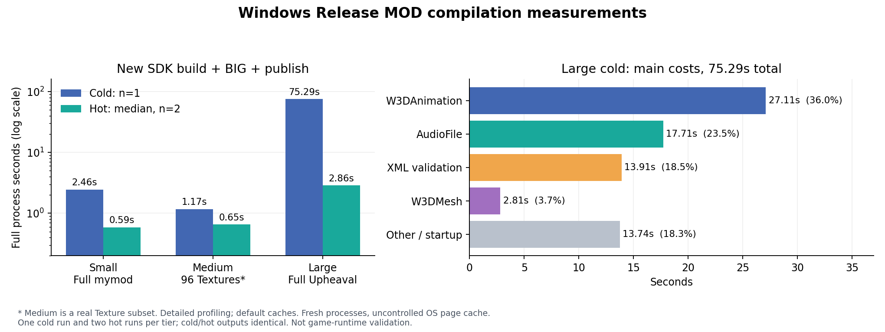

# 新 SDK 编译大、中、小 MOD：实测耗时

三组均完成编译、BIG/SKUDEF 打包和发布，冷/热输出逐文件长度及 SHA256 相同。完整 Upheaval 冷态 **75.29 秒**，热态中位数 **2.86 秒**；冷态主要耗时是动画、音频和 XML 校验，热态主要剩会话缓存加载、引用/复用处理和初始化。

[Windows 运行 40890949858](https://github.com/wu162/NewSdk/actions/runs/40890949858) success，生产与测试来源 `629951986c1776a5fda5ad4a68bbc7b7da3a688d`。本轮只增加测量脚本和工作流，生产逻辑沿用上轮打点版本；Release 生产 EXE 重新构建一次。总测量/校验阶段 **87.63 秒，9 个编译进程**，准备与构建另计。原 ZIP 已下载复算 SHA256 匹配；[来源、逐次指标和档案摘要](../evidence/refactor/mod-scale/40890949858-1/summary.json)、[逐次 CSV](../evidence/refactor/mod-scale/40890949858-1/samples.csv)、[按阶段聚合 CSV](../evidence/refactor/mod-scale/40890949858-1/phases.csv)。

## 输入与测量口径

| 档位 | 输入 | 文件数 | 输入 MiB | 冷态实际编译资产 | 流数 |
| --- | --- | ---: | ---: | ---: | ---: |
| 小 | 完整当前 mymod 副本 | 7 | 0.94 | 47 | 1 |
| 中 | Upheaval 的 96 个真实 Texture 子集 | 114 | 14.32 | 96 | 1 |
| 大 | 完整历史 Upheaval | 2,723 | 286.96 | 3,354 | 5 |

中型没有独立的完整真实 MOD，采用明确标注的纹理子集。113 个候选纹理声明按资产 ID 去重为 96 个，保留原属性和所需原 ART 文件，只生成 include 入口和分组 XML。全部输入 DDS 纹理关闭 mipmap 生成和自动尺寸调整。因此此表同时改变了规模和资产组合，不能视为同一类资产的纯规模伸缩实验。完整 Upheaval 未裁剪，固定来源 `bacfc69fc3e71c8116d1f22b933b8b6173170ecf`、树 `5551fc26a6f96b62613443e0d0fa2958c14cbce0`。实际编译数包含必要的被包含依赖；磁盘上的声明数不等于本次编译数。

Windows 2022 / Release Win32；默认 sc/bc/csc/psc=true、fsc/atc=false；`--performance detailed`；自动发现所有内容，完整 Upheaval 是 base、三个 APT、一个 MapMetaData，共五流。每次都正常生成 BIG/SKUDEF、处理 Additional，再执行发布。每档冷态一次、热态两次，热态中位数；每个样本均为新进程。冷态只清编译器/输出缓存，未控制操作系统页缓存；第二轮倒序、第三轮正序。单进程 180 秒、测量总预算 900 秒。

## 总耗时

| 档位 | 冷态进程秒，n=1 | 热态进程秒，中位数 n=2 | 两次热态范围秒 | 最终发布 MiB |
| --- | ---: | ---: | ---: | ---: |
| 小 | 2.459 | 0.587 | 0.584–0.590 | 1.01 |
| 中 | 1.166 | 0.653 | 0.651–0.655 | 14.32 |
| 大 | 75.286 | 2.864 | 2.794–2.934 | 75.10 |

小型是本 VM 第一笔测量，冷态 CPU 仅 1.03 秒、墙钟 2.46 秒；其启动/等待和初始化成本明显高于后续进程。中型以已有 DDS 纹理为主，不能据此得出“中型天然比小型更快”。这些是单 VM、小样本、不同负载下的描述性数据；并非新旧 SDK 速度对比，也不是严控 OS 冷启动实验。

大型冷态 CPU 74.91 秒，接近墙钟 75.29 秒，整体 CPU 工作占主导。峰值工作集冷态 215.1 MiB，热态约 84.7 MiB。

## 大型冷态热点

| 范围 | 次数 | 秒 | 占进程墙钟 |
| --- | ---: | ---: | ---: |
| W3DAnimation 编译器 | 194 | 27.112 | 36.0% |
| AudioFile 编译器 | 1,289 | 17.707 | 23.5% |
| XML 校验 | 925 个文档校验调用 | 13.910 | 18.5% |
| W3DMesh 编译器 | 134 | 2.814 | 3.7% |
| Schema 全部初始化 | 1 | 0.288 | 0.4% |
| BIG/LoD/Additional/包哈希整个打包阶段 | 1 | 0.326 | 0.4% |

前三项合计约 **78%**。`core.asset.compile` 总计 48.96 秒、`core.process` 总计 72.55 秒，均包含表中子项，不能再相加。动画每次平均约 140 ms，音频约 13.7 ms。此轮只定位到编译器边界，未细分其内部算法；后续若优化冷编译，应优先深入动画、音频，然后看 XML 校验及覆盖/表达式处理。单纯优化打包对这次 75 秒冷编译的收益上限很小。

## 热态剩余成本

三组热态均 **XML 解析 0、资产编译 0**。完整 Upheaval 每次复用 925 个文档、五个会话/链接流，最终发布判断为 unchanged；BIG 仍照常重建。

| 热态中位数范围，ms | 小 | 中 | 大 |
| --- | ---: | ---: | ---: |
| 后端初始化 | 46.1 | 46.4 | 46.4 |
| Schema 读取解析/编译/依赖整理合计 | 223.5 | 229.7 | 239.0 |
| 会话缓存加载 | 15.3 | 16.3 | 773.5 |
| Core 文档/资产复用及引用处理 | 64.6 | 89.5 | 1,100.2 |
| 正常打包 | 26.9 | 51.1 | 332.9 |
| 发布 | 12.9 | 24.5 | 27.1 |

小、中型的固定 Schema 初始化约占完整进程的 35–38%；新进程仍要重新读取编译 Schema，请求内共享并不能消除进程间初始化。

大型的会话缓存加载约占墙钟 27%。五流分别加载缓存，每流约 0.13–0.18 秒；当前 `CoreStreamCompiler` 为每流创建 `SessionCache` 并调用 `LoadCacheFrom`，可进一步研究一个请求内减少同份缓存的重复反序列化。Core 热态还有引用准备约 0.304 秒、资产提交/复用约 0.331 秒；它们包含在上表的 1.100 秒内。

大型热态完整文件哈希计数仍为 1,280–1,293 次、约 107–115 MiB，但 `core.filehash.read` 源文件范围为零。SHA256 计时约 0.233 秒，其中 base 流复用处理约 0.127 秒、新生成包约 0.106 秒。这个计数包含复用输出和新包，不能解释成重新读取/编译了源资产。可研究合并新包写出与 SHA 计算、降低复用输出的重复身份/哈希成本；继续保留每次正常打包的既定行为。

## 结果边界与复现

所有样本退出码 0，错误计数 0；小型每次 82 条警告、大型每次 1,859 条警告，包含缺少 staging 内预编译基础 manifest、未知外部资产引用等既有默认环境告警。告警未隐藏，原始报告和事件全部保留。这是当前默认配置下的完整输入编译/打包计量，不是游戏内验证，也未在本轮和原 SDK 比较完整 Upheaval 字节。后续若补齐基础 manifest，应单列为新的测量条件。

打点报告在最终报告写出前截取；进程墙钟包含启动、报告/日志输出和最终清理。递归文档以及父子 `totalMs` 会重叠，归因时应查看自身耗时或互不重叠的范围。

工作流 `.github/workflows/compiler-mod-scale.yml` 会重新构建当前 Release，再调用 `MeasureCompilerModScale.py`。本次完整原始输入清单、报告/事件、每次请求、构建记录和运行时二进制均在 [artifact 12904872673](https://github.com/wu162/NewSdk/actions/runs/40890949858/artifacts/12904872673)；原 ZIP SHA256 为 `ef49835649e3a6dfc220b2f73db9325e07139106093485903f4279cb4d3c4663`，本地复算一致。
