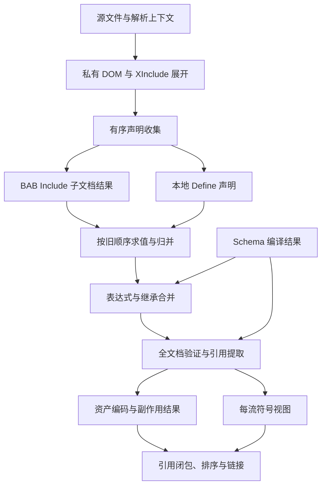

# NewSdk 新编译器目录、XML 增量与性能优化最终方案

> **版本：Final v3 · 2026-10-27**  
> **编译器基线：** compiler-main，提交 `e7396d3b6fb302682d3610ebbc6e99ce87eb867f`。  
> **真实 MOD 样本：** main 分支的 Upheaval，提交 `bacfc69fc3e71c8116d1f22b933b8b6173170ecf`；另核对当前分支 mymod、SDK XML 和 XSD。  
> **用途：** 后续实施与验收的完整设计基线，整合并修订此前 v2 方案。本文中的新接口、缓存格式与参数均为设计提案。  
> **证据边界：** 本轮进行了源码审查、真实 XML 静态统计与官方资料核对；未运行 Win32 编译器、未触发 Actions、未获得新的性能基准。源码可推导的风险明确标为“待验证”，不冒充已复现故障。

## 阅读导航

| 关心的问题 | 对应章节 |
|---|---|
| 最终应采用什么架构，和 v2 有何变化 | 第 1 章 |
| MOD XML 到底是什么格式、如何编译 | 第 2—4 章 |
| 依赖分析怎样真正减少重编译 | 第 5—7 章 |
| 全新缓存、指纹与正确失效 | 第 8—9 章 |
| XML 具体热点、多线程和阶段交叉 | 第 10—12 章 |
| Git、电脑环境、目录与其他优化 | 第 13—15 章 |
| 接口、实施顺序、验收和优先任务 | 第 16—19 章 |
| 固定源码、规范及研究依据 | 文末参考资料 |

## 1. 最终决定与对原方案的修订

### 1.1 推荐路线

采用 **“按实际读取追踪的有类型依赖图 + 分阶段不可变结果 + 资产级增量缓存 + 有界并行调度”**。

首要目标是减少无效工作，其次才是把剩余工作分给更多线程。现有 Core 已有文件摘要、已使用 Define、继承源摘要、引用集合和流提示，不需要先推翻整套 XML 编译器。应保留成熟语义阶段，逐步抽出输入、结果及副作用合同，将文档级的粗粒度失效细化为资产和流实际消费的结果。[C1] [C2] [C3]

推荐的实施顺序为：

1. 固定输出与错误行为基线，补少量高价值探针和阶段计量。
2. 共享输入快照、复用 schema 元数据、增加索引，减少当前串行路径的重复工作。
3. 在旧执行路径旁记录依赖，先证明“会影响什么”，再让新缓存跳过工作。
4. 建立串行新缓存，包含动态依赖、结果指纹和完整副作用恢复。
5. 隔离 Core、流和插件状态；先在关闭缓存时验证真正的并行执行。
6. 开放已审计资产族并行、阶段交叉，最后加入保守硬件自适应。

运行目标保持 **Windows / Win32 / .NET Framework 4.8、现有插件 ABI、当前主进程内编译，以及 EXE 加必要 DLL 的发行方式**。新目录分层不等于拆出大量程序集，也不要求引入 Bazel、Rust、数据库服务、远程缓存或常驻进程。

### 1.2 本轮深入 XML 后的实质修订

| v2 方向 | 最终细化或修正 |
|---|---|
| 新建依赖与缓存机制 | 复用现有依赖采集点，补上定义绑定、符号候选、缺失查询和阶段信息；避免另一套不一致的扫描逻辑。 |
| 从文件级逐渐细化 | 优先解决 `instance` 包含整文件失效：把文件的声明目录、某个继承源和某个资产的文件读取分开。 |
| XML 语义 IR | 先保存忠实的阶段结果和自有元数据，再逐步引入紧凑 IR；不一开始重写 parser、继承或验证器。 |
| 语义指纹 | 区分源字节、前端结果、插件输入、符号合同、诊断和完整产物；不能默认用 C14N 或“去注释 XML”作总键。 |
| Define 依赖 | 记录每次读取时的来源声明及覆盖前环境，不能只有最终 `name → value`。 |
| 共享资产结果 | 资产声明引用可复用；解析到具体目标后的绑定必须属于当前流。 |
| 并行 XML | 可以并行独立文档、独立表达式解析、独立继承分支；Define 安装、Include 归并和全局副作用仍按旧顺序。 |
| 细粒度 XSD 缓存 | 第一版保留完整 schema 合法性和原文档验证范围；先复用编译元数据，避免漏掉默认值和跨节点约束。 |
| 加速传播 | 加入“重算后结果未变就早停”，同时更新本次动态依赖；缓存命中率不再是唯一指标。 |
| 流级缓存 | 使用完整 LinkPlan 和四文件组完成凭据，不能只信旧 OutputChecksum 或一个 .bin 头部。 |

### 1.3 与最新合入代码的关系

本轮复查的 compiler-main 仍为上述 `e7396d3`，已经包含 PR #14 的默认构建流程与 Additional 改动。因此方案应以当前 standard BIG、Additional 归并和自动入口发现为基础，不能把已实现能力再次列为待开发新功能。当前 profiles 不会自动打开旧 `/bc`、`/sc`；新缓存策略需要明确迁移。[A1] [A2]

既有验证记录可用于确认已覆盖的正确性范围，不能当成本方案的性能数据。旧续接说明中的历史状态与实际分支不一致时，以固定提交和真实合入状态为准。

## 2. 真实 MOD 与 schema 的证据范围

### 2.1 样本来自哪里

Upheaval 不在当前 compiler-main 的 `SDK/Mods` 中，本轮采用 main 的固定提交作为较完整真实语料。两个提交的 `SDK/Schemas` 与 `SDK/SageXml` tree SHA 相同，因此基础 schema 和 SDK XML 可以直接引用当前编译器提交：

- `SDK/Schemas`：`62e1c5684ee0ea4407430f0a343a37431be6c03c`。
- `SDK/SageXml`：`67938f04fdbf8084572dc5c4d501aa494fda4c1d`。

统计范围是 Upheaval 的 **Data 目录下全部物理 .xml 文件**，尚未展开 SDK 依赖、XInclude、继承或表达式；不包括 Art 中的 .w3x、音频、纹理及 APT 二进制。下载的该目录 XML 已逐文件核对 Git blob SHA。统计可从固定 [Upheaval Data tree][M1] 和源文件复核。

### 2.2 静态统计

| 指标 | main 原始 mymod | compiler-main mymod，含恢复探针 | main Upheaval Data |
|---|---:|---:|---:|
| 物理 XML 文件 | 3 | 5 | 384 |
| 原始字节 | 17,917 | 69,032 | 2,277,466 |
| 元素节点，排除注释和 PI | 152 | 704 | 26,248 |
| 属性，不含 namespace 声明 | 277 | 1,220 | 53,234 |
| 顶层资产声明 | 4 | 45 | 2,837 |
| BAB Include | 7 | 9 | 981 |
| all / instance / reference | 3 / 1 / 3 | 5 / 1 / 3 | 888 / 90 / 3 |
| inheritFrom | 1 | 3 | 513 |
| xai:joinAction | 1 | 1 | 93 |
| 以 = 开头的属性表达式 | 3 | 3 | 43 |
| 本目录物理 XML 中的 Define | 0 | 0 | 0 |

统计对应固定的 [main mymod][M11]、[compiler-main mymod][M12] 和 [Upheaval Data][M1]，均按物理文件解析后计数；两套 SDK 基础目录的对应版本可由 [compiler-main SDK tree][M13] 与 [main SDK tree][M14] 复核。

Upheaval 的补充特征：

- 51 处 XInclude，分布在 22 个文件，其中 27 处带 XPointer。
- 513 处继承中，AudioEvent 302、GameObject 88、ExperienceLevelTemplate 64、WeaponTemplate 25。
- 93 处 joinAction 原文为 Replace 71、Remove 21、REMOVE 1；统计保留大小写，不据此推断所有拼写均被当前编译器接受。
- 1,504 个 `File` 属性中，AudioFile 1,289、Texture 115、OnDemandTexture 2、APT 类型 98。
- 202 个文件小于 1 KiB，289 个小于 4 KiB；文件大小中位数为 924.5 字节。

这些数量说明继承、Include、外部资源和小文件调度值得分别优化。**它们不能证明 XML 是总耗时瓶颈，也不能用来推算线程数、编译调用次数或提速倍数。** 离线 XML 语法解析成功同样不代表 XSD 验证或完整 MOD 编译成功。

目录中没有本地 Define 并不意味着没有定义依赖。SDK 的 GlobalDefines 有 72 个 Define，BaseSoundEffect 有 11 个，真实 MOD 会读取这些外部定义。例如 Archer Maiden 的 AudioEvent 使用 `Volume="=$WEAPON_IMPACT + 10"`。[M2] [M3] [M4]

## 3. MOD XML 的实际格式与兼容合同

### 3.1 四层规则共同决定结果

MOD XML 的合同由四层组成：

| 层 | 负责什么 | 对优化的约束 |
|---|---|---|
| XML 与 Namespaces | 元素、属性、编码、实体、字符、命名空间 | 保留实际 System.Xml 解析行为；文件路径与 namespace URI 不能使用同一套归一化。 |
| XInclude | 读取时插入外部 XML 或文本、选择片段、处理来源上下文 | 依赖不止 href；还包括 selector、基址、解析选项和实际分支。 |
| SDK XSD | 资产类型、内容顺序、默认值、类型继承、引用注解、约束 | schema 是编译语义输入，不只是最终合法性检查。 |
| BAB / 插件实现 | Define、表达式、继承覆盖、资源解析、引用改写、哈希和二进制生成 | 标准意义等价不自动等于旧编译产物相同；实现可观察行为需要保持。 |

W3C 规范用于解释结构边界，实际兼容目标仍是当前 .NET Framework / Mvp.Xml / BAB 组合。Microsoft 的 Framework 4.8 XmlReader 文档声明遵循 XML 1.0 第四版；不能把“换成最新规范 parser”混入保持兼容的性能改造。[W1] [W2] [W3] [W4] [N1]

### 3.2 根、身份、节点顺序与字段类型

正常资产文档使用 `uri:ea.com:eala:asset` namespace，根为 `AssetDeclaration`。当前 CnC3Types 根声明依次组织可选 Tags、Includes、Defines，再进入资产 choice。具体资产内容还受 sequence、choice、minOccurs、maxOccurs 等约束。[X1]

顶层资产的 id 必填，InstanceId 格式为 `[0-9a-zA-Z_.-]+`。编辑器注解 `XmlEdit:Default="UnnamedAsset"` 不是 XSD default，不能用它绕过 required。缓存身份至少包含 **声明文档/语义上下文、类型和 id**；只有 id 不够，真实样本中 AudioFile 和 AudioEvent 可以同为 `MSIn_Reaper1`。[X2] [M5] [M6]

重复子节点通常有序，不能全部转成“名称 → 单个值”的字典。Weapon 的 Nuggets 可重复，GameObject 内部还有大量按 id 定位的模块。数值也不全是普通 float：Time、Angle、Percentage 等存在单位和特定词法，枚举列表顺序、编号及现有加减处理不能随意改变。[X3] [X4]

### 3.3 BAB Include 的三种模式

以下描述依据当前 ProcessIncludedDocuments，而非仅凭模式名称推测。[C2]

| 模式 | 当前子文档资产的处理 | 最终用途 |
|---|---|---|
| all | 普通资产加入 AllInstances；候选资产继续进入 Tentative；导入已有 ReferenceInstances | 普通资产参与当前流输出根集合，候选按闭包选择。 |
| instance | 普通及候选资产进入 Tentative；这个分支不导入子文档的 ReferenceInstances | 提供候选、继承来源，不代表全部直接输出。 |
| reference | 普通资产及已有外部引用进入 ReferenceInstances；不导入 Tentative | 提供外部流符号；普通递归路径可生成独立引用流。 |

普通递归路径中，三种模式都会合并子文档 AllDefines。成功从预编译 manifest 加载的 reference 会提前继续下一项，显式 StreamReference 也走不同分支，因此不能假定预编译 manifest 带有与原 XML 相同的 Define 环境。

Include 声明顺序、配置、当前搜索路径和冲突规则都是输入。现有集合并非统一“最后一个覆盖前面”：资产集合存在先加入者保留的行为；导入 Define 冲突与本地 override 也不是一回事。子任务可以准备并行，结果必须按原声明顺序提交。

### 3.4 XInclude 必须单独建模

`xi:include` 使用 `http://www.w3.org/2001/XInclude`，在 DOM 加载阶段展开，之后才进行 BAB 声明收集。它可以嵌在 Behaviors、ModelConditionState 等内部；被包含文件可以是以 RepairUpdate 为根的片段，而非 AssetDeclaration。[C4] [M7]

真实样本会使用 namespace 绑定的 XPointer 选择子节点，例如 Reaper 的粒子片段。[M8] 缓存展开结果需要记录：

- 原文档和请求位置、href、parse、encoding、xpointer 等实际选项。
- namespace 与 base URI 上下文、当前 resolver 规则。
- 实际读取对象、缺失/失败探测、fallback 的实际选择。
- 插入顺序、来源映射和当前实现产生的基址修正结果。

W3C XInclude 规定包含后的相对 URI 仍应保有相应基址语义。[W3] 具体 Mvp.Xml 支持哪些规范特性、下游 BAB 怎样消费来源，须保持现有路径并做差分；本方案不额外宣称完整实现所有 XPointer 或 XInclude 功能。

### 3.5 Define 和表达式是有序求值

当前处理顺序是先递归子文档，再按声明顺序求本地 Define；**右侧先在旧环境中求值，再安装当前定义**。因此 override 右侧可以读到被覆盖项，尚未安装的前向定义不会自动求值。父文档稍后建立的本地 Define，也不会提前传给已经处理的子文档。[C5] [C6]

示意：下面是两个文档中 Defines 的内容片段，说明覆盖前读取，不是要求作者修改语法。

```xml
<!-- 被包含文档的 Defines 内容 -->
<Define name="A" value="10" />

<!-- 父文档的 Defines 内容 -->
<Define name="A" value="=$A + 1" override="true" />
```

第二条右侧读取的是之前可见的 A，随后才安装新 A。不能把全部 Define 按名称建一个最终字典，再统一拓扑求值，否则会改变语言行为。

表达式解析 AST 可以缓存，但求值要携带作用域和读取记录。现有 parser 的 and/or 会求两侧；部分整数除法会转为浮点；数值解析及输出还有文化环境语义。直接改用 C#、JavaScript 表达式引擎或增加短路求值，都超出纯性能优化范围。[C6] [C7]

本次所审查 Core / ExpressionEval 未发现专用 `super` 或 `$super` 机制，文档不引入未经实现支持的新关键字。

### 3.6 继承覆盖是依赖 schema 的有序合并

`inheritFrom` 可以写类型前缀，未写时按当前资产类型解释。当前合法跨文档继承还受直接 instance 来源限制，不能因为传递符号集合中找得到，就放宽 all/reference 或传递包含的继承许可。[C8] [C9]

NodeJoiner 使用节点名称、id、schema 内容模型和基类信息决定匹配、插入与覆盖，涉及 Append、Replace/Overwrite、Remove 和 Top/Bottom 等现有规则。重复项可能需要保留首次匹配语义；移除不存在的子项可能报错；一些枚举加减仍是字符串操作。这些行为不能被一个无序字典或集合替代。[C10]

**XSD 顺序不代表原始作者文本已经按该顺序写好。** Reaper AudioEvent 原文是 Delay、NonInterruptibleTime、PitchShift、Sound；schema 要求 PitchShift 在 Delay 之前。它经过当前表达式、继承合并等前序处理后再验证。不能把验证无条件搬到 raw XML 阶段，也不能任意对所有子节点排序。[M6] [X5]

### 3.7 引用、文件路径与普通字符串要分清

当前引用提取依赖 `SchemaInfo`、类型派生关系与 `xas:refType` 等 BAB 注解。[C11]

| 类型或字段 | 含义 | 应建立的依赖 |
|---|---|---|
| AssetReference 及派生类型 | 强资产引用 | 有序声明引用、目标类型和当前流中的解析结果。 |
| WeakReference / 相应 POID | 弱引用或标识语义 | 保留缺失容忍、候选选择、登记及闭包规则。 |
| FileReference | 外部文件资源 | 路径解析查询及实际消费内容。 |
| DataBlob | 基于 FileReference 的外部数据 | 完整文件依赖和插件实际读取。 |
| MapMetaData.FileName | schema 中为 xs:string 的描述字段 | 按真实消费者处理，不能机械要求该运行期路径在构建机上存在。 |

Texture、AudioFile 的 File 是 FileReference，APT 的 File 是 DataBlob；字段名包含 File 并不能证明它是编译文件依赖。[X2] [X6] [X7] [X8]

APT 的 AptID 不一定等于 .ru 文件名中的数字；AdditionalMaps 的 MapMetaData_Global.xml 也可能只是继续包含 AI、HealthBar 等全局覆盖的入口。自动发现及依赖分析应沿用实际格式和 Planner 规则，不从文件名猜测资产内容。[M9] [M10]

## 4. 当前 XML 编译流程的准确拆分

### 4.1 冷加载主路径

下表描述实际数据阶段；缓存恢复会从相应状态进入并补查依赖，不代表每次都重走所有步骤。[C1] [C4] [C11] [C12]

| 次序 | 当前动作 | 产生或修改的状态 |
|---|---|---|
| 1 | OpenDocument / SessionCache 恢复与粗检查 | 文档状态、源与依赖文件摘要、配置、平台。 |
| 2 | XmlReader → XIncludingReader → XmlDocument.Load | 展开的私有 DOM、现有行号元数据与 resolver 路径映射；尚非完整来源映射或动态依赖轨迹。 |
| 3 | GatherTags / Defines / Includes / Instances | 有序声明、资产 handle、继承标记；部分属性已被提取或移除。 |
| 4 | ProcessIncludedDocuments，随后 EvaluateDefinitions | All/Tentative/Reference 视图、最终定义环境。 |
| 5 | 缓存继承与 Define 细查；必要时重载 | 判断旧语义结果是否仍成立。 |
| 6 | ProcessExpressions → ProcessOverrides | 表达式替换、继承合并、预验证摘要。 |
| 7 | 整文档 Validate → ValidateInstances | 默认值、SchemaInfo、类型检查、legacy InstanceHash、引用/文件提取与改写、TypeId。 |
| 8 | 字符串登记、MergeInstances、ProcessInstances / Verify / Commit | 资产各二进制分段、CDATA、登记与编译诊断。 |
| 9 | 根流 PrepareOutputInstances、引用解析、闭包、稳定排序 | 每流最终输出集合与布局。 |
| 10 | CommitManifest / CleanOutput / UpdateOutputAssets / LinkStream | manifest、bin、imp、relo 及相关 CDATA。 |
| 11 | 文档完成、缓存记录；外层后处理、包装与发布 | 最终结果与事务状态。 |

一个重要限制是：**通常先执行资产编译，后进行根流最终引用闭包。** 所以纯资产引用不必然要求先完成目标的二进制；反过来，也不能先按最终可达性删除所有未输出资产的编译工作，因为旧路径可能原本会发现其错误、产生登记或侧文件。[C1] [C12]

### 4.2 可提取阶段，而非立即替换所有实现



图中的“结果”是建议提取的边界。初期仍可由原方法执行，由包装层收集输入与输出；只有合同充分清晰的阶段才变为可共享的不可变值。

### 4.3 验证必须产生完整结果

`XmlDocument.Validate` 会补 schema 默认值并关联类型信息，当前 ValidateInstances 又消费 SchemaInfo 来识别引用、改写 FileReference 和添加 TypeId。因此“保存验证通过=true，下次跳过”并不完整。[N2] [C11]

第一版保留：

- 当前 schema 根及实际支持的组合闭包的整体合法性；不能从 XSD 标准功能反推现有加载器已完整支持 import/redefine。[C20]
- 原全文档验证范围，包括其中有作用域的唯一性与引用约束。
- 默认值、实际类型、BAB 注解和后续需要的验证增补结果。
- 验证错误与来源；失败的部分验证 DOM 不作为成功结果发布。

`Validate(handler, 子节点)` 并不等价于验证文档根，Microsoft 文档明确子节点验证的唯一性/引用约束范围不同。[N2] 后续如需按类型或约束作用域拆分，先证明相关约束、substitution group、wildcard、key/keyref、默认值等闭包，再开放；不能以某资产编码缓存命中替代整套 schema 合法性。

## 5. 现有增量已有能力，缺口在哪里

### 5.1 已有机制与新方案落点

| 现有机制 | 已有价值 | 需要改进的地方 |
|---|---|---|
| FileHashItem | 已有内容 SHA256 复核，保留 legacy FastHash | 脏检查与后续 Hash 更新可能重复读取；同一物理文件被配置/平台项重复处理。 |
| DocumentHash / DependentFileHash | 能快速判断文档及相关文件是否变化 | 主要按文档失效；新强缓存不能直接沿用 32 位旧摘要作完整身份。 |
| DependentFiles | 收集 XInclude、instance 文件、FileReference 等 | 缺少每资产归属；某个文件变化可能先触发整个父文档重载。 |
| IncludePathHash | 能识别已有逻辑包含的解析路径变化 | 需要完整的有序探测、缺失候选和目录成员依赖。 |
| UsedDefines | 已记录实际读取的外部定义值 | 只有文档级 name/value，缺少绑定来源、覆盖前环境与每资产读取点。 |
| InheritFromXmlHash | 已比较具体继承源的预验证内容 | instance 整文件依赖往往更早触发重载；摘要不覆盖所有阶段上下文。 |
| TypeHash / ProcessingHash | 能对类型与处理器变化失效 | 新键还需明确实现、ABI、schema/defaults 与环境合同。 |
| StreamHints | 文件可映射到使用流 | 缺失文件和无 hint 情况会扩大失效，不能承担完整依赖闭包。 |

这些结论来自当前 Reinitialize、SessionCache、FileHashItem 及语义处理代码。[C3] [C13] [C14]

外层 CacheInputSnapshot 还会按流捕获较大的 SDK/MOD/运行目录范围，Core process contract 包含广泛环境输入。它提供保守边界，也增加重复扫描和不相关失效。新路径只有在已证明更精确的输入合同之后，才能逐步缩小这些边界。[A3] [A4]

### 5.2 最明确的增量机会：instance 文件中的无关兄弟资产

当前 GatherUnvalidatedIncludes 将 instance 目标 XML 整文件加入 DependentFiles；恢复时先比较整个依赖文件摘要，再进行较后的继承源细查。[C3] [C26]

假设 Base.xml 同时声明 BaseTank 与 BaseAircraft，Tank.xml 只继承 BaseTank：

- BaseAircraft 变化：当前路径可能先重载 Tank.xml，即使 BaseTank 完全未变。
- 新路径先重读/解析必要的 Base.xml，完成其应有验证，再提取 BaseTank 的准确阶段结果。
- 若 BaseTank 的模板、导出符号关系和相关诊断合同没变，Tank 的继承准备与编码可以复用。
- BaseAircraft 自己的处理及所有旧流程要求的验证仍保留；不能因它与 Tank 无关而吞掉错误。

这就是资产级依赖能减少工作的具体位置。首版不必实现文本编辑范围的增量 XML parser：文件改变可以仍整文件解析，同时避免整文件所有资产与所有引用者都重新编码。

### 5.3 三项必须先用真实 Core 探针确认的风险

| 源码推导的候选问题 | 推导依据 | 最小验证 |
|---|---|---|
| 本地 override 读取外部同名 Define 后，暖恢复可能误判或重复失效 | UsedDefines 存旧读值，恢复后按最终同名定义比较；缓存本地项不保留完整原始求值过程 | A=10，父级 override 为 =$A 或 =$A+1；外部改20，父文件不变，比较冷/暖。 |
| 同一资产在不同流中可能复用不合适的已绑定引用状态 | ValidatedReferencedInstances / AllDependentInstances 放在可共享实例状态中，非空时可提前复用 | 两流符号视图不同，共享声明资产，检查目标绑定和输出闭包。 |
| 单独丢失 .imp 或 .relo 的部分恢复可能不完整 | LinkStream 的相关缓冲在重写 .bin 分支中填充 | 保留有效 .bin，分别删除/截断侧文件，比较完整重建结果。 |

这些是 **静态分析所得、尚未运行复现** 的路径；外层清理、缓存隔离或强制失效可能掩盖它们。应在已有 CompilerCoreLifecycle、CompilerCacheContent、CompilerCacheBoundary 等入口内增加小探针，确认后再单独修复，不把候选问题直接写成当前 CLI 必然出错。[C5] [C12] [C15] [T1]

## 6. 一张有类型的依赖图，提供多种视图

### 6.1 节点粒度

推荐一份依赖事实源，派生缓存失效视图、任务调度视图和“为什么重建”视图。不要分别维护三套容易不同步的图。

起步粒度是 **输入文件 / 查询、schema 集、文档、Define 绑定、资产、流、包装结果**。不需要每个 XML 属性都变成磁盘缓存项。

| 节点/查询 | 关键上下文 | 主要结果 |
|---|---|---|
| ReadSnapshot | 物理身份、当前输入代 | 实际消费的封存字节、内容身份、来源。 |
| ResolveResource | 逻辑请求、来源目录、配置、平台、有序搜索规则 | 胜出路径与完整必要探测轨迹。 |
| EnumerateInputs | 自动入口/Additional/glob 的目录与匹配规则 | 有序成员、类型、存在性及相关冲突。 |
| ParseExpandDocument | 字节、ParserContract、文档 URI、resolver | 忠实解析/展开结果、源映射、动态 XInclude 依赖。 |
| BuildSchema | 根 schema、有效 namespace、组合闭包、实现 | 合法性与不可变类型、派生、引用描述元数据。 |
| GatherDeclarations | 展开文档 | 有序 Includes/Defines/Tags/资产目录及诊断。 |
| EvaluateDefine / Expression | 读取点、实际作用域版本、语言合同 | 绑定后的值、读取轨迹。 |
| PrepareInheritedAsset | 声明、定义读取、准确阶段模板、schema | 继承与表达式处理结果。 |
| ValidateScope | 准备后的文档、schema、验证合同 | 增补类型与默认值、约束结果、诊断。 |
| PrepareAssetInputs | 已验证资产、文件查询、处理器合同 | 可编码输入、声明引用、注册计划、legacy 元数据。 |
| CompileAsset | 精确插件输入、实现/ABI/必要环境 | 完整资产 bundle 和可重放副作用。 |
| BindStream / LinkPlan | 当前符号视图、声明引用、有序输出根 | 当前流绑定、闭包、稳定布局、完整链接输入。 |
| Link / PostProcess / Package | 上游封存结果与各自选项 | 流文件组、后处理结果、BIG/SKUDEF。 |

Parse 与 Expand 可以先在同一查询里实现，以匹配现有 XIncludingReader 管线；拆成两层是后续减少重复加载的机会，不要求先重写 XInclude。

### 6.2 边必须写明“消费了什么”

| 边类别 | 示例 | 传播与调度含义 |
|---|---|---|
| 文件内容 | AudioFile 实际读取某音频 | 内容变化使相应编码输入失效。 |
| 路径解析 | ART 请求先找 MOD，再找 SDK | 高优先级候选新增也使查询失效，不只监测旧赢家。 |
| 目录成员 | auto APT 入口、Additional 递归发现 | 新增/删除/重命名影响计划。 |
| XInclude | 选择外部片段 | 依赖选择结果、上下文和读取分支。 |
| BAB Include | instance / all / reference | 保留集合可见性、定义导入、配置和源顺序。 |
| Define 读取 | Volume 读取某次绑定的 WEAPON_IMPACT | 依赖该绑定及值，不是所有全局 Define。 |
| 继承 | Tank 继承 BaseTank | 依赖实际模板及合并规则，不是 Base.xml 的所有资产 payload。 |
| schema 与验证 | 某字段的默认值/引用类型 | 依赖完整必要 schema 合同及文档合法性。 |
| 符号解析 | 武器引用解析到一个类型/id | 若仅消费身份与类型，不自动依赖目标 payload。 |
| 编码结果 | 经审计插件确实读取另一资产二进制 | 真正的执行前置，目标结果就绪后才能编码。 |
| 链接布局 | imports、relocations、目标集合与顺序 | 影响链接及输出元数据。 |
| 登记/诊断 | STRINGHASH、POID、错误位置 | 是独立可观察结果，不能藏在 payload 相同后面。 |

依赖图可以含引用环。**只有真实计算前置形成任务 DAG**；包含/继承中旧语义不允许的环按原合同报错，合法的符号或弱引用环不能被新的通用拓扑排序误拒绝。必要时对允许的互相依赖组件做分相或保守组件处理，而不是改变语言。

### 6.3 正依赖、负依赖和集合依赖

必须同时记录以下几种查询：

1. **正文件依赖：** 本次读到了哪个文件的哪些完整内容。
2. **负文件依赖：** 某高优先级路径不存在，才落到次优路径；新增后必须重新解析。
3. **目录集合依赖：** 某 glob 或自动入口查询的成员发生变化。
4. **负符号依赖：** 精确类型匹配不存在，才回退到派生候选。
5. **候选集合依赖：** 原来只有一个派生候选，新增第二个可能变成歧义。
6. **缺失弱引用：** 旧时不存在，后来成为 Tentative 目标，可能改变输出闭包。

集合可以用相关名称桶、类型目录或成员查询的版本指纹表示，避免每个引用都依赖整个全局符号表。首版允许较粗的安全目录版本，再根据数据缩小。

### 6.4 资产身份、流上下文与哈希碰撞

内部稳定身份建议包含逻辑文档身份、声明类型和 id；有重复声明或覆盖位置时另带稳定消歧信息和有序声明表。最终生效的资产由流内符号视图选择，不在整个物理 MOD 目录上强加全局唯一性。

内部强身份保留原字符串及 namespace/当前兼容名称信息；旧 32 位 type/instance hash 仍用于既有输出格式。不要以旧 hash 单独充当数据库主键，也不要用线程编号、对象地址、全局自增任务号作跨构建身份。

内部强键不改变旧游戏 ID 与集合冲突合同：保留 TypeName 区分大小写、InstanceName 大小写不敏感的既有哈希规则，以及原来同 ID 声明的报错或先入保留行为。强键更精确不代表这些声明现在可以同时输出。[C24]

## 7. 增量算法：按结果早停，而非一脏全脏

### 7.1 借鉴的机制与适用范围

本方案借鉴三组已有研究，而不引入其运行框架：

| 主源 | 采用的思想 | NewSdk 的具体应用 |
|---|---|---|
| rustc 查询系统 | 稳定查询身份、结果指纹、red-green、动态读取顺序 | 区分“输入变了”和“这个消费者需要的结果变了”。 |
| Bazel Skyframe | 通过查询环境读取依赖、不可变结果、change pruning | 文件、路径查找、目录成员和符号查询统一记录。 |
| Build Systems à la Carte | 重建判定与调度分离、验证轨迹与结果存储分离 | 先证明串行增量正确，再用相同判定器接并行调度。 |

这些来源支持机制选择；下面的节点、指纹、边界与实施顺序是对 NewSdk 的设计推导。[I1] [I2] [I3] [I4]

### 7.2 三种身份分别保存

```text
StableQueryKey
  = QueryKind + StableLogicalIdentity + SemanticContextIdentity
    + ImplementationContractVersion

InputFingerprint
  = Hash(EffectiveParameters,
         OrderedDirectDependenciesWithConsumedProjections)

ResultFingerprint[Projection]
  = Hash(VersionedStableSerialization(Result.Projection))
```

- StableQueryKey 用来找到“上次是否问过同一个问题”，不把所有输入内容变化都变成全新的查询身份。
- InputFingerprint 反映这次真正消费的直接依赖；不把全部传递叶子文件压成一个大键，丢掉中间结果早停的机会。
- ResultFingerprint 用来比较重算后的输出。可以只保存便宜指纹，未必保存该节点的完整值。
- 序列化要区分类型、长度、缺失、空值和列表顺序，使用稳定的强摘要，如 SHA256；不使用 .GetHashCode() 或无分隔字符串拼接。

初期实现身份可以保守覆盖实际 EXE、桥接 DLL、原生依赖与相关 schema 实现。后续只有在组件边界可靠后，才缩小到组件身份，避免每次无关改动使所有资产缓存失效。

### 7.3 验证旧轨迹与重新记录新轨迹

概念流程如下，非现有 API：

```text
Evaluate(query):
    固定本次直接参数、语义上下文和实现合同
    仅对上述条件一致的调用复用本次结果或加入 singleflight
    找到该 StableQueryKey 的可信旧记录

    若旧记录存在、能力允许复用，且直接参数/上下文/实现合同一致:
        按旧执行顺序验证直接依赖及所消费投影
        若遇到首个变化、过期合同或无法证明:
            停止沿旧控制路径继续检查，转到重新执行
        若全部成立且完整结果可恢复:
            将节点、已验证依赖边、结果清单和 CAS 引用带入本次 generation
            恢复结果，向本次事务登记副作用与来源信息
            返回

    在 QueryContext 内重新执行原语义
    记录本次读取顺序、依赖边、结果各投影和诊断
    用本次轨迹替换旧轨迹，即使结果指纹恰好相同
    将成功结果加入本次 pending generation
    只向消费了变化投影的下游继续传播
```

动态轨迹必须按读取顺序验证。假设一个源声明从包含 A 改为包含 B，就应先发现声明变化并重新执行该查询，不能仍沿旧图强制读取已删除且不再需要的 A，提前抛出不应存在的错误。rustc 的官方说明专门强调这种顺序要求。[I1]

早停不等于跳过必要验证。构建结果节点要显式依赖当前要求的 schema、文档验证、编译诊断和不可缓存动作；某个 payload 可复用，不代表这些成功条件也自动满足。

查询有效性检查与请求实际值可以分开：只需验证依赖未变时，可使用已验证指纹而不反序列化完整值；真的需要值而值未持久化时再计算。命中节点也必须保留本次图边及 blob 引用，避免连续暖构建丢失依赖或被 GC 误回收。

### 7.4 Define 绑定记录

建议保存：

```text
DefineRead {
    ReadSiteId,
    RequestedName,
    ScopeIdentity,
    ScopeEpochOrDeclarationOrder,
    BoundDeclarationId,
    BoundSourceDocument,
    ValueFingerprint,
    LookupEvidence
}
```

本地覆盖前后同名 Define 是不同的有效绑定。记录发生在 LookupDefine 读取时，而不是处理完文档后反推。

实现可用持久化作用域链或带版本的不可变映射：每次安装定义形成下一环境版本；表达式读取绑定到对应版本。不要为每个资产复制整个大字典，也不要把整个环境的内容 hash 填入每个资产编码键，造成无关定义变更全部失效。

Define 绑定来源改变但数值未变时，必须更新查找证据和诊断来源；若某消费者已证明只消费值，其编码投影可以保持不变。查找、重复定义、override 合法性仍要按旧规则判断。

### 7.5 继承模板必须标明阶段

建议把缓存模板区分为至少两类实际阶段：

- 同文档递归继承时使用的前验证展开内容。
- 跨文档继承时实际可见、已经经过相应验证及改写的来源内容。

当前跨文档来源可能含 schema 默认值、绝对 FileReference、引用编号或 TypeId 等处理结果；同文档来源所处阶段不同。`PrevalidationXmlHash` 不能独自表示二者全部状态。[C9] [C11]

模板应包含源上下文、阶段标记、必要类型信息及默认值。可先由旧代码私有恢复 DOM，再逐步改为专用不可变结构；仅将 OuterXml 写盘再读回来，可能丢失 SchemaInfo 等下游需要的结果。

继承图与引用图分开看待。对继承使用独立 visiting/complete 状态检查循环，保持既有合法来源与错误合同；不要拿“摘要是否为零”代替完整的访问状态，也不因此新增对合法资产引用环的限制。

### 7.6 资产声明结果和每流绑定结果分离

```text
AssetSemanticResult
    经过指定阶段的资产内容和类型信息
    DeclaredStrongReferences：保留每次出现及顺序
    DeclaredWeakReferences
    FileReads / DefineReads / InheritanceReads
    LegacyHashMetadata
    RegistrationDelta / Diagnostics / SourceMap

StreamBindingResult
    StreamIdentity + SymbolViewGeneration
    BoundReferenceTable
    MissingAndCandidateQueries
    OutputClosure
    StableOrder + LinkPlan
```

强引用提取可能改写引用文本并分配 imports 序号，因此重复引用不能按目标去重。相同语义资产在两个流中，可以解析到不同的 Self / All / Tentative / External 目标；不能共享修改后的 BoundReferenceTable。[C11] [C12]

解析缓存可按“符号视图 + 请求类型/id + 当前规则”建立索引。精确类型优先，派生回退候选集合要包含唯一性结果。某个原先缺失的弱引用后来绑定到 Tentative，可能需要把新目标加入输出；弱引用不是无关依赖。

### 7.7 六个具体变更应怎样传播

| 变更 | 必须重新检查/执行 | 可以早停的边界 |
|---|---|---|
| Base.xml 中无关 BaseAircraft 改动，Tank 只继承 BaseTank | 文件解析、相关文档合法性、变动资产 | BaseTank 的准确模板和符号合同未变时，Tank 继承与编码复用。 |
| 外部 Define 的写法变了，实际值相同 | 定义求值与来源记录 | 只消费该值的表达式结果可保持；legacy 元数据/诊断另判断。 |
| 武器伤害改变，单位只保存武器 handle | 武器准备与编码、受影响链接 | 已证明只消费身份/类型的单位编码输入不变，可复用。 |
| 新增同名派生资产，旧引用者未改 | 候选查询与流绑定 | 若产生歧义，按旧规则报错；不能沿用旧唯一目标。 |
| MOD/Art 新建文件遮蔽 SDK 中旧赢家 | 路径解析、资源读取、相关资产 | 无关资源不失效；旧赢家 hash 未变也不能命中相关动作。 |
| XML 只改变排版或注释 | 必要解析、诊断/来源与旧哈希相关处理 | 仅在已证明消费者投影不变时复用；不预先承诺所有产物不变。 |

其中“单位编码可复用”以插件消费审计为条件。如果该插件实际读取目标 payload、目标摘要或其他 metadata，就为那项输入建立边，照常重编。

## 8. 指纹与 XML 等价：防止“优化得很快但产物变了”

### 8.1 保留 legacy hash，另建强缓存身份

当前 HashProvider.GetXmlHash 通过 XmlWriter 和节点 WriteTo 获取序列化结果，HashingWriter 继续按既有算法生成摘要。InstanceHash、TypeHash、OutputChecksum 参与现有产物与复用逻辑。[C16]

新缓存使用 SHA256 等强指纹，**不替换旧格式中的哈希值和算法**：

- 文件 legacy FastHash 的原有分块合同继续保持；现有测试包含 1 MiB 分块约束。
- XML legacy hash 的序列化方式、顺序和处理种子保持。
- 新内部身份避免碰撞风险；旧输出仍按兼容算法生成。
- 单遍读文件时可以同时计算新 SHA256 与旧 FastHash，但不能改变旧块边界。[C14] [T1]

### 8.2 不同投影服务不同消费者

| 投影 | 保存的信息 | 主要消费者 |
|---|---|---|
| SourceBytes | 精确原始字节、编码事实、内容身份 | 解析与输入验证。 |
| FrontendStage | 当前阶段实际保留的节点、名称、顺序、值、上下文 | 表达式、继承、legacy hash。 |
| Validation | 类型、默认值、约束结果和 BAB 注解 | 引用提取与插件输入准备。 |
| SymbolContract | 可见类型/id、归属、解析规则及必要元数据 | 流绑定、候选选择。 |
| CompilerInput | 经审计插件真正读取的输入及环境 | 资产编码缓存。 |
| BinaryBundle | 数据/import/relo/CDATA 及所需 metadata | 链接、验证、后处理。 |
| Registration | STRINGHASH、POID 等可重放登记 | 构建汇总与相应输出。 |
| Provenance / Diagnostics | 当前来源位置、错误/警告及顺序信息 | 用户诊断与兼容性。 |

首版可以让多个投影共享一个保守完整指纹；只有消费合同明确、差分通过后，才拆出更窄的投影。字段级依赖不是越细越好，查询、摘要与序列化本身也有成本。

**首版完整资产 bundle 的键必须包含全部相关 legacy metadata、引用序号和上下文。** 当前 BinaryAsset 会把类型/实例摘要写入头部与文件名；即使插件 payload 不变，也不能在 InstanceHash 已变化时直接恢复旧完整 bundle。[C25]

后续若要复用更窄的编码结果，应拆成 PayloadAction 与 MaterializeAssetResult：前者只缓存经审计可独立复用的编码段，后者用当前 LegacyHashMetadata、引用、登记计划和 payload 组装本次资产头、名称、CDATA 身份及链接输入。如果编码器自身读取某项 metadata，该项仍必须进入 PayloadAction 的键。不得把合理的 metadata 变化误报为“同键非确定性”。

### 8.3 为什么不能直接上 C14N

W3C C14N 定义的是一组 XML 表示规范化规则，不覆盖 BAB 的表达式、继承、schema 注解、文件查找、插件和诊断语义；规范也明确存在应用等价及 base URI 等边界。[W6]

当前代码还有更直接的限制：

- GatherUnvalidatedInstances 以 namespace 查询后，仍用 `item.Name` 与 Includes/Tags/Defines 字面名称比较；通用前缀改写不能直接证明兼容。
- ProcessExpressionsInNode 对 node.Value 检查首字符 `=`，没有先限定仅元素文本或属性；因此注释、PI、CDATA 等节点不能未经差分就统一剔除。
- legacy InstanceHash 来自实际序列化，属性顺序、节点表示等变化可能影响 metadata，即使插件 payload 看起来相同。
- NodeJoiner 依赖有序匹配和 schema 序列，不能排序所有 child。[C4] [C16] [C17]

因此以下操作均不作为第一版默认优化：全局 Trim、删除所有注释/空白、统一前缀、统一数值词法、排序属性/子节点、将 XML 全转 JSON。C14N 若用于特定内部表示，必须限定消费者和上下文，不能充当全局语义键。

XML 的 CDATA 节与 BAB 输出中的二进制 CDATA 文件也应分别命名和处理，避免混淆。

### 8.4 诊断与成功条件不能被早停吞掉

文件排版变化可能只改变行号。此时允许复用经证明不受影响的编码结果，但应恢复当前源映射，不复用旧行号。

错误也不能只看最终输出可达性。即使某候选资产最终不进流，当前流程原本会验证、编译或登记它的行为，仍属于兼容范围。首版保留“必须检查的文档/资产集合”作为构建根依赖；不做默认 tree shaking。

缓存只持久发布完整成功结果。失败诊断可在同次构建内去重，但不跨构建直接复用旧失败而省略新输入检查。

## 9. 全新缓存：追踪、结果索引和 CAS 分离

### 9.1 分层设计

| 层 | 首版建议 | 失效边界 |
|---|---|---|
| 输入快照与查询 | 同构建共享物理内容摘要、解析查询和目录查询；有上限 | 实际内容、相关候选/成员和解析规则。 |
| schema | 构建内共享自有不可变元数据；受控 worker 实例 | schema 组合闭包、有效 namespace、实现与设置。 |
| XML/语义 | 文档级恢复与资产阶段结果逐步持久化 | parser 合同、XInclude、Define 绑定、继承、验证。 |
| 资产 | 成本高、读取完整的动作优先保存 bundle | 精确插件输入、实现/ABI、文件和环境。 |
| 流 | LinkPlan 与四文件组及 CDATA | 有序资产结果、实际绑定、引用流、布局、版本。 |
| 后处理 | HashFix、Resolver、LoD 各自独立动作 | 对应输入流、参考数据、规则与参数。 |
| 包装 | 有序成员计划；依据成本决定是否存整个 BIG | 成员名/字节/顺序、覆盖关系和消费的选项。 |
| 发布 | 每次执行当前事务与路径保护 | 当前目标及所有权，不能由缓存命中省略。 |

Action/Query Cache 保存键、依赖轨迹和结果清单；CAS 按内容保存不可变 blob。引用这套成熟分离模型即可，不要求远程缓存服务。[I5]

### 9.2 动态依赖的缓存查找

不能在不知道输入时先拼一个“所有输入的最终键”。建议两阶段查找：

1. 按稳定查询身份查少量历史候选记录。
2. 在本次快照上按顺序验证其依赖轨迹，包括缺失、目录和符号查询。
3. 得到实际直接输入指纹，验证完整结果清单。
4. 不成立则执行，并记录新轨迹；即使新输出相同，也写入新的依赖事实。

候选数量设置上限，缓存索引失效或损坏只导致 miss，不让复杂索引恢复成本超过重算。小表达式的 AST 可只放内存；不把每次名称查找都序列化成独立小文件。

### 9.3 完整命中合同

这里的完整 bundle 采用第 8.2 节的保守完整键；只有明确拆分 PayloadAction 后，才允许更窄的插件输入键复用编码段。两种键不能混用。

资产结果至少包括：

- 数据、imports、relocations 各段，长度、对齐及相关类型/实例 metadata。
- CDATA 对象、逻辑名称和完整内容身份。
- 声明引用的出现顺序，以及后续流绑定所需信息。
- STRINGHASH/POID 等登记增量、验证结果、必要诊断和来源。
- 插件实现/ABI、处理规则与已记录输入能力。

现有恢复路径本就会重放字符串登记，说明仅存 .asset 并不足以恢复全部语义。[C18]

缓存命中和真实执行返回同一结果合同。副作用在同一语义位置只合并一次；重放当前构建事件时使用新的 buildId、streamId、sequence 和时间，不复制旧 JSONL 行或旧成功终态。

### 9.4 完整 LinkPlan 与原子文件组

新 LinkPlan 键应覆盖：

- 输出资产的稳定有序列表和全部所消费 metadata。
- 每次引用的实际绑定 TypeId/InstanceId、出现位置。
- 三段数据及 CDATA 身份、长度、偏移与对齐规则。
- 来源逻辑名称、引用 manifest 集合及其身份。
- BasePatchStream 布局、排序规则、链接实现和有效版本选项。

旧 OutputChecksum 的字段集少于 CommitManifest 实际写入的信息，不能直接升级为新缓存的完整强键。[C15] [C19]

流恢复必须验证 manifest/bin/imp/relo 和相关 CDATA 的完整清单。任一缺失、截断或摘要不符，按 miss 或受控恢复处理；不能只检查 .bin 头部就宣告整流完成。

### 9.5 不透明插件的能力分级

允许持久命中的共同前提是：实现/ABI 与有效环境身份明确、结果合同完整、确定性及副作用重放经过验证。可缓存性和线程安全分别审计，不能互相推导。

| 能力 | 允许的行为 |
|---|---|
| 读取与副作用完整可追踪 | 允许持久动作缓存和依赖早停。 |
| 精确读取未知，但完整保守边界已知 | 依赖整个边界内容，可接受较粗失效。 |
| 输入闭包未知 | 本次必须执行；上层流/BIG 命中不能绕过。 |
| 输入未知，但本次完整输出与副作用可观察 | 执行后可比较结果，使下游纯动作早停；不缓存跳过该未知动作本身。 |
| 输出副作用也不完整 | 受影响范围保持兼容执行，先补合同。 |

当前 Texture、OnDemandTexture、TerrainTextureAtlas 的 build cache，以及混合 Texture 的 session cache，有明确限制，原因涉及尚未证明完整的 D3DX 等读取闭包。全新缓存也必须逐类型开放，不能通过流级或 BIG 级命中间接绕过。[A4] [A5]

### 9.6 输入一致性

IInputSnapshot 第一次读取时封存实际字节并计算摘要；解析、编码和键消费同一内容。小文件使用有限内存，大文件使用私有磁盘快照或 CAS。只接受路径的 native API 应使用经审计的受控物化路径，并保持逻辑路径、相对依赖和诊断映射；无法证明读取封闭的路径仍按上节保守执行。

同构建内，读取、SHA256、legacy FastHash、复制尽量合为一次流式过程。发布前只复核实际依赖闭包和相关查询，不再对每个流重复扫整个 SDK。当前启用相关缓存的路径已有输入变化拒绝发布的保护；新引擎应在 cache off 等模式中也统一封存与复核。发生影响当前结果的输入变化时，按明确合同拒绝发布或受控重做；无法证明不可变的文件不能只凭 mtime/size 免去内容复核。

这并不承诺热构建零读盘。强内容验证仍可能读取当前依赖；优化目标是去除重复扫描、无关读取、重复 hash 和无效编译。输入快照也不是整个 SDK 在同一时刻的系统级原子快照；不要求 VSS、管理员权限或长时间锁住用户整个目录。

### 9.7 成功发布与缓存事务

沿用当前“整次构建及必需报告/事件通道成功后，才开放新缓存”的合同。[A6]

1. blob 写入私有临时文件，校验后原子安装为不可变对象。
2. 新结果进入本次 pending generation，其他构建不能作为成功命中。
3. 提前准备索引、输出代和可回滚事务；协调发布、报告、事件及 sink 关闭。
4. 全部必需步骤成功后，激活已准备的 generation。
5. 成功终态之前发生失败或取消，撤销 pending 引用并按原合同回滚发布；旧成功缓存不受影响。
6. 最后的缓存激活失败保持 miss，不能在成功终态后再增加需要撤回成功的新安装步骤。

同键工作使用 singleflight；跨进程仅对必要索引提交加短锁。GC 从完整结果清单追踪 blob，活动读取、快照和 pending writer 使用 lease/pin；不用“文件太老”作为唯一删除依据。损坏按 miss 隔离；同一完整键产生不同结果要记录非确定性证据并禁用该键，不能覆盖旧结果掩盖问题。

首版采用简单、可恢复的文件布局和未压缩 CAS。是否增加压缩、专用索引存储或大 BIG 缓存，由实际读写成本和复用收益决定。

## 10. XML 热路径的具体优化

以下按实施收益的可验证性排序。优先级表示建议顺序，不表示已经测得耗时占比。

### 10.1 P0：共享物理输入与 schema 元数据

**物理输入摘要共享。** 为同次构建建立 PhysicalInputSnapshot，配置/平台不同的 FileHashItem 复用同一封存内容及摘要，语义上下文另存。减少 IsDirty 与 Hash 更新重复读、同一资源被多个文档重复 hash。保留 legacy 有序依赖列表的哈希合同；读取可以去重，不代表原摘要输入列表也可任意去重。[C13] [C14]

**SchemaSnapshot 按内容代复用。** 当前每流加载 schema 并构造类型、继承和依赖元数据；已有 ReloadIfChanged 内容复核不应被删除。[C20] 首先共享本次相同输入闭包产生的自有只读描述表。schema 改动建立新代，不能在 worker 使用期间原地 Reload。

底层 XmlSchemaSet 不以 IsCompiled=true 作为“对象没有变化”或“可任意并发共享”的证明。未经完整调用链审计时使用每 worker 的受控实例，并让它在同一代的多个文档间复用；避免每文档重新 Compile。持久层存 XSD 与自有稳定元数据，不直接序列化 Framework 运行时对象。[N3]

### 10.2 P1：表达式 AST 与 schema 描述索引

**精确文本 AST 缓存。** 缓存键包含表达式精确文本和 grammar/实现版本；结果为不可变 AST。每次求值仍使用当前环境、数值/文化合同，生成本次 DefineRead。AST 不保存上次求值结果或可变解析器状态。

**引用类型描述表。** 预计算某个 schema 元素/属性声明的实际类型、强弱/FileReference 分类、refType 查找和 hashable 行为，减少每节点反复沿基类查找。键要能区分声明上下文；同一类型在不同元素/属性上可能有不同 refType 注解，不能只按类型名缓存。[C11]

**schema 合并描述表。** 为 NodeJoiner 预计算粒子顺序、允许子节点、maxOccurs、choice/sequence 和基类关系。不能删除 xas 注解或把所有 annotation/appinfo 当作编辑器无关信息。

### 10.3 P1：有序索引替代重复扫描

可做三类索引：

1. NodeJoiner 子节点按当前匹配规则建立有序索引，保留重复项、首次匹配和位置；每次插入/删除同步更新。
2. ResolveReference 为当前 SymbolView 建立精确和派生候选索引，记录候选集合变化及缺失结果。
3. BasePatchStream 匹配建立 `(TypeId, InstanceId) → 输出项` 索引，按原 base manifest 顺序消费，替代逐 base 项扫描全部输出项。

第三项对应 StableSort_InitializeFromBaseManifest 中明确的双重查找机会；实现时保留旧重复处理、位置复用和复制条件。[C19] 不将旧稳定排序整体替换为通用 Kahn 算法，避免改变 tie-break、patch 布局和最终字节。

### 10.4 P2：减少继承模板和 DOM 的存活范围

当前文档 Reset 清空 XmlDocument 字段，但可继承实例仍可能保留 XmlNode；其 OwnerDocument 可能继续保留整份 DOM。这是源码可推导的内存保留路径，尚未用堆快照测得具体大小。[C21]

建议：

- 将可复用模板从大文档所有权中拆开，保持必要的阶段、类型与来源信息。
- 对只读结果使用结构共享，只有被改写部分私有复制；成熟前仍可私有重建。
- 完成语义冻结后释放不再需要的 reader、原始大 DOM、临时字符串和遍历栈。
- 结果缓存以字节预算限制，不按“缓存了多少文档”单一计数。
- 大资产结果落盘，只在调度队列中保存描述符。

不要把“用 ImportNode 拷贝后一定保留所有 SchemaInfo”作为未经验证的假设。Win32 下减少峰值有助于给有限并行留空间，但收益仍须 Private Bytes 和堆采样验证。

### 10.5 小文件合批，按成本调度

XML 任务按估计节点数、文件大小、历史耗时和资源类别合批；不能只用字节大小决定，包含展开和继承会放大工作。小而独立的文档在一个 worker 中连续处理，减少排队/上下文开销；遇到实际依赖时仍按图等待，不把一批任务绑定成新的语义单元。

同一文件的独立请求 singleflight；预取已知依赖时只提前读取封存字节，不提前无序安装 Define 或提交错误。预取失败先记录到对应任务，在原本应消费的位置处理，避免改变错误顺序。

### 10.6 暂不优先的 XML 重写

首轮不做全量 SAX/流式重写、文本范围增量解析器、自制 XSD 运行时、通用 XML 规范化器、默认跳过未输出资产或字段级持久缓存。

现有表达式、继承、XPointer 和验证依赖树结构；先减少重复读取、重复准备和过度失效，通常更容易保留语义。后续只有测量显示 DOM 分配或某一验证阶段仍主导关键路径，才单独论证更大改造。

## 11. 多线程编译：先建立状态所有权

### 11.1 当前不能直接 Parallel.ForEach

当前 Core 有执行租约、不可重入和线程约束；HashProvider 的 scope 保存/恢复进程级表，CacheInputBoundary 还有线程局部状态。直接删除保护或简单改成 ThreadStatic/AsyncLocal，并不能使整条调用链安全。[A4] [C22] [C23]

建议显式分层：

| 状态 | 所有者 | 并行前必须完成的工作 |
|---|---|---|
| 有效参数、工具身份、输入根、资源预算 | BuildContext | 配置冻结；共享服务声明并发合同。 |
| 文档栈、当前流、缺失引用、输出闭包 | StreamContext | 不与其他流共享可变 Instance 状态。 |
| resolver、DOM、validator、依赖记录、缓冲 | JobContext | 私有可变对象，输入边界显式传递。 |
| 字符串/POID 登记与诊断 | 局部结果 + 确定性汇总器 | 不直接并发写进程级表。 |
| schema 元数据 | 内容代级只读值 | 不在读者运行期间 Reload。 |
| OutputManager 缓冲与文件 | 单个 writer | 去掉跨流静态可变缓冲，明确关闭与移交。 |
| 插件及原生桥接 | 能力声明指定 | 初始化、处理、释放和 native 静态状态一并审计。 |
| 计量、事件 sequence、终态 | BuildSession 汇总层 | activeStream/activeStage 等不被 worker 互相覆盖。 |

旧公开字段和 ABI 可保留在兼容通道，新代码用显式 context。输入边界必须随 JobContext 传到 worker，防止 ThreadStatic 未建立时检查被静默跳过。

### 11.2 插件线程策略

每个资产族至少声明：

```text
CompilerCapabilities {
    ThreadPolicy: Reentrant | PerWorkerInstance | OwnerThreadSerial,
    InputTracking: Exact | ConservativeBoundary | Unknown,
    ResultContractVersion,
    CacheEligibility,
    MemoryClass,
    RequiredEnvironment
}
```

- 已证明全调用链可重入的插件可并行。
- 只要求实例隔离的插件每 worker 一个实例。
- Texture 和未知 native 路径先放在固定 owner thread 上串行，初始化、处理和 Dispose 保持线程亲和性。
- 未声明能力默认保守；某个 native 函数用了局部 relocation tracker，不足以证明整个插件可重入。

即使插件串行，XML 准备、输入读取、其他可重入资产和封存后的独立后处理仍可利用空隙。

### 11.3 XML 各阶段的并行边界

| 阶段 | 可并行范围 | 保留的汇合点 |
|---|---|---|
| 读取与摘要 | 独立实际输入，有界 I/O | 相同内容统一快照，记录完整依赖。 |
| 文档解析 / XInclude | 独立 reader、resolver、私有 DOM | 有序包含、基址、来源与错误合同。 |
| 子文档准备 | 无真实前置的子文档 | 按父 Include 原顺序归并。 |
| Define 安装 | 独立文档环境可并行 | 同一文档逐声明安装，不能前向求值。 |
| 表达式 | 定义环境已冻结的独立资产/节点组 | 局部结果回写保持原顺序与诊断。 |
| 继承 | 基础模板确定后的独立分支 | 合并规则及源阶段一致。 |
| XSD 验证 | 独立文档或已证明独立的验证范围 | 首版全文档范围，私有 validator。 |
| 资产编码 | 插件能力允许、真实前置满足 | 完整局部副作用与结果封存。 |
| 流绑定与链接 | 不同流状态隔离后可并行准备 | 单流确定闭包、顺序与 writer。 |

全局只设置一个共享调度预算，不能 XML 开 N 线程、每流再开 N 线程、codec 再乘一层。任务等待依赖时退出就绪队列，不占住所有 worker 同步等待队列里的子任务。

### 11.4 确定性、失败与取消

完成顺序不决定输出顺序。任务携带稳定语义序号，汇总器按原顺序处理冲突、登记和需要确定的诊断。对于旧 fail-fast 行为，要维护可提交前沿，不能先报告较后任务的错误，再悄悄丢失前序本应出现的诊断。

结果队列同时限制任务数和字节数；大 bundle 私有落盘。取消先停止派发，再请求协作取消；native 调用等待安全返回，不使用 Thread.Abort，也不在 worker 写入时删除其目录。最终受控提交边界沿用现有行为。

首次并行验收必须 **关闭结果缓存**，确保确实运行了多线程编译；否则全命中可能掩盖共享状态问题。

## 12. 原有编译步骤的交叉与关键路径优化

### 12.1 允许交叉的工作

| 交叉组合 | 可以开始的条件 | 最后仍需等待什么 |
|---|---|---|
| Additional 发现与 Core 编译 | 输入根和规则确定 | 编译成员清单形成后，最终裁定覆盖与诊断。 |
| 下一批 XML 预读与当前资产编码 | 实际路径已知，预算有余量 | 不提前改变语义环境；预取队列受字节预算限制。 |
| 独立流准备/编码 | 状态隔离，引用流合同明确 | 必需的跨流 metadata 或结果前置。 |
| 已完成流的后处理与其他独立流 | 当前流四文件封存，移交私有目录 | HashFix、Resolver、LoD 内部原顺序与真实读取依赖。 |
| 已关闭文件的摘要与其他 CPU 工作 | 文件不再修改 | 不能对尚在回填或后处理的文件确认最终 hash。 |
| BIG 的成员预取与就绪任务 | 名称、覆盖、顺序、长度已确定 | 单 writer 按冻结计划写入和完成头部。 |
| 日志批量刷出与非关键任务 | 有界事件队列 | 错误、阶段边界、终态及关闭必须 flush。 |

后处理必须先确认不访问仍被编译任务修改的 Core 全局状态。同一数据有依赖的步骤只优化读写和中间副本，不强行交叉。

### 12.2 四个明确汇合点

1. **资产输入冻结：** Include、Define、继承和验证已满足该资产的前置合同。
2. **流结果封存：** 必需资产、绑定、登记和稳定排序完成，才移交后处理。
3. **包计划冻结：** Additional 和所有编译成员的赢家、冲突、名称、长度、顺序确定。
4. **最终提交：** 所有任务、产物验证和必需输出通道完成，才提交发布与缓存可见性。

### 12.3 关键路径优先，而非单看 CPU 利用率

调度优先准备下游较多、预计较长且真正阻塞关键路径的任务；用历史耗时作提示，不作为正确性输入。命中缓存的任务不占重编码令牌。

并行上限的收益受串行插件、验证、链接、磁盘及内存制约。应用常见的并行上界思路即可：串行部分不变时，增加 worker 的收益递减；本项目没有实测串行比例，本文不填入假定百分比或承诺倍数。

## 13. 有 Git 与无 Git：使用相同的正确性模型

### 13.1 Git 的作用

Git 提供变化候选、来源和解释信息；实际工作树内容与解析查询才决定构建输入。HEAD 相同不能证明输入相同，HEAD 改变也不应让所有资产失效。

两种源码环境都使用相同依赖图、内容校验和缓存结果格式。无 Git 的普通 MOD 文件夹也能使用资产级增量，不降级为每次全编译。

### 13.2 需要覆盖的状态

| 状态 | 正确处理 |
|---|---|
| staged / unstaged | 读取编译器实际使用的工作树字节，不只读取 index blob。 |
| untracked / ignored | 只要被读取或影响目录/路径查询，就进入依赖；.gitignore 不是编译忽略规则。 |
| 换行、编码、clean/smudge filters | Git 对象字节可能不同于实际物化文件，不能直接替代消费内容摘要。 |
| assume-unchanged / skip-worktree | 不能当作文件未变的可靠保证。 |
| LFS | 确认真实资源已物化；pointer 不能冒充音频或贴图。 |
| submodule / linked worktree | 识别实际边界；.git 可能是文件，不只检测目录。 |
| 切分支 / 无关提交 | 按实际内容复用，不把分支名或整个 HEAD 放进资产编码键。 |
| Git 不可用、版本不足或调用失败 | 回退自身输入快照与目录查询，构建照常进行。 |

这些边界依据 Git 的状态、attributes、index、worktree 与 LFS 官方说明。[G1] [G2] [G3] [G4] [G5]

### 13.3 保守实现

每次构建集中探测，不逐资产启动 Git。可使用 rev-parse 和支持时的如下状态命令：

```bash
git --no-optional-locks status --porcelain=v2 -z --untracked-files=all --ignore-submodules=none
```

解析 NUL 分隔路径，避免空格/特殊字符误拆；ignored 的真实编译输入仍由自身查询覆盖。版本不足时降级，不修改 Git 配置、不自动拉取仓库。

FileSystemWatcher 可作为提示或本次会话去重辅助，但不能单独提供跨会话无遗漏证明；溢出、丢失或重新启动后应重建相关输入状态。[N4] 首轮不增加常驻守护程序或复杂 USN 依赖。

## 14. 实际电脑环境：保守自适应

### 14.1 只调整本进程工作量

自动策略调整 worker、任务内存和每卷 I/O 预算，不修改系统电源方案、进程优先级、CPU 亲和性、分页文件或安全软件设置。

| 资源 | 观察值 | 建议首版起点 |
|---|---|---|
| CPU | 进程可见处理器、可用亲和范围、可查询 Job 约束 | 新路径先 1—2 个 CPU 任务，有余量再缓慢上调；auto 上限暂可取 4。 |
| 内存 | Private Bytes、提交压力、可用物理内存、Job 限制 | 按任务类别申请内存令牌，保留写入与系统余量。 |
| Win32 地址空间 | 进程地址空间及大块分配压力 | 大纹理/音频初期最多 1 个重任务，不按整机 RAM 放大并发。 |
| 磁盘 | SDK/MOD/缓存/输出所在卷及实测延迟 | HDD 或未知设备从 1 个重 I/O 起步；低延迟盘可试 2 个。 |
| 空间 | 快照、pending、旧发布代、缓存预计占用 | 先缩减可回收缓存扩张；事务空间不足明确报错。 |
| 负载变化 | 平滑后的耗时、等待、内存与 I/O 压力 | 只在安全边界调整，设置滞回，避免频繁抖动。 |

上表数字是待测的保守初值，不是已证明最优。用户明确设置的 jobs 是上限，仍须满足内存、插件线程合同和 I/O 预算。

.NET Framework 4.8 的 ProcessorCount 不能完整代表受限进程的有效 CPU 配额；Microsoft 在 .NET 6 才改变 Windows 下对亲和性和 CPU 配额的相关处理。Win32 进程可用空间也不能由整机 RAM 推算。[N5] [N6]

### 14.2 可解释且可回退

日志记录检测值、最终预算、峰值和降速原因。查询不到约束时使用保守默认，不把未知当作无限资源。

若单个必要任务大于当前预算，不能无限等待令牌：进行单任务可行性检查，在安全条件下独占执行，或报告明确资源不足。磁盘预算按卷共享，扫描、快照、缓存恢复、BIG、GC 不各自开满。

## 15. 目录、包装与其他性能优化

### 15.1 源码按职责整理，保持程序集与 ABI

保留 recovery 工程根，先移动职责清晰的 App 文件，避免同时重命名公开类型、程序集和旧插件字段。

| 建议位置 | 职责 |
|---|---|
| src/App/Contracts | 请求、计划、上下文合同、结果描述符、错误码和接口。 |
| src/App/Planning | 入口发现、内容选择、命名与包身份。 |
| src/App/Execution | 生命周期、查询需求、调度、预算、取消和最终汇合。 |
| src/App/Compilation | Core 适配，逐步区分 Xml 和 Assets。 |
| src/App/Caching | Trace、键、CAS、事务；新引擎与 Legacy 目录分开。 |
| src/App/Packaging | Additional 归并、成员计划、BIG/SKUDEF。 |
| src/App/Packaging/PostProcessing | 私有流结果的 HashFix、Resolver、LoD。 |
| src/App/Publishing | 发布代切换、回滚、恢复与旧代清理。 |
| src/App/Workspace | 物理目录、所有权与逻辑身份映射。 |
| 现有 Cli / Diagnostics / Compatibility | 保留入口、事件和旧 ABI 适配。 |
| 现有 Managed / Native / Bridge / Plugin / Hosting | 保留根层次，内部再按职责整理。 |

Execution 通过接口协调，Compilation 不依赖 CLI/发布，Packaging 只消费封存结果，Publishing 只接收 ReadyGeneration。依赖记录和存储不能再反向偷偷读取 Core 可变状态。

同步更新生产脚本、Managed/Native 源清单、资源路径和 App 独立构建入口；Hosting/CompilerEntry.cpp 是实际入口，不因目录美化而误删。移动目录本身不应改变嵌入资源逻辑名及身份。[A7]

### 15.2 运行目录及生命周期

所有构建工作在独立 out 根下，避免写入 SDK/MOD 源目录。

| 位置 | 内容及生命周期 |
|---|---|
| .build/&lt;buildId&gt;/work/ | 各任务私有临时材料、intermediate、后处理输入。 |
| .build/&lt;buildId&gt;/ready/ | 封存候选发布代；移交后 worker 不再修改。 |
| .cache/pipeline-v1/ | 新格式 objects、results/trace、pending、leases、输入索引。 |
| 现有旧缓存 namespace | 迁移期独立保留，不原地伪装为精确新缓存。 |
| published/ | 当前完整正式产物，失败保持上一代。 |
| logs/&lt;buildId&gt;/，如需归档 | 与 staging 删除及缓存 GC 分离；保持现有参数合同。 |

日志不移进 .build，避免与当前日志路径限制和 staging 整体删除冲突。[A11] 发布的备份及事务记录另有工具私有所有权，不能随普通临时目录清理。

### 15.3 减少复制、扫描与重复校验

ArtifactDescriptor 携带逻辑名、长度、最终强摘要、生成阶段和封存状态。后续阶段对同一不可变对象复用校验证据，避免各自重复打开整文件。

BIG 可以直接写到 ready 中的临时文件，关闭并校验后定名。同卷所有权明确时采用可回滚的重命名移交；跨卷仍需复制并同步校验。目录重命名本身不是完整事务，保留上一代、报告失败回滚与崩溃恢复。[A6]

CAS 不硬链接到会被后处理改写的工作文件。当前 BIG 写入有头部回填，按 write 调用顺序计算的 hash 不代表最终文件内容；需先确定头部，或关闭后读取最终内容建立摘要。[A10]

### 15.4 按真正消费阶段处理版本与 Additional

| 变更 | 应主要重做 | 可以保留 |
|---|---|---|
| 有效参数相同，仅来源由默认变 CLI | 参数解析/报告 | 实际编译、链接结果。 |
| loose 与 BIG 输出形式切换 | 包装、发布 | 编译参数一致的资产与流。 |
| 仅 ModVersion | 当前消费它的外部命名、SKUDEF、发布计划 | 未消费该值的资产、流与包 payload。 |
| 仅 GameVersion | SKUDEF 及有关发布结果 | 未消费该值的上游。 |
| Additional 成员变化 | 覆盖计划、相关诊断与包装 | 无依赖的资产编译。 |

当前 BigPackage 的实际版本消费位置和 APT .version 处理已有实现，应按源码划分，而不是把完整 CLI 参数及其来源放进每个资产键。[A8]

Additional 保留“编译成员、SDK Additional、MOD Additional”的当前覆盖顺序。当前已先归并再复制，不将其重复列为新功能。赢家字节影响 payload，输家的存在、名称、来源及文件/目录冲突仍可能影响诊断；不能只保存赢家 hash。[A9]

被 Additional 覆盖的编译结果，仍按当前选中任务完成必要验证和错误处理，不以最终覆盖为理由默认跳过。

### 15.5 其他候选

- 日志按数量或短窗口缓冲，边界和错误立即 flush；保留必需输出失败的权威结果。
- imports/relo 按已知长度流式写或使用任务私有暂存，降低整段复制和峰值。
- 音频减少大数组复制；仅在逐字节差分证明后调整解码/重采样路径，保留现有同采样率跳过逻辑。
- 路径、名称、schema 描述与排序索引限定在构建或内容代生命周期，不全局无限 intern。
- 编译器自身构建使用精确源清单和工具链身份，复用可信中间对象，保持生产与独立入口一致。
- WPR/PerfView 用于定位确实残留的 CPU、I/O、GC、锁及大对象热点，再决定 codec、SIMD 或更大重构。[N7]

分布式编译、远程缓存、默认多进程 worker、全面 x64/.NET 迁移及激进系统调优不进入首轮；后续根据剩余瓶颈单独决策。

## 16. 建议接口、用户控制与迁移方式

### 16.1 接口以最小合同起步

| 接口/结果 | 责任 |
|---|---|
| IInputSnapshot | 提供封存读取、来源及强摘要，不让查询绕过读取边界。 |
| IQueryContext / IDependencyRecorder | 记录直接参数、有序读取、消费投影、正负查询和本次图边。 |
| IQueryCache / IContentStore | 轨迹验证、结果恢复、CAS、pending generation、lease 与 GC。 |
| ISchemaSnapshot | 暴露只读类型/引用/合并描述，不暴露可被任意 Reload 的共享对象。 |
| AssetSemanticResult / StreamBindingResult | 分开声明语义和当前流绑定。 |
| ICompilerCapabilities | 明确读取、确定性、结果与线程策略。 |
| IBuildScheduler / ResourceBudget | 管理真实就绪依赖、CPU/内存/I/O 令牌和取消。 |
| ArtifactDescriptor / StreamResult | 传递完整清单、强摘要和封存所有权。 |
| ReadyGeneration | 可发布的完整候选代及回滚准备信息。 |

接口用于划分可验证边界，不要求一次性新增全部层或抽象每个函数。先把现有阶段的读写收敛到边界，再决定是否拆实现。

### 16.2 少量用户参数

以下为 **拟议参数，当前版本尚不具备这些新语义**：

| 参数 | 建议含义 |
|---|---|
| --cache auto / off / refresh | auto 仅允许合格动作命中；off 不读写结果缓存；refresh 重算后按完整键提交并检查非确定性。 |
| --jobs auto / N | CPU 调度上限，仍受插件、内存和 I/O 约束。 |
| --explain-cache | 显示直接失效原因、传播到哪些结果，以及在哪里早停。 |
| 高级配置中的预算/缓存容量 | 有需要时收紧资源；普通用户不必手填一串硬件参数。 |

解释报告应能表达“Base.xml 变了，但 BaseTank 模板未变，所以 Tank 编码复用”，也能表达“新增更高优先级 ART 候选导致重绑”。把 hit、miss、unsupported、保守执行、同构建去重和重算后未变分开统计。

旧 /bc 与 /sc 含义保持，不能静默改成新引擎。迁移期一次构建选择一种引擎；新旧参数冲突明确处理。旧缓存缺少必要轨迹，不能直接包装成新缓存的可信命中。

保留 taskId、streamId、maps 分类、退出码和最终报告合同；新 jobId、缓存原因等作为协议可版本化扩展，不依赖事件抵达次序推导输出布局。[A12]

### 16.3 上线策略

新引擎先显式启用、jobs=1；通过串行缓存门槛后逐步开放。并行、阶段交叉和 auto 预算分别开关，便于定位回归。目录迁移、默认参数变更和语义改动分批提交，不在同一轮同时切换。

## 17. 正确性与兼容性验收矩阵

### 17.1 XML 与依赖语义

| 场景组 | 最少覆盖的变化 | 通过条件 |
|---|---|---|
| BAB Include | all/instance/reference、预编译 reference、顺序交换、配置变化 | 集合可见性、Define 暴露、冲突和输出保持旧规则。 |
| Define | 前向读取、同名 override、右侧读取旧值、外部值变/不变 | 冷/暖相同；绑定正确，无无关全量失效或旧值误用。 |
| 继承 | 同文件、直接 instance、传递 instance、all/reference、同名继承、环 | 合法性和错误合同一致；正确区分阶段与来源。 |
| 无关兄弟资产 | 被 instance 的文件中只改另一个资产 | 相关文件检查仍执行；不需要的派生编码可早停。 |
| XInclude | 嵌套、片段根、XPointer、base URI、有效 fallback/失败路径 | 当前实现的接受/拒绝行为、来源及输入闭包一致。 |
| schema | 默认值、类型继承、引用注解、约束、缺失声明新增 | 不遗漏整集合合法性与原验证范围。 |
| 文件查询 | 新增高优先级文件、删除/重建、同时间戳改内容 | 解析与内容变化均识别，不只比较旧赢家。 |
| 符号查询 | 精确缺失、派生唯一→歧义、弱引用缺失→Tentative | 绑定、错误与输出闭包正确更新。 |
| 跨流共享 | 同声明资产进入不同符号视图 | 不串用 BoundReferenceTable 或登记状态。 |
| 引用顺序 | 重复强引用、不同出现顺序、外部目标变更 | imports 索引和最终引用内容一致。 |
| 原可检查候选 | 最终不进流的资产含错误或登记 | 不因新剪枝而吞掉旧行为。 |
| 资产身份 | 类型大小写、id 大小写、旧 ID 冲突 | 内部强身份不改变原游戏身份和集合冲突处理。 |

### 17.2 XML 表示与指纹专项

单独构造小样本，比较“解析/验证状态、legacy metadata、插件 payload、完整 bundle、流字节与诊断”这几层，不只比较最后一个文件：

- 属性顺序、namespace 前缀、显式/缺省值。
- 普通空白、significant whitespace、xml:space、换行和编码。
- 注释、PI、CDATA，特别是节点值以 = 开头的情况。
- 同类型数值的不同词法、单位、字符串和枚举列表。
- 继承合并前后的顺序；重复 child、相同 id 首次匹配、Remove 不存在目标。
- 只改变 legacy InstanceHash 的场景，确保不会恢复旧资产头/文件名。
- 源行号改变但编码输入未变，确保当前诊断位置正确。
- 动态依赖从 A 切换到 B 且删除 A，不能按旧轨迹错误访问 A。
- 结果相同但依赖来源改变，下一次修改新来源必须正确失效。

真实 Upheaval 中没有覆盖所有这些语法；缺失场景用最小 fixture 补齐。不能把真实 MOD 的一次成功当作所有节点类型和异常路径都已覆盖。

### 17.3 缓存、并行与事务

| 场景 | 通过条件 |
|---|---|
| cache off / cold / warm / refresh | 在各自合同下生成相同完整结果；refresh 的同键差异有证据。 |
| 连续多轮全命中，再修改深层依赖 | 图边与 CAS 保活未丢失，深层变化正确传播。 |
| 丢失/截断任一资产段、CDATA、manifest/bin/imp/relo | 损坏命中变 miss 或受控恢复，结果等价。 |
| 仅解析目标或引用 manifest 改变 | 新 LinkPlan 更新，即使旧 OutputChecksum 恰好相同。 |
| BasePatchStream 顺序与复用位置变化 | 稳定顺序、偏移和复制规则与基线一致。 |
| 1 / 2 / 4 worker，主动打乱完成次序 | 输出字节、冲突、登记及需要稳定的诊断相同。 |
| 首轮并行 cache off | 确实覆盖并发执行，而非被暖缓存掩盖。 |
| 失败/取消后立即下一次构建 | 无污染的静态状态、半结果、死锁或错误命中。 |
| 报告/事件/sink 关闭失败 | 延续现有发布与新缓存回滚合同。 |
| 构建中改输入或目录成员 | 按明确策略拒绝发布或受控重做，不发布不一致键的结果。 |
| 两构建同时请求同键或同输出 | 缓存共享与发布目标锁各自正确，等待可取消。 |
| GC 与活动读取/写入重叠 | lease/pin 生效，活动对象不被回收。 |
| Git 各状态与无 Git 对照 | 实际输入相同则结果相同，Git 不成为正确性前提。 |
| 低内存、慢盘、跨卷、空间不足 | 有界退让，无无限等待、爆量排队或破坏旧发布代。 |

日常小探针优先扩展现有真实 Core 生命周期与缓存测试。仅当修改涉及相应边界时运行相应组，不每个文件移动都重跑全部 SDK。[T1]

## 18. 性能验证：证明少做了什么，也测实际耗时

### 18.1 比较顺序与场景

比较对象固定源码、工具链、实际输入、配置和输出形式：

1. 当前串行无缓存基线。
2. 新路径串行 cache off，测框架与追踪额外成本。
3. 新路径串行 cold / warm / 单点变更，验证精确增量。
4. 并行 cache off，再比较缓存命中下的 jobs 1 / 2 / 4。
5. 最后增加阶段交叉和 auto 预算，分别量化。

代表性场景包括单 XML、外部 Define、无关兄弟继承资产、共享基类、单音频/贴图、schema、候选符号新增、Additional、版本、纯排版、无关 Git 提交与切分支。Texture 等不透明类型按其能力报告执行，不将 bypass 混进 miss。

小样本用于开发，mymod 用于链路，完整 Upheaval/SDK 在资源完整且可运行的 Windows 环境进行里程碑回归。本轮静态解析不替代这一验收。

### 18.2 必须记录的指标

| 指标 | 用途 |
|---|---|
| 总 wall time、各阶段区间与关键路径 | 判断用户等待是否减少，交叉阶段耗时不能简单相加。 |
| 文件打开数、枚举数、逻辑读写和 hash 字节 | 确认重复扫描/摘要确实下降；逻辑读取不等同物理磁盘读取。 |
| Parse、Define、继承、Validate、Compile、Link 执行次数 | 区分少重载、少语义工作和少编码。 |
| dirty 候选、重算后未变、最终变化、受影响边数 | 判断依赖精度和早停收益。 |
| 分层 hit/miss/bypass、恢复耗时与字节 | 避免只有总命中率而掩盖慢恢复。 |
| 队列、锁、依赖和串行插件等待 | 找出线程空转或关键瓶颈。 |
| CPU、GC、Private Bytes、地址空间压力 | 判断吞吐改善是否以过高峰值为代价。 |
| 发布/校验/日志/缓存提交成本 | 避免只计插件时间而漏掉用户实际等待。 |

进程 CPU 秒 / wall 秒表示平均核等价工作量，再按有效 CPU 归一化。并发时不能把同一段进程 CPU 增量分别归到多个任务，造成重复计量。

### 18.3 实验成本与通过门槛

短基准先交错运行 3—5 次，报告中位数与范围；只有波动影响结论时才增加次数。P95 要有足够样本，不从三次运行推算。完整 SDK 回归按里程碑集中执行，不机械重复同样次数。

区分编译缓存 off/cold/warm 与操作系统页缓存状态；未控制后者标 unknown，不称为真正冷磁盘。不同 CI 机器时长不直接相除得提速倍数。

通过门槛：

- 正确性差分通过；预期修复的旧问题单独记录，不能把未解释差异称作优化。
- 无关兄弟资产、未消费 Define、无关版本/包装参数等场景能解释并展示传播早停。
- 未变化输入不再按每流重复全目录扫描，相关读取成本可解释。
- 新查询/摘要/序列化的冷构建成本得到测量，收益不足的细粒度持久项可以关闭。
- 并行没有失控的内存、I/O 放大、死锁或确定性回归。
- 每个默认开启的能力都有可回退开关和已通过的代表性场景。

第一版不设置虚构的“必须提升 50%”指标。实现后根据真实基线共同确定可接受退化和目标收益。

## 19. 交付阶段与第一批任务

### 19.1 阶段与放行条件

| 阶段 | 交付内容 | 放行条件 |
|---|---|---|
| A：基线与低风险重复工作 | 固定合同、阶段计量、少量风险探针、物理摘要去重、局部索引 | 产物和错误行为一致，能量化当前成本。 |
| B：依赖影子记录 | 正负文件/符号查询、DefineRead、阶段标记、每资产读取集 | 旧执行仍权威；变更实验没有漏边。 |
| C：串行新缓存 | 稳定查询、输入/结果指纹、完整 bundle、CAS 和 pending | cache off/cold/warm 等价，Texture 边界和失败事务通过。 |
| D：状态隔离与并行 | Job/StreamContext、局部副作用、插件能力、共享预算 | 关闭缓存下 1/2/4 worker 通过，确定性与内存受控。 |
| E：早停细化与阶段交叉 | 更窄且已证明的消费投影、payload/metadata 分离、后处理交叉 | 无关变更确实少做工作，旧 metadata 与诊断仍正确。 |
| F：Git 与保守 auto | 变化提示、资源检测、缓慢调节、解释报告 | Git/无 Git 正确性一致，代表性机器有收益且无失控退化。 |
| G：默认切换与目录收尾 | 文档、迁移、回退、清理旧入口 | 集中完整回归通过，默认行为与版本发布说明一致。 |

阶段内可以按依赖并行开发，但不能让状态未隔离的多线程先进入默认路径，也不能让尚未追踪的 native 读取被上层缓存绕过。

### 19.2 第一批可直接拆分的任务

| 编号 | 任务 | 明确产出 |
|---|---|---|
| W01 | 对 Define override、跨流绑定、单侧文件缺失增加最小探针 | 区分已复现问题与被外层保护的路径，形成固定基线。 |
| W02 | 为当前阶段补计时与执行次数 | 不依赖采样猜测热点，得出优化前记录。 |
| W03 | 共享 PhysicalInputSnapshot，单遍多摘要 | 减少同构建重复读取，保持 legacy 分块。 |
| W04 | 提取 SchemaSnapshot 与引用/合并描述表 | 同代复用，自有只读元数据、明确 worker 生命周期。 |
| W05 | 记录 DefineRead、资源探测和符号候选查询 | 精确依赖事实与可解释失效报告。 |
| W06 | 拆 AssetSemanticResult 与 StreamBindingResult | 取消跨流共享已绑定可变状态，为缓存和并行共同铺路。 |
| W07 | 在串行路径建立新完整 bundle 缓存 | 强键、完整副作用、事务及损坏恢复。 |
| W08 | exact AST 缓存、NodeJoiner/引用/patch 索引 | 保持旧顺序的局部性能改进。 |
| W09 | 隔离 Settings、HashProvider、OutputManager、Tracer 等状态 | 可审计的 worker 与 owner-thread 插件通道。 |
| W10 | 开放有界并行并测试阶段交叉 | 关闭缓存的真实并发证据、资源峰值和最终耗时。 |

**最终优先级：先减少过度失效和重复准备，再并行安全的剩余工作。** XML 深入分析支持新增资产级依赖、覆盖前 Define 绑定、每流符号解析、阶段化继承模板和结果早停；它同时要求保留 legacy 哈希、全文验证及旧输出顺序。按这些边界推进，才能让缓存、多线程和目录调整共同服务于可测量的构建提速。

## 参考资料

以下源码链接固定到审查提交；真实 MOD 链接单独固定到 main 样本提交。规范与构建系统资料为官方或作者主源，检索日期为 2026-10-27。文中的实现建议属于针对 NewSdk 的推导，不表示该项目已实现相关框架或新接口。

### 编译器现状与外层管线

- [A1：PR #14，默认构建与 Additional][A1]
- [A2：当前使用与默认参数合同][A2]
- [A3：CacheInputSnapshot 的捕获范围和键][A3]
- [A4：CoreStreamCompiler，租约、缓存及 Texture 边界][A4]
- [A5：LegacyTextureAdapter 的身份与 ABI][A5]
- [A6：BuildSession 的成功、报告、关闭和回滚合同][A6]
- [A7：生产构建脚本][A7]
- [A8：BigPackage，版本与包装][A8]
- [A9：AdditionalFiles，覆盖与冲突][A9]
- [A10：MakeBig 的写入和回填][A10]
- [A11：Options 的默认参数与路径限制][A11]
- [A12：当前事件与报告协议][A12]

### Core、表达式与测试

- [C1：DocumentProcessor 主处理顺序][C1]
- [C2：BAB Include 的三种模式与 Define 合并][C2]
- [C3：文档恢复与依赖文件粗判断][C3]
- [C4：XML / XInclude 加载、收集与行号记录][C4]
- [C5：Define 求值、旧缓存校验与继承源校验][C5]
- [C6：ExpressionEvaluator 与 UsedDefines][C6]
- [C7：ExpressionParser 的实际语言行为][C7]
- [C8：InstanceDeclaration 提取资产身份与 inheritFrom][C8]
- [C9：继承来源、Override 和节点保留][C9]
- [C10：NodeJoiner 的 schema 驱动合并][C10]
- [C11：ValidateInstances、引用类型与实际解析][C11]
- [C12：流内绑定、闭包和共享实例状态][C12]
- [C13：SessionCache 的文件与流提示][C13]
- [C14：FileHashItem 内容复核与 legacy hash][C14]
- [C15：OutputManager，manifest 与 LinkStream][C15]
- [C16：HashProvider 的 XML hash][C16]
- [C17：表达式处理观察的节点值][C17]
- [C18：缓存恢复的字符串登记][C18]
- [C19：稳定排序与 OutputChecksum][C19]
- [C20：SchemaSet 加载、组合、编译及复核][C20]
- [C21：文档 Reset 与继承实例 DOM 保留][C21]
- [C22：HashProvider 进程级表与 scope][C22]
- [C23：CacheInputBoundary 的线程局部边界][C23]
- [C24：InstanceHandle 的游戏 ID 及相等规则][C24]
- [C25：BinaryAsset 的头部、名称与摘要][C25]
- [C26：instance 文件加入 DependentFiles][C26]
- [T1：现有测试目录与 Core/cache 测试入口][T1]

### 实际 schema 与 MOD 样本

- [X1：CnC3Types 的 AssetDeclaration][X1]
- [X2：AssetBase 的身份、Include、Define 和引用类型][X2]
- [X3：WeaponTemplate 的 Nuggets 与引用][X3]
- [X4：基础数值、单位与词法][X4]
- [X5：Audio 的 sequence 与默认值][X5]
- [X6：Texture 的 FileReference 和默认选项][X6]
- [X7：MapMetaData 的 FileName 类型][X7]
- [X8：APT 的 DataBlob 字段][X8]
- [M1：Upheaval Data 固定 Git tree][M1]
- [M2：SDK GlobalDefines][M2]
- [M3：SDK BaseSoundEffect][M3]
- [M4：真实 MOD 的外部 Define 表达式][M4]
- [M5：Reaper AudioFile][M5]
- [M6：Reaper AudioEvent 的身份与原始节点顺序][M6]
- [M7：XInclude 片段 GenericBuildingRepair][M7]
- [M8：Reaper 的 XPointer 包含][M8]
- [M9：APT 的 AptID 与外部文件][M9]
- [M10：AdditionalMaps 的全局覆盖入口][M10]
- [M11：main mymod Data][M11]；[M12：compiler-main mymod Data][M12]
- [M13：compiler-main SDK tree][M13]；[M14：main SDK tree][M14]

### XML、Framework 与增量机制主源

- [W1：W3C XML 1.0][W1]；[W2：Namespaces in XML 1.0][W2]
- [W3：XInclude 1.0][W3]；[W4：XSD Structures][W4]；[W5：XSD Datatypes][W5]
- [W6：Canonical XML 1.1，含应用等价与信息损失边界][W6]
- [N1：Framework 4.8 XmlReader][N1]；[N2：XmlDocument.Validate 的增补和约束范围][N2]
- [N3：XmlSchemaSet 编译与 IsCompiled 的限制][N3]
- [N4：FileSystemWatcher.Error][N4]
- [N5：ProcessorCount 在 Windows 的行为变化][N5]；[N6：Windows 内存限制][N6]
- [N7：Microsoft PerfView][N7]
- [I1：rustc 增量查询与依赖读取顺序][I1]；[I2：稳定身份、结果指纹与持久化成本][I2]
- [I3：Bazel Skyframe 的输入追踪与 change pruning][I3]
- [I4：Mokhov、Mitchell、Peyton Jones，Build Systems à la Carte，ICFP 2018][I4]
- [I5：Bazel action cache 与 CAS][I5]

### Git 主源

- [G1：git-status][G1]；[G2：gitattributes][G2]；[G3：git-update-index][G3]
- [G4：git-worktree][G4]；[G5：Git LFS 规范][G5]

[A1]: https://github.com/wu162/NewSdk/pull/14
[A2]: https://github.com/wu162/NewSdk/blob/e7396d3b6fb302682d3610ebbc6e99ce87eb867f/recovery/COMPILER_USAGE.md
[A3]: https://github.com/wu162/NewSdk/blob/e7396d3b6fb302682d3610ebbc6e99ce87eb867f/recovery/src/App/Application/CacheInputSnapshot.cs#L26-L123
[A4]: https://github.com/wu162/NewSdk/blob/e7396d3b6fb302682d3610ebbc6e99ce87eb867f/recovery/src/App/Application/CoreStreamCompiler.cs
[A5]: https://github.com/wu162/NewSdk/blob/e7396d3b6fb302682d3610ebbc6e99ce87eb867f/recovery/src/App/Compatibility/LegacyTextureAdapter.cs#L65-L103
[A6]: https://github.com/wu162/NewSdk/blob/e7396d3b6fb302682d3610ebbc6e99ce87eb867f/recovery/src/App/Application/BuildSession.cs#L129-L201
[A7]: https://github.com/wu162/NewSdk/blob/e7396d3b6fb302682d3610ebbc6e99ce87eb867f/recovery/scripts/BuildCompiler.ps1
[A8]: https://github.com/wu162/NewSdk/blob/e7396d3b6fb302682d3610ebbc6e99ce87eb867f/recovery/src/App/Application/BigPackage.cs
[A9]: https://github.com/wu162/NewSdk/blob/e7396d3b6fb302682d3610ebbc6e99ce87eb867f/recovery/src/App/Application/AdditionalFiles.cs
[A10]: https://github.com/wu162/NewSdk/blob/e7396d3b6fb302682d3610ebbc6e99ce87eb867f/recovery/src/App/Application/MakeBig.cs#L73-L94
[A11]: https://github.com/wu162/NewSdk/blob/e7396d3b6fb302682d3610ebbc6e99ce87eb867f/recovery/src/App/Cli/Options.cs
[A12]: https://github.com/wu162/NewSdk/blob/e7396d3b6fb302682d3610ebbc6e99ce87eb867f/recovery/protocol/README.md
[C1]: https://github.com/wu162/NewSdk/blob/e7396d3b6fb302682d3610ebbc6e99ce87eb867f/recovery/src/Managed/Core/BinaryAssetBuilder.Core/DocumentProcessor.cs#L448-L605
[C2]: https://github.com/wu162/NewSdk/blob/e7396d3b6fb302682d3610ebbc6e99ce87eb867f/recovery/src/Managed/Core/BinaryAssetBuilder.Core/DocumentProcessor.cs#L676-L826
[C3]: https://github.com/wu162/NewSdk/blob/e7396d3b6fb302682d3610ebbc6e99ce87eb867f/recovery/src/Managed/Core/BinaryAssetBuilder.Core/AssetDeclarationDocument.cs#L487-L632
[C4]: https://github.com/wu162/NewSdk/blob/e7396d3b6fb302682d3610ebbc6e99ce87eb867f/recovery/src/Managed/Core/BinaryAssetBuilder.Core/AssetDeclarationDocument.cs#L634-L758
[C5]: https://github.com/wu162/NewSdk/blob/e7396d3b6fb302682d3610ebbc6e99ce87eb867f/recovery/src/Managed/Core/BinaryAssetBuilder.Core/AssetDeclarationDocument.cs#L853-L928
[C6]: https://github.com/wu162/NewSdk/blob/e7396d3b6fb302682d3610ebbc6e99ce87eb867f/recovery/src/Managed/ExpressionEval/BinaryAssetBuilder.ExpressionEval/ExpressionEvaluator.cs#L15-L54
[C7]: https://github.com/wu162/NewSdk/blob/e7396d3b6fb302682d3610ebbc6e99ce87eb867f/recovery/src/Managed/ExpressionEval/BinaryAssetBuilder.ExpressionEval/ExpressionParser.cs
[C8]: https://github.com/wu162/NewSdk/blob/e7396d3b6fb302682d3610ebbc6e99ce87eb867f/recovery/src/Managed/Core/BinaryAssetBuilder.Core/InstanceDeclaration.cs#L204-L236
[C9]: https://github.com/wu162/NewSdk/blob/e7396d3b6fb302682d3610ebbc6e99ce87eb867f/recovery/src/Managed/Core/BinaryAssetBuilder.Core/AssetDeclarationDocument.cs#L969-L1063
[C10]: https://github.com/wu162/NewSdk/blob/e7396d3b6fb302682d3610ebbc6e99ce87eb867f/recovery/src/Managed/Core/BinaryAssetBuilder.Core/NodeJoiner.cs
[C11]: https://github.com/wu162/NewSdk/blob/e7396d3b6fb302682d3610ebbc6e99ce87eb867f/recovery/src/Managed/Core/BinaryAssetBuilder.Core/AssetDeclarationDocument.cs#L1194-L1499
[C12]: https://github.com/wu162/NewSdk/blob/e7396d3b6fb302682d3610ebbc6e99ce87eb867f/recovery/src/Managed/Core/BinaryAssetBuilder.Core/AssetDeclarationDocument.cs#L1502-L1580
[C13]: https://github.com/wu162/NewSdk/blob/e7396d3b6fb302682d3610ebbc6e99ce87eb867f/recovery/src/Managed/Core/BinaryAssetBuilder.Core/SessionCache.cs#L282-L341
[C14]: https://github.com/wu162/NewSdk/blob/e7396d3b6fb302682d3610ebbc6e99ce87eb867f/recovery/src/Managed/Core/BinaryAssetBuilder.Core/FileHashItem.cs#L55-L118
[C15]: https://github.com/wu162/NewSdk/blob/e7396d3b6fb302682d3610ebbc6e99ce87eb867f/recovery/src/Managed/Core/BinaryAssetBuilder.Core/OutputManager.cs#L208-L485
[C16]: https://github.com/wu162/NewSdk/blob/e7396d3b6fb302682d3610ebbc6e99ce87eb867f/recovery/src/Managed/Core/BinaryAssetBuilder.Core/HashProvider.cs#L278-L290
[C17]: https://github.com/wu162/NewSdk/blob/e7396d3b6fb302682d3610ebbc6e99ce87eb867f/recovery/src/Managed/Core/BinaryAssetBuilder.Core/AssetDeclarationDocument.cs#L930-L970
[C18]: https://github.com/wu162/NewSdk/blob/e7396d3b6fb302682d3610ebbc6e99ce87eb867f/recovery/src/Managed/Core/BinaryAssetBuilder.Core/AssetDeclarationDocument.cs#L166-L183
[C19]: https://github.com/wu162/NewSdk/blob/e7396d3b6fb302682d3610ebbc6e99ce87eb867f/recovery/src/Managed/Core/BinaryAssetBuilder.Core/AssetDeclarationDocument.cs#L1581-L1762
[C20]: https://github.com/wu162/NewSdk/blob/e7396d3b6fb302682d3610ebbc6e99ce87eb867f/recovery/src/Managed/Core/BinaryAssetBuilder.Core/SchemaSet.cs
[C21]: https://github.com/wu162/NewSdk/blob/e7396d3b6fb302682d3610ebbc6e99ce87eb867f/recovery/src/Managed/Core/BinaryAssetBuilder.Core/AssetDeclarationDocument.cs#L468-L485
[C22]: https://github.com/wu162/NewSdk/blob/e7396d3b6fb302682d3610ebbc6e99ce87eb867f/recovery/src/Managed/Core/BinaryAssetBuilder.Core/HashProvider.cs#L10-L74
[C23]: https://github.com/wu162/NewSdk/blob/e7396d3b6fb302682d3610ebbc6e99ce87eb867f/recovery/src/Managed/Core/BinaryAssetBuilder.Core/CacheInputBoundary.cs#L10-L45
[C24]: https://github.com/wu162/NewSdk/blob/e7396d3b6fb302682d3610ebbc6e99ce87eb867f/recovery/src/Managed/Core/BinaryAssetBuilder.Core/InstanceHandle.cs#L182-L259
[C25]: https://github.com/wu162/NewSdk/blob/e7396d3b6fb302682d3610ebbc6e99ce87eb867f/recovery/src/Managed/Core/BinaryAssetBuilder.Core/BinaryAsset.cs#L288-L384
[T1]: https://github.com/wu162/NewSdk/tree/e7396d3b6fb302682d3610ebbc6e99ce87eb867f/recovery/tests
[X1]: https://github.com/wu162/NewSdk/blob/e7396d3b6fb302682d3610ebbc6e99ce87eb867f/SDK/Schemas/xsd/CnC3Types.xsd#L636-L711
[X2]: https://github.com/wu162/NewSdk/blob/e7396d3b6fb302682d3610ebbc6e99ce87eb867f/SDK/Schemas/xsd/Base/AssetBase.xsd
[X3]: https://github.com/wu162/NewSdk/blob/e7396d3b6fb302682d3610ebbc6e99ce87eb867f/SDK/Schemas/xsd/AssetTypeWeaponTemplate.xsd#L428-L697
[X4]: https://github.com/wu162/NewSdk/blob/e7396d3b6fb302682d3610ebbc6e99ce87eb867f/SDK/Schemas/xsd/Includes/Base.xsd#L59-L132
[X5]: https://github.com/wu162/NewSdk/blob/e7396d3b6fb302682d3610ebbc6e99ce87eb867f/SDK/Schemas/xsd/AssetTypeAudio.xsd#L205-L233
[X6]: https://github.com/wu162/NewSdk/blob/e7396d3b6fb302682d3610ebbc6e99ce87eb867f/SDK/Schemas/xsd/AssetTypeTexture.xsd#L25-L34
[X7]: https://github.com/wu162/NewSdk/blob/e7396d3b6fb302682d3610ebbc6e99ce87eb867f/SDK/Schemas/xsd/Includes/MetaDataCommon.xsd#L11-L25
[X8]: https://github.com/wu162/NewSdk/blob/e7396d3b6fb302682d3610ebbc6e99ce87eb867f/SDK/Schemas/xsd/AssetTypeAptAssets.xsd#L5-L35
[M1]: https://api.github.com/repos/wu162/NewSdk/git/trees/91f97a993deeb3c87472acb685f2ad31fa28abe9?recursive=1
[M2]: https://github.com/wu162/NewSdk/blob/e7396d3b6fb302682d3610ebbc6e99ce87eb867f/SDK/SageXml/GlobalData/GlobalDefines.xml
[M3]: https://github.com/wu162/NewSdk/blob/e7396d3b6fb302682d3610ebbc6e99ce87eb867f/SDK/SageXml/Sounds/BaseSoundEffect.xml
[M4]: https://github.com/wu162/NewSdk/blob/bacfc69fc3e71c8116d1f22b933b8b6173170ecf/SDK/Mods/Upheaval/Data/Mod/Units/Archer%20Maiden/AudioEvent.xml#L86-L90
[M5]: https://github.com/wu162/NewSdk/blob/bacfc69fc3e71c8116d1f22b933b8b6173170ecf/SDK/Mods/Upheaval/Data/Mod/Units/Reaper/AudioFile.xml#L1-L4
[M6]: https://github.com/wu162/NewSdk/blob/bacfc69fc3e71c8116d1f22b933b8b6173170ecf/SDK/Mods/Upheaval/Data/Mod/Units/Reaper/AudioEvent.xml#L1-L34
[M7]: https://github.com/wu162/NewSdk/blob/e7396d3b6fb302682d3610ebbc6e99ce87eb867f/SDK/SageXml/Includes/GenericBuildingRepair.xml#L1-L7
[M8]: https://github.com/wu162/NewSdk/blob/bacfc69fc3e71c8116d1f22b933b8b6173170ecf/SDK/Mods/Upheaval/Data/Mod/Units/Reaper/GameObject.xml#L1079-L1081
[M9]: https://github.com/wu162/NewSdk/blob/bacfc69fc3e71c8116d1f22b933b8b6173170ecf/SDK/Mods/Upheaval/Data/AptUI/TacticalHUDBuildQueuePage/TacticalHUDBuildQueuePage.xml#L3-L14
[M10]: https://github.com/wu162/NewSdk/blob/bacfc69fc3e71c8116d1f22b933b8b6173170ecf/SDK/Mods/Upheaval/Data/AdditionalMaps/MapMetaData_Global.xml#L1-L12
[W1]: https://www.w3.org/TR/REC-xml/
[W2]: https://www.w3.org/TR/REC-xml-names/
[W3]: https://www.w3.org/TR/xinclude/
[W4]: https://www.w3.org/TR/xmlschema-1/
[W5]: https://www.w3.org/TR/xmlschema-2/
[W6]: https://www.w3.org/TR/xml-c14n11/
[N1]: https://learn.microsoft.com/en-us/dotnet/api/system.xml.xmlreader?view=netframework-4.8
[N2]: https://learn.microsoft.com/en-us/dotnet/api/system.xml.xmldocument.validate?view=netframework-4.8
[N3]: https://learn.microsoft.com/en-us/dotnet/standard/data/xml/xmlschemaset-for-schema-compilation
[N4]: https://learn.microsoft.com/en-us/dotnet/api/system.io.filesystemwatcher.error?view=netframework-4.8
[N5]: https://learn.microsoft.com/en-us/dotnet/core/compatibility/core-libraries/6.0/environment-processorcount-on-windows
[N6]: https://learn.microsoft.com/en-us/windows/win32/memory/memory-limits-for-windows-releases
[N7]: https://github.com/microsoft/perfview
[I1]: https://rustc-dev-guide.rust-lang.org/queries/incremental-compilation.html
[I2]: https://rustc-dev-guide.rust-lang.org/queries/incremental-compilation-in-detail.html
[I3]: https://bazel.build/reference/skyframe
[I4]: https://www.microsoft.com/en-us/research/wp-content/uploads/2018/03/build-systems-final.pdf
[I5]: https://bazel.build/remote/caching
[G1]: https://git-scm.com/docs/git-status
[G2]: https://git-scm.com/docs/gitattributes
[G3]: https://git-scm.com/docs/git-update-index
[G4]: https://git-scm.com/docs/git-worktree
[G5]: https://github.com/git-lfs/git-lfs/blob/main/docs/spec.md

[C26]: https://github.com/wu162/NewSdk/blob/e7396d3b6fb302682d3610ebbc6e99ce87eb867f/recovery/src/Managed/Core/BinaryAssetBuilder.Core/AssetDeclarationDocument.cs#L1148-L1168
[M11]: https://github.com/wu162/NewSdk/tree/bacfc69fc3e71c8116d1f22b933b8b6173170ecf/SDK/Mods/mymod/Data
[M12]: https://github.com/wu162/NewSdk/tree/e7396d3b6fb302682d3610ebbc6e99ce87eb867f/SDK/Mods/mymod/Data
[M13]: https://api.github.com/repos/wu162/NewSdk/git/trees/1f2d71a20ce8bf7d9343c7a2246c10275abe28f9
[M14]: https://api.github.com/repos/wu162/NewSdk/git/trees/ee0b6ccd592e1486ea6342130828c926c9a30b89


